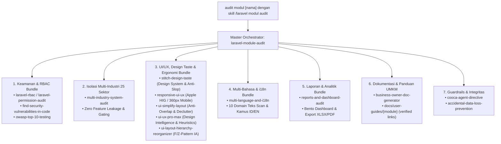

# Laravel Module Audit — dari Bukti Kode sampai Production Readiness

Skill ini mengaudit **satu modul Laravel per run**, lalu membawanya sampai keputusan production
yang bisa dipertanggungjawabkan. Hasil akhirnya bukan opini, melainkan: temuan berbukti,
task yang bisa dieksekusi, perbaikan yang sudah diuji, dan status gate yang jujur.

## 🔗 Orkestrasi Otomatis Bundle Skill Spesialis (Automatic Multi-Skill Bundling)

Ketika pengguna memanggil:
👉 `audit modul [nama_modul] dengan skill /laravel modul audit`  
👉 `/laravel modul audit [nama_modul]`  
👉 `/laravel-module-audit` atau `audit modul [nama_modul]`

Skill ini bertindak sebagai **Master Orchestrator** yang secara otomatis mengaktifkan, memadukan, dan menjalankan seluruh bundle skill spesialis yang terpasang di workspace tanpa perlu dipanggil satu per satu secara manual:



### Pemetaan Otomatis Bundle Skill ke 13 Aspek Audit:

1. **Keamanan, RBAC & Otorisasi (Aspek 2 & 3):**
   - **`laravel-rbac` / `laravel-permission-audit`**: Mengaudit deklarasi middleware permission (wajib Controller-Level RBAC), memeriksa `@can` / `@role` di Blade views, menjalankan scanner controller (`scan_controllers.py`), memastikan sinkronisasi seeder permission di database, dan memverifikasi multi-tenant isolation.
   - **`find-security-vulnerabilities-in-code` & `owasp-top-10-testing`**: Pindai injeksi SQL, Stored/Reflected XSS (`{!! !!}` & Alpine `x-html`), kebocoran secret di DOM/JS, CSRF (`@csrf`), IDOR, Formula CSV Injection (`CsvSanitizer`), dan ekstensi unggahan aman (`guessExtension()`).

2. **UI/UX, Layout Hierarchy, Design Taste & Responsif (Aspek 5 & 6):**
   - **`stitch-design-taste`**: Mengaudit cita rasa visual (*design taste*), visual atmosphere, kalibrasi warna (larangan AI purple/neon murahan, zinc/slate netral dengan 1 accent color terkontrol), tipografi berkarakter (banned generic Inter/Times New Roman, headline track-tight, tabular monospace untuk angka), serta penegakan anti-patterns (no text overlapping, asymmetric balanced grids, no filler text).
   - **`responsive-ui-ux`**: Memastikan tampilan mobile-first (viewport 360px–430px), touch target minimum 44×44px (jarak antar tombol ≥ 8px), zona jempol (*thumb zone* di 1/3 bawah layar ponsel), estetika Apple HIG (Adaptive Full Bottom Sheet pada mobile `rounded-t-[28px]`, Centered Modal pada tablet, XXL Bento Dialog pada desktop), eliminasi horizontal scroll pada 320px, kontras rasio WCAG AA (≥ 4.5:1).
   - **`ui-simplify-layout`**: Mengeliminasi kekacauan visual (*decluttering*), mengatasi tombol bertumpuk/tumpang tindih (overlap), hierarki tombol terstruktur (maksimal 1 primary action per section), eliminasi form yang terlalu padat, penerapan progressive disclosure (elemen sekunder disembunyikan dalam tab/sheet/accordion), dan uji bebas tumpang tindih (*no-overlap layout fix*).
   - **`ui-ux-pro-max`**: Design intelligence & heuristics komprehensif (79 gaya desain, 192 product palettes, 119 UX guidelines, 25 tipe visualisasi data/grafik, 22 stack best practices). Menjalankan audit interaksi, penanganan state komprehensif (loading skeletons, empty states informatif, error summary per-field, disabled submit state), kepatuhan aksesibilitas WCAG (fokus keyboard, ARIA semantic, contrast ratio), serta layout teks/chip overflow.
   - **`ui-layout-hierarchy-reorganizer`**: Mengaudit dan menyusun ulang hierarki tata letak visual (F/Z-pattern) secara non-destruktif tanpa merusak business logic atau Alpine model.


3. **Multi-Bahasa, Lokalisasi & Universal i18n (Aspek 5 & 12 — Mandat Zero Hardcoded Text 100%):**
   - **`multi-language-and-i18n`**: Mengaudit dan menegakkan mandat Zero Hardcoded Text 100% pada 10 domain sasaran teks (*Document Title `@extends`*, *Breadcrumb/Overline*, *Headers H1/H2*, *Form Input/Placeholder/Helper*, *Dev/Sandbox Testing Alert Banners*, *Validation Error Headings*, *Action Buttons/Links*, *Modals/Dialogs*, *Tables/Badges/Empty States*, *Backend Messages/Exceptions/Audit Logs*).
   - Menjalankan scanner otomatis `scripts/scan_i18n.py` pada direktori view modul.
   - Menegakkan simetri kamus dwibahasa `lang/id/*.php` $\leftrightarrow$ `lang/en/*.php` (Bahasa Indonesia default & English), menyingkirkan string mentah, serta memastikan adapter format mata uang dan tanggal terkonfigurasi secara adaptif.

4. **Laporan, Dashboard, & Ekspor Data (Aspek 7, 8, & 9 — jika modul memiliki fitur laporan):**
   - **`reports-and-dashboard-audit`**: Mengaudit validitas perhitungan saldo, omzet, HPP, FIFO/Average inventory, struktur Bento Dashboard, serta ekspor file (XLSX/PDF) agar profesional dan aman dari formula injection.

5. **Dokumentasi Pengguna & SOP Bisnis (Aspek 13 & Fase G):**
   - **`business-owner-doc-generator`**: Menyusun panduan pengguna berperspektif Pemilik Bisnis untuk 20 sektor UMKM tanpa jargon rumit, terintegrasi pada `resources/views/app/docs/` atau `docs/user-guides/{module}/` dengan rujukan route terverifikasi (`php artisan route:list`).

6. **Guardrails & Integritas Sistem (Seluruh Fase):**
   - **`cooca-agent-directive`**: Menjaga standar multi-tenant COOCA, bahasa ID/EN (i18n), dan prinsip zero-regression.
   - **`accidental-data-loss-prevention`**: Menghentikan dan meminta konfirmasi eksplisit sebelum menjalankan aksi destruktif (DROP/TRUNCATE/DELETE massal).

---

## Prinsip yang mengatur semua keputusan

1. **Code-first factuality.** Setiap klaim harus menunjuk ke file:baris, output perintah, atau hasil test.
   Alasannya: audit yang berisi asumsi memberi rasa aman palsu, dan itu lebih berbahaya daripada tidak ada audit.
2. **Tiga kelas bukti, jangan dicampur.** Tandai tiap pernyataan sebagai
   `[VERIFIED]` (dilihat/dijalankan sendiri), `[INDICATED]` (ada petunjuk, belum dibuktikan),
   atau `[POTENTIAL]` (risiko teoretis). Hanya `[VERIFIED]` yang boleh mengubah status gate menjadi lulus.
3. **Baseline sebelum menyentuh kode.** Mengubah kode sebelum memahami modul menghasilkan perbaikan yang merusak hal lain.
4. **Akar masalah, bukan gejala.** Satu temuan biasanya punya satu root cause; perbaiki di sana dan tulis test yang gagal sebelum perbaikan.
5. **Jujur soal batas.** Yang tidak bisa diverifikasi (tidak ada akses production, tidak ada DB, test tidak bisa jalan)
   dicatat sebagai keterbatasan, bukan disamarkan sebagai "lulus".
6. **Aman secara default.** Tindakan destruktif, perubahan data production, dan deployment butuh persetujuan eksplisit pengguna.

## Memakai tiga skill sumber tanpa saling bertabrakan

Skill ini mengintegrasikan `skill-creator` (cara menyusun/menguji skill), `laravel-generator`
(standar arsitektur enterprise), dan `laravel-supreme-analyzer-generator` (analisis anomali,
OWASP, scorecard). Ambil yang berguna, hati-hati dengan yang tidak cocok untuk audit:

| Dari | Dipakai | Tidak dipakai begitu saja |
|---|---|---|
| laravel-generator | Pola arsitektur (thin controller, service, policy), naming, checklist deployment, clean-code check | Repository/DTO/Action dipaksakan ke semua kode. Audit menilai **konsistensi dengan konvensi repo yang ada** dan risiko nyatanya, bukan kepatuhan ke satu template |
| laravel-supreme-analyzer-generator | Anomaly scanner (severity + file:baris), OWASP mapping, scorecard, ERD/route map | Banner ASCII wajib, "military-grade" sebagai target universal, dan rujukan ke `references/*.md` miliknya (file itu tidak ada, jadi skill ini membawa referensinya sendiri) |
| skill-creator | Struktur progressive disclosure, loop evaluasi skill | - |

Aturan konflik (urutan prioritas): **keamanan > akurasi berbasis kode aktual > integritas data > kompatibilitas sistem > keseragaman gaya**.
Contoh: header `X-XSS-Protection` di template generator sudah usang di browser modern; jangan jadikan temuan
bila CSP yang kuat ada, dan jangan "memperbaiki" dengan menambahkannya.

## Langkah 0 — Intake (maksimal satu putaran pertanyaan)

Mulai bekerja bila modul jelas. Tanyakan hanya yang mengubah hasil dan tidak bisa ditemukan sendiri:

- **Modul target** dan path-nya (jika ambigu, cari dulu: `references/discovery.md`).
- **Mode kerja**: `audit-only` (temuan + plan + task list), `audit+fix` (plus implementasi & verifikasi), atau `full` (plus deployment).
  Bila tidak dijawab, pakai `audit+fix` untuk dev/staging dan **tidak pernah** `full` tanpa persetujuan.
- **Akses lingkungan**: apakah ada DB dev/staging, apakah test bisa dijalankan, apakah ada akses server production.
  Cek sendiri lebih dulu (Fase A); tanya hanya sisanya.

Bila sesi berjalan tanpa pengguna aktif, ambil bacaan paling masuk akal, tulis asumsinya di baris pertama `00-executive-summary.md`, lanjutkan.

## Alur kerja

Setiap fase punya **exit evidence**: fase belum selesai sebelum bukti itu ada. Catat progres di
`docs/audits/{module}/audit-state.json` supaya audit bisa dilanjutkan di sesi lain (lihat "Resumability").

### Fase A — Discovery & Baseline (read-only)

Tujuan: memahami modul dan lingkungannya sebelum menilai apa pun.

1. Jalankan `scripts/discover.sh <project-root> [module-hint]`. Skrip hanya membaca; ia mengumpulkan versi PHP/Laravel,
   package, struktur direktori, route (JSON), middleware, model, policy, job/event/listener, migration, test, status git,
   dan **tidak mencetak nilai secret** dari `.env`.
2. Cek konvensi docs repo (`docs/`, `README`, `CLAUDE.md`, `AGENTS.md`, ADR) dan skill/instruksi proyek lain. Ikuti yang ada.
3. Petakan modul: file milik modul, file di luar folder modul yang dipakainya (helper, trait, observer global, scope, listener,
   kebijakan di `AuthServiceProvider`, config, view komponen), aktor, permission, business rules, alur data.
4. Bandingkan **implementasi aktual vs dokumentasi vs ekspektasi bisnis**; catat selisihnya sebagai kandidat temuan.
5. Catat batas lingkungan: apa yang ada di dev, staging, production (dan mana yang tidak bisa diakses).
6. Scaffold dokumen: `python scripts/scaffold_docs.py <module> --root <project-root>`.

Exit evidence: `01-system-baseline.md` terisi dengan versi, inventaris, peta dependensi, dan daftar batas verifikasi.
Detail teknik: `references/discovery.md`.

### Fase B — Audit & Evidence Collection

Telusuri satu alur penuh: UI → route → middleware → controller/request → service/action → model → DB → event/job → integrasi → respons.
Untuk setiap aspek dari 13 aspek, buka bagian terkait di `references/audit-aspects.md`; di sana ada *apa yang diperiksa*,
*cara memverifikasi* (perintah/pola grep), dan *bukti minimum*.

Ringkasan 13 aspek: Architecture, Security, Workflow, Functional, UI/UX, Human Error Prevention, Database, Performance,
Integration, Testing, Operations, Compliance & Data Governance, Documentation.

Aturan temuan (format lengkap di `references/evidence-and-severity.md`):

- ID `F-{MOD}-{nnn}`, severity `Critical | High | Medium | Low | Informational`, kelas bukti, lokasi `path:baris`,
  bukti (potongan kode/output perintah), skenario reproduksi, dampak, root cause, rekomendasi, dampak lintas modul.
- Jangan menulis temuan dari ingatan pola umum. Buka file, kutip baris. Temuan tanpa lokasi hanya boleh `[POTENTIAL]`.
- Untuk temuan keamanan, buktikan lewat **jalur kode** atau **test otorisasi di dev/staging milik sendiri** (mis. user A mengakses data user B).
  Jangan menjalankan serangan terhadap production, dan jangan membuat exploit yang bisa dipakai di luar test.
- Periksa **lintas modul**: siapa yang memanggil modul ini dan siapa yang dipanggilnya (event, FK, service, shared table).

Exit evidence: tiap aspek punya status `Covered` atau `Not verifiable (alasan)`. Tidak ada aspek yang diam-diam dilewati.

### Fase C — Dokumentasi Audit

Tulis dokumen 00-06 dan 09-12 sesuai `references/document-templates.md` (struktur `docs/audits/{module}/` ada di bawah).
Dokumen ditulis dari temuan Fase B, bukan dari template kosong. Executive summary harus bisa dibaca pemilik bisnis dalam dua menit:
status gate saat ini, jumlah temuan per severity, 3 risiko terbesar, keputusan yang dibutuhkan darinya.

Exit evidence: setiap temuan muncul di risk register; setiap klaim "lulus" punya rujukan bukti.

### Fase D — Implementation Plan & Task List

Ubah setiap temuan yang butuh tindakan menjadi task (`07-implementation-plan.md`, `08-task-list.md`).
Format wajib dan aturan urutan ada di `references/implementation.md`. Intinya:

- Tiap task: ID `T-{MOD}-{nnn}`, prioritas, temuan dasar, file terdampak, langkah, dependensi, acceptance criteria objektif,
  test case yang harus lulus, risiko + rencana rollback, status `Pending | In Progress | Blocked | Verified`.
- Urut berdasarkan dependensi lalu risiko: pengaman data & otorisasi dulu, refactor kosmetik terakhir.
- Tandai `Blocked` + minta keputusan bila: downtime, penghapusan/penimpaan data, perubahan kontrak API/integrasi,
  perubahan skema besar pada tabel besar, atau butuh keputusan bisnis.

Exit evidence: tidak ada temuan actionable tanpa task; tidak ada task tanpa acceptance criteria yang bisa dicek mesin atau mata.

### Fase E — Implementasi Perbaikan (hanya mode `audit+fix` / `full`)

Per task, dalam urutan plan: **tulis test yang menangkap bug → lihat gagal → perbaiki root cause → test lulus → jalankan regression modul terkait → catat bukti → ubah status ke Verified**.
Aturan teknis (migration aman, backward compat, tanpa data dummy/hardcode bisnis, kontrak API) ada di `references/implementation.md`.

Status `Verified` hanya boleh diberikan bila ada bukti: nama test + output lulus, atau perintah + output. "Kode sudah diubah" bukan bukti.
Jangan menyentuh kode di luar scope task kecuali ada alasan teknis tertulis di task.

### Fase F — Verification & Regression

Jalankan yang relevan dengan proyek aktual (daftar perintah dan cara menafsirkannya: `references/verification.md`):
test suite, Pint/PHPStan/Larastan (bila ada), `route:list`, `composer audit`, validasi migration (up, down/rollback, pada salinan data bila ada),
test otorisasi per peran, edge case bisnis, pengecekan UI/responsif (browser bila tersedia), performa pada skenario representatif
(hitung query, bandingkan sebelum/sesudah), dan regression pada modul yang bergantung.

Larangan: menyatakan fitur lulus hanya karena kode ter-compile atau halaman terbuka. Kegagalan test yang tidak terkait harus dicatat, bukan dihapus atau di-skip.

Exit evidence: `09-test-and-verification-report.md` berisi perintah, hasil nyata, dan daftar yang **tidak** dijalankan beserta alasannya.

### Fase G — User Guide berbasis artikel

Buat `docs/user-guides/{module}/` (index, artikel per fitur/workflow, troubleshooting, faq) sesuai `references/user-guides.md`.
Syarat keras: setiap artikel punya tautan langsung ke halaman fitur yang **terverifikasi terhadap route aktual**.

1. Ambil route nyata: `php artisan route:list --json > routes.json` (atau baca definisi route bila artisan tidak bisa jalan; catat sebagai keterbatasan).
2. Tulis tautan dengan route yang ada, perhitungkan prefix, tenant/outlet, parameter dinamis, base URL.
3. Jalankan `python scripts/verify_links.py docs/user-guides/{module} --routes routes.json`; semua tautan harus lolos
   atau dicatat sebagai pengecualian dengan alasan.
4. Cocokkan langkah artikel dengan UI aktual (view/komponen); jangan menggambarkan tombol yang tidak ada.

### Fase H — Production Readiness Gate & Deployment

1. Isi `10-production-readiness-checklist.md` dari bukti, memakai gate di `references/production-gate.md`.
2. Tetapkan status: **READY** (semua gate wajib lulus + bukti), **READY WITH ACCEPTED RISKS** (ada risiko residual yang
   dinilai dan disetujui tertulis oleh pemilik), atau **NOT READY** (gate wajib gagal atau bukti penting belum ada).
   Temuan Critical/High yang terbuka otomatis `NOT READY` kecuali ada risk acceptance formal.
3. Tulis `11-deployment-and-rollback-plan.md` dan `12-residual-risks.md`.
4. Deployment ke production hanya bila **semua** terpenuhi: akses nyata tersedia, pengguna memberi otorisasi eksplisit untuk
   deployment itu, backup terverifikasi, rencana rollback tertulis, pre-deployment check lulus. Selainnya: berhenti di
   dokumen dan daftar tindakan manusia yang tersisa. Prosedur bertahap dan larangan: `references/production-gate.md`.
5. Jangan mengklaim deployment atau verifikasi production berhasil tanpa bukti aktual (output health check, log, hasil query, dll).

Gate adalah pernyataan tentang **bukti yang ada hari ini**, bukan janji bahwa masalah tak akan pernah terjadi. Targetnya
meminimalkan risiko, mendeteksi kegagalan lebih awal, dan memastikan pemulihan sudah diuji.

## Struktur output

```
docs/audits/{module}/
  00-executive-summary.md        07-implementation-plan.md
  01-system-baseline.md          08-task-list.md
  02-architecture-and-workflow.md 09-test-and-verification-report.md
  03-security-audit.md           10-production-readiness-checklist.md
  04-functional-ui-ux-audit.md   11-deployment-and-rollback-plan.md
  05-database-performance-audit.md 12-residual-risks.md
  06-risk-register.md            audit-state.json
docs/user-guides/{module}/
  index.md  <artikel per fitur>.md  troubleshooting.md  faq.md
```

Periksa konvensi dokumentasi repo lebih dulu; nama dan lokasi boleh menyesuaikan standar repo,
tetapi semua deliverable harus tetap ada dan mudah ditemukan (tulis petanya di `00-executive-summary.md`).

## Resumability

`audit-state.json` (dibuat `scaffold_docs.py`) mencatat fase, status tiap aspek, severity count, dan status tiap task.
Di awal sesi lanjutan: baca file itu, baca `08-task-list.md`, cek `git status/diff` untuk perubahan di luar audit,
lalu lanjutkan dari fase yang belum selesai. Perbarui file ini setiap akhir fase dan setiap task berubah status.
Jika kode berubah sejak baseline (commit berbeda), ulangi bagian Fase A yang terdampak sebelum melanjutkan.

## Cara melaporkan ke pengguna

Singkat dan berbasis hasil: status gate, jumlah temuan per severity, task selesai/blocked, apa yang tidak bisa diverifikasi,
dan keputusan yang dibutuhkan. Jangan menceritakan ulang langkah. Letakkan detail di dokumen, bukan di chat.

## Definition of Done

Audit selesai bila: scope lengkap tercakup; temuan berbukti dan berseverity; plan + task list ada; perbaikan yang disetujui
sudah diimplementasikan; test/regression wajib sudah dijalankan; dokumen teknis dan user guide diperbarui; tautan guide
terverifikasi terhadap route aktual; checklist production terisi dari bukti; risiko residual dan keterbatasan dilaporkan;
status deployment production dinyatakan jujur sesuai hasil.

## Peta referensi (baca saat fase terkait)

| File | Baca saat |
|---|---|
| `references/discovery.md` | Fase A - cara menemukan modul, dependensi lintas modul, pola multi-tenant/outlet |
| `references/audit-aspects.md` | Fase B - 13 aspek: yang diperiksa, cara verifikasi, bukti minimum |
| `references/evidence-and-severity.md` | Fase B/C - format temuan, rubrik severity, kelas bukti |
| `references/document-templates.md` | Fase C - isi wajib tiap dokumen 00-12 |
| `references/implementation.md` | Fase D/E - format task, aturan implementasi, migration aman, kapan Blocked |
| `references/verification.md` | Fase F - perintah verifikasi dan cara membacanya |
| `references/user-guides.md` | Fase G - template artikel, aturan URL, verifikasi tautan |
| `references/production-gate.md` | Fase H - gate, status akhir, kebijakan eksekusi server, rollback |

Skrip: `scripts/discover.sh`, `scripts/scaffold_docs.py`, `scripts/verify_links.py`.
