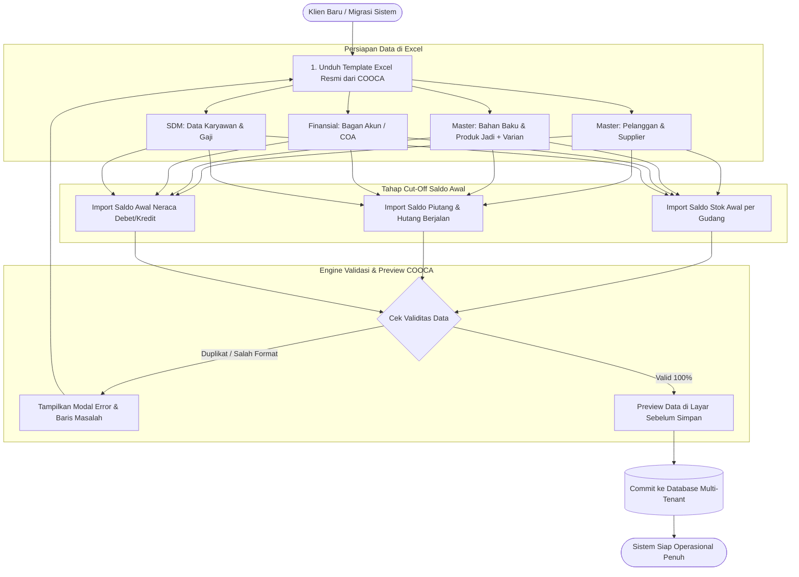
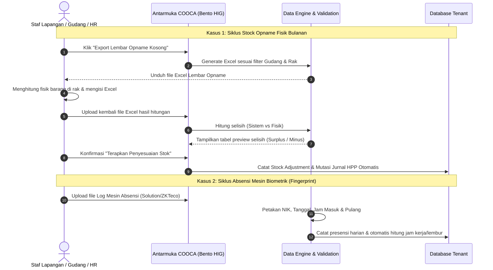

# LAPORAN AUDIT KOMPREHENSIF KEBUTUHAN IMPORT & EXPORT SISTEM COOCA
**Platform SaaS ERP Multi-Tenant untuk UMKM & Perusahaan Berkembang Indonesia**

> **Metadata Dokumen:**  
> - **Lokasi Codebase:** `c:\laragon\www\cooca_core`  
> - **Fokus Audit:** Antarmuka Aplikasi ([`resources/views/app`](file:///c:/laragon/www/cooca_core/resources/views/app)), Pengendali Web ([`app/Http/Controllers/Web`](file:///c:/laragon/www/cooca_core/app/Http/Controllers/Web)), Rute Pemilik ([`routes/owner.php`](file:///c:/laragon/www/cooca_core/routes/owner.php)), dan Layanan Impor ([`app/Services/DataImportService.php`](file:///c:/laragon/www/cooca_core/app/Services/DataImportService.php)).  
> - **Klasifikasi:** Arsitektur Sistem, Kesiapan Migrasi Klien (*Client Onboarding & Data Migration*), & Standardisasi UX.  
> - **Status Dokumen:** `RECOMMENDED ROADMAP & TECHNICAL SPECIFICATION`

---

## DAFTAR ISI
1. [Ringkasan Eksekutif & Skor Kesiapan](#1-ringkasan-eksekutif--skor-kesiapan)
2. [Evaluasi Arsitektur Saat Ini (Current State Analysis)](#2-evaluasi-arsitektur-saat-ini-current-state-analysis)
   - [2.1 Keterbatasan & Bug Kritis pada Importer Eksisting](#21-keterbatasan--bug-kritis-pada-importer-eksisting)
   - [2.2 Kondisi Fitur Export Saat Ini](#22-kondisi-fitur-export-saat-ini)
3. [Matriks Audit Lengkap Kebutuhan Lintas 5 Domain](#3-matriks-audit-lengkap-kebutuhan-lintas-5-domain)
   - [Domain 1: Master Data & CRM (Client Onboarding)](#domain-1-master-data--crm-client-onboarding)
   - [Domain 2: Inventori, Gudang & Pengadaan (Supply Chain)](#domain-2-inventori-gudang--pengadaan-supply-chain)
   - [Domain 3: Keuangan, Akuntansi & Perbankan (Financial Cut-Off)](#domain-3-keuangan-akuntansi--perbankan-financial-cut-off)
   - [Domain 4: SDM, Presensi & Penggajian (HRM)](#domain-4-sdm-presensi--penggajian-hrm)
   - [Domain 5: Penjualan & Pesanan Omnichannel](#domain-5-penjualan--pesanan-omnichannel)
4. [Diagram Alur Data Migrasi & Siklus Operasional](#4-diagram-alur-data-migrasi--siklus-operasional)
5. [Spesifikasi Teknis & Skema Data Modul Prioritas (P1)](#5-spesifikasi-teknis--skema-data-modul-prioritas-p1)
6. [Pedoman Desain Antarmuka & UX (Bento Apple HIG)](#6-pedoman-desain-antarmuka--ux-bento-apple-hig)
7. [Rencana Roadmap Eksekusi Bertahap (Sprint 1 - Sprint 3)](#7-rencana-roadmap-eksekusi-bertahap-sprint-1---sprint-3)

---

## 1. Ringkasan Eksekutif & Skor Kesiapan

Kemampuan pertukaran data (*Data Import & Export*) adalah **tulang punggung keberhasilan implementasi sistem ERP**. Klien bisnis yang beralih dari software kompetitor (seperti Mekari Jurnal, Accurate Online, Ecount ERP, SAP B1, atau pembukuan manual Excel) memiliki ribuan baris data historis dan master data yang tidak mungkin diinput secara manual satu per satu melalui formulir web biasa.

Berdasarkan audit menyeluruh terhadap 41 folder modul di `resources/views/app`:
- **Skor Kesiapan Import:** **18%** *(Hanya mencakup 4 entitas, dan 1 entitas mengalami kegagalan validasi logika produk).*
- **Skor Kesiapan Export Harian:** **25%** *(Terkonsentrasi di laporan rekapitulasi akhir, namun absen pada tabel kerja operasional harian).*
- **Tingkat Hambatan Onboarding (Friction Rate):** **Sangat Tinggi**. Klien ritel, distributor, maupun manufaktur tidak dapat memigrasikan daftar pelanggan, vendor, saldo awal piutang/hutang, dan bagan akun (COA) secara massal.

```
CAKUPAN FITUR DATA EXCHANGE SAAT INI
[████░░░░░░░░░░░░░░░░] 20% Terpenuhi
  - Terpenuhi: Laporan Laba Rugi, POS 9-Sheet, Bahan Baku & Produk (Flat), Payroll Export.
  - Belum Terpenuhi: Pelanggan, Supplier, Karyawan, COA, Saldo Awal Neraca, Hutang/Piutang, Stock Opname, Mesin Fingerprint, Toko Online Orders.
```

---

## 2. Evaluasi Arsitektur Saat Ini (Current State Analysis)

### 2.1 Keterbatasan & Bug Kritis pada Importer Eksisting

Pusat impor data saat ini berlokasi di rute `/import` ([`resources/views/app/import/index.blade.php`](file:///c:/laragon/www/cooca_core/resources/views/app/import/index.blade.php)) yang ditangani oleh [`ImportWebController.php`](file:///c:/laragon/www/cooca_core/app/Http/Controllers/Web/ImportWebController.php) dan diproses oleh [`DataImportService.php`](file:///c:/laragon/www/cooca_core/app/Services/DataImportService.php).

Terdapat 3 kelemahan mendasar:
1. **Bug Kritis Saldo Awal Stok ([`DataImportService.php#L644-L670`](file:///c:/laragon/www/cooca_core/app/Services/DataImportService.php)):**
   - Logika pemrosesan impor persediaan awal secara eksplisit mengeksekusi:
     ```php
     $material = Material::where('business_id', $businessId)->where('code', $sku)->first();
     if (!$material) {
         // Throws error: SKU tidak ditemukan!
     }
     ```
   - **Dampak:** Bisnis ritel, grosir, atau toko yang hanya menjual Barang Jadi (`Product`) **tidak dapat mengimpor stok awal produk mereka**, karena parser hanya mengenali Bahan Baku (`Material`).
2. **Ketiadaan Dukungan Multi-Varian pada Produk:**
   - Template produk hanya mendukung atribut flat (`nama_produk`, `kode_sku`, `barcode`, `kategori`, `harga_jual`, `satuan`, `stok_minimum`, `deskripsi`).
   - Tidak dapat memetakan varian (Ukuran, Warna, Rasa) dan multi-satuan beli/jual (Karton, Lusin, Pcs).
3. **Ketiadaan Validasi HPP / Harga Beli pada Impor Produk:**
   - Kolom `harga_beli` tidak terintegrasi dalam parser produk jadi, sehingga saldo awal persediaan tidak membentuk nilai aset buku besar secara otomatis.

### 2.2 Kondisi Fitur Export Saat Ini

Fitur export yang ada saat ini terkonsentrasi pada modul:
- `ReportWebController@exportExcel`: Laporan Laba Rugi, Arus Kas, Neraca, Valuasi Stok, dan Aging.
- `PosReportWebController@exportExcel`: Master Workbook 9-Sheet Transaksi Kasir POS.
- `InvoiceWebController@exportExcel`: Rekapitulasi Faktur Tagihan.
- `HrmWebController`: Export Penggajian (Excel 2-Sheet, CSV, dan File Batch Transfer Bank).
- `TaxWebController`: Format e-Bupot & PPh Final.

**Masalah UX:** Pengguna di halaman kerja (seperti [`customers/index.blade.php`](file:///c:/laragon/www/cooca_core/resources/views/app/customers/index.blade.php) atau [`products/index.blade.php`](file:///c:/laragon/www/cooca_core/resources/views/app/products/index.blade.php)) **tidak memiliki tombol ekspor langsung**. Jika pemilik usaha ingin mengunduh daftar 500 pelanggan untuk dibagikan ke tim sales, mereka tidak menemukan caranya di antarmuka.

---

## 3. Matriks Audit Lengkap Kebutuhan Lintas 5 Domain

### Domain 1: Master Data & CRM (Client Onboarding)

| Modul & File Path | Status Import | Status Export | Prioritas | Dampak Bisnis & Rekomendasi Fitur |
| :--- | :---: | :---: | :---: | :--- |
| **Pelanggan & Kontak**<br>[`customers/index.blade.php`](file:///c:/laragon/www/cooca_core/resources/views/app/customers/index.blade.php) | ❌ Belum Ada | ❌ Belum Ada | **P1 (Kritis)** | **Import:** Wajib untuk migrasi data kontak pelanggan (Nama, HP/WhatsApp, Email, Alamat Lengkap, Kategori/Tier Diskon, Batas Limit Kredit, NPWP).<br>**Export:** Unduh database pelanggan terfilter untuk kampanye promosi WhatsApp, integrasi CRM eksternal, atau arsip audit. |
| **Pemasok / Vendor**<br>[`suppliers/index.blade.php`](file:///c:/laragon/www/cooca_core/resources/views/app/suppliers/index.blade.php) | ❌ Belum Ada | ❌ Belum Ada | **P1 (Kritis)** | **Import:** Migrasi master data supplier (Badan Usaha/Toko, PIC, No. Telp, Alamat, Syarat Pembayaran / TOP, Nomor Rekening Bank Vendor).<br>**Export:** Ekspor daftar vendor aktif untuk verifikasi tim purchasing & finance. |
| **Katalog Produk Jadi**<br>[`products/index.blade.php`](file:///c:/laragon/www/cooca_core/resources/views/app/products/index.blade.php) | ⚠️ Ada di `/import` | ❌ Belum Ada | **P1 (Kritis)** | **Perbaikan Import:** Perluas schema agar mendukung varian matriks (Ukuran/Warna) dan default HPP.<br>**Export:** Sediakan tombol `Export Excel` langsung di header tabel produk (lengkap dengan stok saat ini dan kategori). |
| **Bahan Baku & Penolong**<br>[`materials/index.blade.php`](file:///c:/laragon/www/cooca_core/resources/views/app/materials/index.blade.php) | ⚠️ Ada di `/import` | ❌ Belum Ada | **P2 (Tinggi)** | **Export:** Ekspor seluruh daftar bahan mentah beserta satuan dasar, stok minimal, dan harga pembelian terakhir. |
| **Layanan & Jasa**<br>[`services/index.blade.php`](file:///c:/laragon/www/cooca_core/resources/views/app/services/index.blade.php) | ❌ Belum Ada | ❌ Belum Ada | **P2 (Tinggi)** | **Import & Export:** Sangat dibutuhkan untuk industri jasa (Klinik kecantikan, salon, bengkel, jasa instalasi, spa) yang memiliki daftar ratusan item jasa beserta durasi dan tarif. |
| **Satuan, Kategori & Brand**<br>[`master-data/index.blade.php`](file:///c:/laragon/www/cooca_core/resources/views/app/master-data/index.blade.php) | ❌ Belum Ada | ❌ Belum Ada | **P3 (Menengah)** | **Import:** Import massal kategori produk hierarkis dan konversi multi-satuan (*Unit of Measurement*). |

---

### Domain 2: Inventori, Gudang & Pengadaan (Supply Chain)

| Modul & File Path | Status Import | Status Export | Prioritas | Dampak Bisnis & Rekomendasi Fitur |
| :--- | :---: | :---: | :---: | :--- |
| **Saldo Stok Awal**<br>[`import/index.blade.php`](file:///c:/laragon/www/cooca_core/resources/views/app/import/index.blade.php) | ⚠️ Terbatas (Material saja) | ❌ Belum Ada | **P1 (Kritis)** | **Perbaikan Mendesak:** Ubah parser agar dapat mengenali `Product` ATAU `Material` berdasarkan SKU. Wajib menyertakan kolom ID/Kode Gudang tujuan dan harga perolehan (HPP awal). |
| **Audit Fisik (Stock Opname)**<br>[`inventory/opname.blade.php`](file:///c:/laragon/www/cooca_core/resources/views/app/inventory/opname.blade.php) | ❌ Belum Ada | ❌ Belum Ada | **P1 (Kritis)** | **Standar Industri Gudang Modern:**<br>1. **Export:** Unduh *Blank Stock Opname Sheet* (Gudang, Rak, Barcode, SKU, Nama Barang, dan kolom kosong untuk diisi fisik).<br>2. **Import:** Upload kembali file Excel yang telah diisi fisik oleh tim lapangan; sistem otomatis menghitung selisih (kurang/lebih) dan membuat draf penyesuaian. |
| **Stok & Nilai Persediaan**<br>[`inventory/stocks.blade.php`](file:///c:/laragon/www/cooca_core/resources/views/app/inventory/stocks.blade.php) |   | ❌ Belum Ada | **P2 (Tinggi)** | **Export:** Tombol langsung untuk mengunduh rekap saldo stok per gudang dengan status peringatan *understock* / *overstock*. |
| **Surat Jalan / Mutasi Gudang**<br>[`warehouse/show.blade.php`](file:///c:/laragon/www/cooca_core/resources/views/app/warehouse/show.blade.php) & [`inventory/transfers.blade.php`](file:///c:/laragon/www/cooca_core/resources/views/app/inventory/transfers.blade.php) | ❌ Belum Ada | ❌ Belum Ada | **P2 (Tinggi)** | **Export:** Cetak PDF & Export Excel dokumen resmi *Surat Jalan Pengiriman Antar Gudang / Transfer Manifest* untuk supir logistik dan staf gudang penerima. |
| **Pengadaan & PO**<br>[`purchase-orders/index.blade.php`](file:///c:/laragon/www/cooca_core/resources/views/app/purchase-orders/index.blade.php) | ❌ Belum Ada | ❌ Belum Ada | **P2 (Tinggi)** | **Import:** Bulk upload item baris barang ke dalam draf Purchase Order yang besar (misal 100+ baris kebutuhan proyek).<br>**Export:** Rekap PO berstatus Open/Closed/Billed beserta tanggal jatuh tempo kirim. |

---

### Domain 3: Keuangan, Akuntansi & Perbankan (Financial Cut-Off)

| Modul & File Path | Status Import | Status Export | Prioritas | Dampak Bisnis & Rekomendasi Fitur |
| :--- | :---: | :---: | :---: | :--- |
| **Bagan Akun (COA)**<br>[`finance/accounting/coa.blade.php`](file:///c:/laragon/www/cooca_core/resources/views/app/finance/accounting/coa.blade.php) | ❌ Belum Ada | ❌ Belum Ada | **P1 (Kritis)** | **Import:** Kunci utama migrasi akuntansi. Klien membawa struktur akun dari sistem lama (Kode Akun, Nama Akun, Klasifikasi Aset/Kewajiban/Ekuitas/Pendapatan/Beban, Level Sub-Akun).<br>**Export:** Cadangan struktur akun keuangan perusahaan. |
| **Saldo Awal Neraca**<br>[`finance/accounting/balance-sheet.blade.php`](file:///c:/laragon/www/cooca_core/resources/views/app/finance/accounting/balance-sheet.blade.php) | ❌ Belum Ada | ❌ Belum Ada | **P1 (Kritis)** | **Import:** Upload saldo debit & kredit per tanggal cut-off migrasi agar buku besar awal seimbang (*balanced opening balance journal*). |
| **Daftar Piutang Usaha (AR)**<br>[`finance/receivables.blade.php`](file:///c:/laragon/www/cooca_core/resources/views/app/finance/receivables.blade.php) | ❌ Belum Ada | ⚠️ *(Ada di Reports)* | **P1 (Kritis)** | **Import:** Migrasi faktur piutang pelanggan lama yang belum terbayar saat tanggal *go-live* (Nomor Invoice lama, Nama Pelanggan, Jatuh Tempo, Nilai Sisa Piutang).<br>**Export:** Ekspor langsung kartu piutang dan jadwal penagihan per pelanggan. |
| **Daftar Hutang Usaha (AP)**<br>[`finance/payables.blade.php`](file:///c:/laragon/www/cooca_core/resources/views/app/finance/payables.blade.php) | ❌ Belum Ada | ⚠️ *(Ada di Reports)* | **P1 (Kritis)** | **Import:** Migrasi tagihan pemasok yang masih terutang per tanggal *go-live* (No. Bill lama, Nama Vendor, Jatuh Tempo, Sisa Hutang).<br>**Export:** Rekap jadwal jatuh tempo pembayaran supplier. |
| **Jurnal Umum (General Journal)**<br>[`finance/journals.blade.php`](file:///c:/laragon/www/cooca_core/resources/views/app/finance/journals.blade.php) | ❌ Belum Ada | ❌ Belum Ada | **P2 (Tinggi)** | **Import:** Import jurnal manual berkala dari akuntan/konsultan eksternal (misal penyesuaian akhir tahun atau depresiasi manual).<br>**Export:** Ekspor jurnal umum terfilter rentang tanggal untuk audit pajak/KAP. |
| **Beban & Pengeluaran**<br>[`finance/expenses.blade.php`](file:///c:/laragon/www/cooca_core/resources/views/app/finance/expenses.blade.php) | ❌ Belum Ada | ❌ Belum Ada | **P2 (Tinggi)** | **Import:** Import batch klaim pengeluaran kas kecil / reimburse karyawan dari Excel operasional.<br>**Export:** Rekap beban usaha bulanan per kategori biaya. |
| **Mutasi Bank & Rekonsiliasi**<br>[`finance/cash-bank`](file:///c:/laragon/www/cooca_core/resources/views/app/finance/cash-bank) | ❌ Belum Ada | ❌ Belum Ada | **P2 (Tinggi)** | **Import:** Upload mutasi rekening koran (format CSV/Excel internet banking BCA, Mandiri, BRI, BNI) untuk fitur pencocokan (*auto bank reconciliation*). |

---

### Domain 4: SDM, Presensi & Penggajian (HRM)

| Modul & File Path | Status Import | Status Export | Prioritas | Dampak Bisnis & Rekomendasi Fitur |
| :--- | :---: | :---: | :---: | :--- |
| **Master Data Karyawan**<br>[`hrm/index.blade.php`](file:///c:/laragon/www/cooca_core/resources/views/app/hrm/index.blade.php) | ❌ Belum Ada | ❌ Belum Ada | **P1 (Kritis)** | **Import:** Onboarding instan staf untuk perusahaan dengan 20–500 karyawan (NIK, Nama, Kontak, Divisi, Jabatan, Gaji Pokok, Tunjangan, Rekening Bank, Status PTKP & BPJS).<br>**Export:** Master data SDM lengkap untuk arsip HRD & compliance ketenagakerjaan. |
| **Log Presensi Mesin Fingerprint**<br>[`hrm/index.blade.php`](file:///c:/laragon/www/cooca_core/resources/views/app/hrm/index.blade.php) | ❌ Belum Ada | ❌ Belum Ada | **P1 (Kritis)** | **Import:** Banyak pabrik, gudang, dan resto masih menggunakan mesin absensi biometrik fisik (Solution/ZKTeco/Fingerspot). Importer file log absensi (NIK, Tanggal, Jam Masuk, Jam Pulang) wajib ada agar payroll otomatis menghitung denda keterlambatan dan uang makan. |
| **Slip & Rekap Payroll**<br>[`hrm/payroll`](file:///c:/laragon/www/cooca_core/resources/views/app/hrm/payroll) |   | ✅ Sudah Lengkap | *Good* | Format ekspor payroll COOCA saat ini sudah sangat komprehensif (Excel 2-sheet, CSV, dan File Batch Transfer Bank). |

---

### Domain 5: Penjualan & Pesanan Omnichannel

| Modul & File Path | Status Import | Status Export | Prioritas | Dampak Bisnis & Rekomendasi Fitur |
| :--- | :---: | :---: | :---: | :--- |
| **Pesanan Toko Online (Storefront)**<br>[`storefront/orders/index.blade.php`](file:///c:/laragon/www/cooca_core/resources/views/app/storefront/orders/index.blade.php) |   | ❌ Belum Ada | **P2 (Tinggi)** | **Export:** Export batch order harian ke format Excel untuk kebutuhan tim picking & packing gudang, pembuatan label pengiriman, dan manifes serah terima kurir (JNE/J&T/SiCepat). |
| **Pesanan Marketplace**<br>[`marketplace/orders.blade.php`](file:///c:/laragon/www/cooca_core/resources/views/app/marketplace/orders.blade.php) |   *(via API)* | ❌ Belum Ada | **P2 (Tinggi)** | **Export:** Export rekap order gabungan lintas saluran (Shopee, Tokopedia, TikTok Shop) untuk audit omzet dan rekonsiliasi biaya admin platform. |
| **Sales Order B2B**<br>[`sales-orders/index.blade.php`](file:///c:/laragon/www/cooca_core/resources/views/app/sales-orders/index.blade.php) | ❌ Belum Ada | ❌ Belum Ada | **P3 (Menengah)** | **Export:** Laporan rekap pesanan penjualan B2B dengan filter status pemenuhan dan jatuh tempo pembayaran. |

---

## 4. Diagram Alur Data Migrasi & Siklus Operasional

### A. Alur Onboarding Klien Baru (Client Onboarding Pipeline)



### B. Siklus Operasional Harian Stock Opname & Absensi Fisik



---

## 5. Spesifikasi Teknis & Skema Data Modul Prioritas (P1)

Berikut adalah definisi kolom wajib dan strategi validasi untuk 5 modul paling kritis:

### 1. Pelanggan ([`customers`](file:///c:/laragon/www/cooca_core/resources/views/app/customers/index.blade.php))
- **File Format:** `.xlsx`, `.csv`
- **Kolom Header:**
  - `nama_pelanggan` *(Wajib | String max 255)*
  - `nomor_telepon` *(Wajib | Phone/WA unik tenant)*
  - `email` *(Opsional | Format email valid)*
  - `kategori_tier` *(Opsional | Default: 'Reguler', opsi: 'VIP', 'Grosir', 'Reseller')*
  - `alamat_lengkap` *(Opsional | Text)*
  - `kota` *(Opsional | String)*
  - `kode_pos` *(Opsional | String)*
  - `limit_piutang` *(Opsional | Numeric, default: 0)*
  - `npwp` *(Opsional | String 16 digit)*
- **Anti-Duplikat:** Cek kecocokan `nomor_telepon` atau kombinasi `nama_pelanggan` dalam `business_id` yang sama.

### 2. Pemasok / Vendor ([`suppliers`](file:///c:/laragon/www/cooca_core/resources/views/app/suppliers/index.blade.php))
- **File Format:** `.xlsx`, `.csv`
- **Kolom Header:**
  - `nama_supplier` *(Wajib | String max 255)*
  - `kode_supplier` *(Opsional | Unik per tenant)*
  - `nama_kontak_pic` *(Opsional | String)*
  - `nomor_telepon` *(Wajib | String)*
  - `email` *(Opsional | Email)*
  - `termin_pembayaran_hari` *(Opsional | Integer, misal 0/Cash, 14, 30, 60 hari)*
  - `nama_bank` *(Opsional | String)*
  - `nomor_rekening` *(Opsional | String)*
  - `atas_nama_rekening` *(Opsional | String)*
  - `alamat` *(Opsional | Text)*

### 3. Saldo Stok Awal (Bahan Baku & Produk Jadi)
- **File Format:** `.xlsx`, `.csv`
- **Kolom Header:**
  - `sku` *(Wajib | String, harus terdaftar di `products` ATAU `materials`)*
  - `kode_gudang` *(Wajib | String, harus terdaftar di master gudang)*
  - `jumlah_stok` *(Wajib | Numeric > 0)*
  - `satuan` *(Wajib | String, harus cocok dengan UOM barang)*
  - `harga_modal_satuan` *(Wajib | Numeric >= 0, digunakan untuk nilai awal persediaan)*
  - `catatan` *(Opsional | String)*
- **Logika Engine:**
  ```php
  // Cek apakah barang adalah Produk atau Material
  $item = Product::where('business_id', $bId)->where('sku', $sku)->first()
       ?? Material::where('business_id', $bId)->where('code', $sku)->first();
  ```

### 4. Bagan Akun / COA ([`finance/accounting/coa.blade.php`](file:///c:/laragon/www/cooca_core/resources/views/app/finance/accounting/coa.blade.php))
- **File Format:** `.xlsx`, `.csv`
- **Kolom Header:**
  - `kode_akun` *(Wajib | String unik, misal: '1111', '1112', '2111')*
  - `nama_akun` *(Wajib | String)*
  - `kategori_utama` *(Wajib | Opsi: 'Aset Lancar', 'Aset Tidak Lancar', 'Kewajiban Jangka Pendek', 'Kewajiban Jangka Panjang', 'Ekuitas', 'Pendapatan', 'Harga Pokok Penjualan', 'Beban Operasional', 'Pendapatan/Beban Lainnya')*
  - `kode_akun_induk` *(Opsional | Kode akun parent untuk COA bertingkat)*
  - `posisi_normal` *(Wajib | 'Debit' / 'Kredit')*
  - `deskripsi` *(Opsional | Text)*

### 5. Log Presensi Mesin Fingerprint ([`hrm/index.blade.php`](file:///c:/laragon/www/cooca_core/resources/views/app/hrm/index.blade.php))
- **File Format:** `.xlsx`, `.csv` (kompatibel output Solution/ZKTeco)
- **Kolom Header:**
  - `nik_karyawan` *(Wajib | Terdaftar di master employee)*
  - `tanggal` *(Wajib | Format YYYY-MM-DD atau DD/MM/YYYY)*
  - `jam_masuk` *(Opsional | Format HH:MM:SS)*
  - `jam_pulang` *(Opsional | Format HH:MM:SS)*
  - `lokasi_terminal_id` *(Opsional | String)*

---

## 6. Pedoman Desain Antarmuka & UX (Bento Apple HIG)

Sesuai direktif operasional COOCA ([`cooca-agent-directive`](file:///c:/laragon/www/cooca_core/.agents/skills/cooca-agent-directive/SKILL.md)) dan standar Bento Apple HIG:

### A. Pola Aksi Kontekstual di Tabel (Direct Table Action)
Setiap halaman tabel data operasional (Pelanggan, Supplier, Produk, dll.) tidak boleh menyembunyikan aksi di submenu lain. Header tabel wajib menyediakan tombol aksi standar:

```html
<!-- Standar Tombol Header Tabel COOCA -->
<div class="flex items-center gap-2">
    <!-- Tombol Export Excel -->
    <a href="{{ route('app.customers.export', request()->query()) }}" 
       class="inline-flex items-center gap-1.5 px-3 py-2 text-xs font-medium text-slate-700 bg-white border border-slate-200 rounded-xl hover:bg-slate-50 transition shadow-sm">
        <svg class="w-4 h-4 text-slate-500" ...><!-- Icon Download --></svg>
        <span>Export Excel</span>
    </a>

    <!-- Tombol Import Excel -->
    <button type="button" @click="showImportModal = true"
       class="inline-flex items-center gap-1.5 px-3 py-2 text-xs font-medium text-slate-700 bg-white border border-slate-200 rounded-xl hover:bg-slate-50 transition shadow-sm">
        <svg class="w-4 h-4 text-emerald-600" ...><!-- Icon Upload --></svg>
        <span>Import Excel</span>
    </button>
</div>
```

### B. Standardisasi Modal Import XXL
Modal import harus menggunakan layout lapang (Bento XXL) dengan 3 tahap jelas:
1. **Langkah 1:** Tombol *Unduh Template Resmi* (dengan contoh data dan keterangan kolom wajib/opsional).
2. **Langkah 2:** *Drag & Drop Area* file Excel/CSV dengan indikator nama file dan tombol hapus.
3. **Langkah 3:** *Strategi Duplikat* (Radio button: "Lewati data duplikat" atau "Perbarui data yang sudah ada").
4. **Langkah 4:** *Tabel Preview Pra-Simpan* yang menampilkan 5 baris pertama hasil parse dengan status badge hijau (*Siap Import*) atau merah (*Format Salah*).

---

## 7. Rencana Roadmap Eksekusi Bertahap (Sprint 1 - Sprint 3)

```
┌────────────────────────────────────────────────────────────────────────┐
│ SPRINT 1: PERBAIKAN BLOCKER & MASTER DATA ONBOARDING (Urgent / 1-2 Minggu) │
├────────────────────────────────────────────────────────────────────────┤
│ 1. Fix DataImportService: Dukung Produk & Material di Saldo Stok Awal   │
│ 2. Tambah Import & Export Pelanggan (Customers) + Template Excel       │
│ 3. Tambah Import & Export Pemasok (Suppliers) + Template Excel         │
│ 4. Tambah Tombol Export Excel di Tabel Produk & Bahan Baku             │
└────────────────────────────────────────────────────────────────────────┘
                                    │
                                    ▼
┌────────────────────────────────────────────────────────────────────────┐
│ SPRINT 2: CUT-OFF AKUNTANSI & OPERASIONAL GUDANG (2-3 Minggu)          │
├────────────────────────────────────────────────────────────────────────┤
│ 1. Workflow Stock Opname Excel (Download Blank Sheet & Upload Hitung)  │
│ 2. Tambah Import Bagan Akun (COA) dari Excel/CSV                       │
│ 3. Tambah Import Saldo Awal Piutang (AR) & Hutang (AP)                 │
│ 4. Tambah Export Cetak Surat Jalan / Mutasi Antar Gudang               │
└────────────────────────────────────────────────────────────────────────┘
                                    │
                                    ▼
┌────────────────────────────────────────────────────────────────────────┐
│ SPRINT 3: SDM, LOG ABSENSI & OMNICHANNEL DISPATCH (2-3 Minggu)         │
├────────────────────────────────────────────────────────────────────────┤
│ 1. Tambah Import Data Karyawan Massal (HRM)                            │
│ 2. Tambah Importer Log Presensi Mesin Fingerprint (Solution/ZKTeco)    │
│ 3. Tambah Export Pesanan Toko Online (Storefront) untuk Label/Kurir    │
│ 4. Tambah Export Pesanan Marketplace Multi-Channel                     │
└────────────────────────────────────────────────────────────────────────┘
```

---

> **Langkah Selanjutnya yang Direkomendasikan:**  
> Mulai eksekusi dari **Sprint 1**, yaitu memperbaiki *importer saldo stok* agar mendukung barang jadi (`Product`) dan menambahkan modul *Import/Export Pelanggan & Supplier*.
