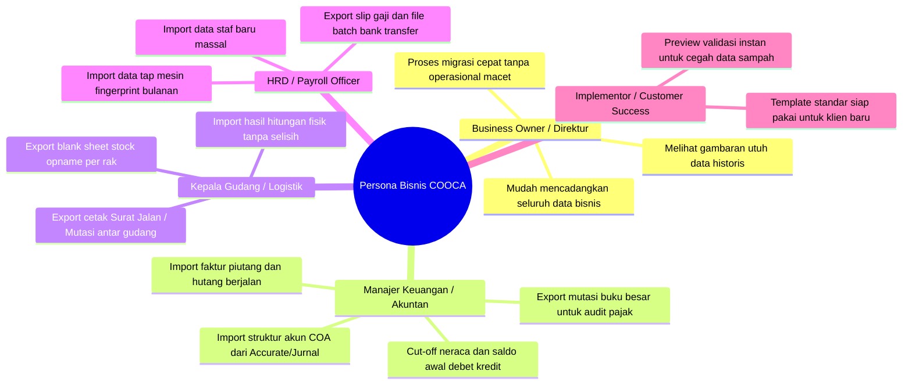

# BUSINESS REQUIREMENTS DOCUMENT (BRD)
## Arsitektur Pertukaran Data Terpadu (Unified Data Exchange Engine): Solusi Impor, Ekspor, & Migrasi Klien Skala Enterprise

> **Identitas Dokumen:**
> - **Kode Dokumen:** `BRD-DATA-EXCHANGE-2026-V1`
> - **Rujukan Audit:** [`docs/AUDIT_KOMPREHENSIF_IMPORT_EXPORT_SISTEM_COOCA.md`](file:///c:/laragon/www/cooca_core/docs/AUDIT_KOMPREHENSIF_IMPORT_EXPORT_SISTEM_COOCA.md)
> - **Target Platform:** COOCA ERP Multi-Tenant SaaS
> - **Versi:** 1.0 (Ratified for Implementation)
> - **Target Pengguna Bisnis:** Business Owner (UMKM & Menengah), Tim Akuntan/Keuangan, Tim Logistik/Gudang, HRD/Payroll Officer, serta Konsultan Implementasi & Onboarding.

---

## 1. Latar Belakang & Masalah Bisnis (Executive Summary & Problem Statement)

COOCA memposisikan diri sebagai sistem ERP modern terpadu untuk 20 sektor bisnis di Indonesia (F&B, Ritel, Grosir, Manufaktur, Jasa, Klinik, dsb.). Namun, dalam realitas komersial dan proses akuisisi klien, **keberhasilan penjualan dan retensi pelanggan 90% ditentukan oleh kemudahan migrasi data (*Time-to-Value & Onboarding Friction*)**.

### Kondisi Nyata di Lapangan (Pain Points Klien):
1. **Kegagalan Onboarding Klien Eks-Kompetitor:**
   - Klien yang bermigrasi dari *Accurate Online, Mekari Jurnal, Ecount ERP*, atau *Excel* memiliki ribuan baris master data (500–5.000 pelanggan, ratusan vendor, puluhan akun akuntansi COA, dan ribuan SKU barang).
   - Ketiadaan importer massal untuk Pelanggan, Supplier, COA, dan Saldo Awal Neraca memaksa staf klien mengetik manual satu per satu. Akibatnya, **angka drop-off/churn klien baru pada masa uji coba mencapai titik kritis karena proses input yang melelahkan**.
2. **Kegagalan Operasional Ritel & Grosir pada Saldo Stok:**
   - Importer saldo stok awal saat ini terkunci hanya untuk Bahan Baku (`Material`) dan menolak Barang Jadi (`Product`). Bisnis ritel/distribusi langsung mengalami *deadlock* saat mencoba memulai pencatatan stok.
3. **Inersia Operasional Stock Opname Fisik:**
   - Gudang ritel dan grosir rutin melakukan audit fisik stok bulanan. Tanpa fitur unduh lembar opname kosong dan unggah hasil hitungan Excel, tim gudang menolak beralih ke COOCA karena proses manual di layar web dinilai terlalu lambat.
4. **Ketergantungan Mesin Absensi Biometrik:**
   - Pabrik, gudang, dan restoran menggunakan mesin absensi fisik (Solution/ZKTeco/Fingerspot). Belum adanya importer log presensi membuat tim HRD enggan menggunakan payroll otomatis COOCA.

---

## 2. Tujuan Strategis & Metrik Keberhasilan Bisnis (OKRs & KPIs)

| Sasaran Bisnis (Objective) | Indikator Kunci Kinerja (KPI) | Target Kuantitatif |
| :--- | :--- | :---: |
| **Akselerasi Onboarding Klien** | Durasi rata-rata migrasi data klien baru dari sistem lama hingga siap transaksi | Turun dari **14 hari** menjadi **< 2 jam** |
| **Penurunan Churn Masa Trial** | Tingkat pembatalan langganan di 30 hari pertama akibat kesulitan input data | Berkurang hingga **> 65%** |
| **Efisiensi Kerja Harian Pengguna** | Waktu yang dibutuhkan untuk audit fisik stock opname per 1.000 SKU | Dipangkas dari **8 jam** menjadi **15 menit** |
| **Kemandirian Pengguna (Zero-Ticket)** | Jumlah tiket bantuan teknis terkait "Cara input data banyak" / "Minta bantu import" | Berkurang hingga **> 80%** |
| **Integritas & Keamanan Finansial** | Tingkat keberhasilan validasi otomatis (anti duplikat, balancing debet/kredit neraca) | **100% Lolos Tanpa Selisih** |

---

## 3. Analisa Persona & Kebutuhan Pengguna (User Personas)



### Kebutuhan Spesifik Tiap Persona:
1. **Pak Hendra (Owner Toko Grosir & Ritel - 3 Cabang):**
   - *"Saya mau pindah ke COOCA, tapi saya punya 2.400 kontak langganan warung dan 1.800 SKU produk. Kalau tim saya harus ngetik satu-satu, butuh sebulan dan toko saya bisa kacau. Saya butuh sekali upload Excel, semua langsung masuk."*
2. **Ibu Ratna (Accounting & Tax Consultant):**
   - *"Klien saya menggunakan bagan akun khusus manufaktur. Saya butuh template COA dan Saldo Awal Neraca per tanggal cut-off. Saya tidak mau repot membuat jurnal manual ratusan akun dari nol."*
3. **Budi (Supervisor Gudang Logistik):**
   - *"Tiap akhir bulan kami tutup toko setengah hari untuk Stock Opname. Kami butuh cetak form Excel daftar barang per rak, staf lapangan tulis tangan atau isi di tablet, lalu file Excel diupload balik ke sistem agar selisih stok otomatis terhitung."*
4. **Siti (HRD & GA Perusahaan FnB 8 Outlet):**
   - *"Staf kami ada 120 orang dan memakai mesin absensi sidik jari Solution di outlet. Kami butuh fitur tarik data dari flashdisk mesin finger lalu upload ke COOCA agar potongan telat langsung otomatis di payroll."*

---

## 4. Ruang Lingkup Bisnis (Scope of Work)

```
┌────────────────────────────────────────────────────────────────────────┐
│                              IN-SCOPE                                  │
├────────────────────────────────────────────────────────────────────────┤
│ 1. Engine Impor & Ekspor Terpadu (Excel .xlsx, .xls, .csv).            │
│ 2. Perbaikan bug saldo stok awal (mendukung Bahan Baku & Barang Jadi). │
│ 3. Paket Master Data: Pelanggan (CRM) & Pemasok (Suppliers).           │
│ 4. Paket Finansial: Bagan Akun (COA), Saldo Neraca, Piutang & Hutang.  │
│ 5. Paket Gudang: Siklus 2 Arah Stock Opname (Download Sheet & Upload). │
│ 6. Paket HR: Data Staf & Log Mesin Absensi Biometrik (Fingerprint).    │
│ 7. Tombol Aksi Kontekstual (Direct Table Action) di seluruh tabel view.│
│ 8. Template Standar Resmi ber-Header Warna & Baris Contoh Panduan.     │
│ 9. Preview Tabel Pra-Simpan & Laporan Diagnostik Error per Baris.      │
│ 10. Audit Log & Isolasi Multi-Tenant Mutlak.                           │
└────────────────────────────────────────────────────────────────────────┘
                                    │
┌────────────────────────────────────────────────────────────────────────┐
│                            OUT-OF-SCOPE                                │
├────────────────────────────────────────────────────────────────────────┤
│ 1. Sinkronisasi real-time kabel LAN mesin fingerprint (menggunakan CSV)│
│ 2. OCR scan nota/kuitansi fisik otomatis via AI (Fase 4 tersendiri).   │
│ 3. Modifikasi struktur database relasional inti di luar skema tenant.  │
└────────────────────────────────────────────────────────────────────────┘
```

---

## 5. Kebutuhan Bisnis Tingkat Tinggi (High-Level Business Requirements)

### BR-01: Arsitektur Ekspor & Impor Dua Arah (Symmetric Data Loop)
Setiap modul yang memiliki fitur Impor **wajib** memiliki fitur Ekspor dengan format header kolom yang kompatibel. Data yang diekspor dari sistem harus dapat diedit secara offline lalu diimpor kembali tanpa kegagalan parsing header.

### BR-02: Zero-Loss Data & Atomic Transaction Safety
- Jika terjadi error validasi format (misal baris 45 ada format tanggal salah), sistem harus memberitahu pengguna letak baris yang salah dan alasannya secara manusiawi (*human-readable*).
- Pada saat proses simpan (*commit*), jika salah satu baris krusial gagal dalam transaksi akuntansi, sistem wajib melakukan *rollback* penuh untuk mencegah data menggantung (*half-baked data*).

### BR-03: Pencegahan Duplikasi Data Pintar (Duplicate Prevention Strategy)
Pengguna diberikan 2 opsi penanganan saat sistem mendeteksi data yang sudah ada di database:
1. **Lewati (Skip):** Hanya menambahkan data baru yang belum ada.
2. **Perbarui (Update/Overwrite):** Memperbarui data lama berdasarkan kunci unik (No. Telepon untuk Pelanggan, Kode/SKU untuk Produk/Bahan, NIK untuk Karyawan, Kode Akun untuk COA).

### BR-04: Pengalaman Pengguna Berstandar Apple HIG (Zero-Manual UI)
- Template Excel resmi harus dilengkapi:
  - Header dengan warna penanda jelas (Merah = Kolom Wajib, Abu-abu = Kolom Opsional).
  - Baris contoh data nyata (bukan teks lorem ipsum atau kode abstrak).
  - Petunjuk pengisian langsung di baris kedua.
- Antarmuka web harus menampilkan ringkasan pra-impor: **Total Baris Terbaca, Data Valid, Data Duplikat, dan Data Rusak**.

---

## 6. Kebutuhan Kepatuhan, Keamanan & Tata Kelola Data

1. **Isolasi Multi-Tenant Mutlak:**
   - Tidak ada baris data yang boleh diimpor atau diekspor melintasi batas `business_id`.
   - Nama file ekspor yang dihasilkan wajib menyertakan identitas tenant dan timestamp unik (contoh: `COOCA_Pelanggan_NamaBisnis_20261015_0915.xlsx`).
2. **Audit Trail Pencatatan Aktivitas:**
   - Setiap aktivitas impor dan ekspor wajib dicatat ke dalam log audit (`AuditLog`) mencakup: Nama Pengguna, Waktu, Jumlah Baris Diproses, dan IP Address.
3. **Pemberian Hak Akses Berbasis Peran (RBAC):**
   - Hanya peran berwenang (*Owner, Finance Manager, Store Manager*) yang memiliki izin melakukan ekspor atau impor data sensitif seperti data keuangan dan gaji karyawan.

---

## 7. Rencana Fase Peluncuran Bisnis

```
FASE 1: ONBOARDING QUICK-WINS (Pekan 1-2)
  ├── 1. Perbaikan Bug Saldo Stok Awal (Bahan Baku + Barang Jadi)
  ├── 2. Impor & Ekspor Master Pelanggan (CRM)
  ├── 3. Impor & Ekspor Master Pemasok (Vendor)
  └── 4. Ekspor Langsung di Tabel Produk & Bahan Baku

FASE 2: OPERASIONAL GUDANG & MIGRASI FINANSIAL (Pekan 3-4)
  ├── 1. Workflow 2 Arah Stock Opname Fisik
  ├── 2. Impor Bagan Akun (COA) Standar & Custom
  ├── 3. Impor Saldo Awal Neraca (Opening Balances)
  └── 4. Impor Saldo Awal Piutang (AR) & Hutang (AP) Berjalan

FASE 3: SDM, ABSENSI & LOGISTIK OMNICHANNEL (Pekan 5-6)
  ├── 1. Impor Master Karyawan Massal (HRM)
  ├── 2. Impor Log Presensi Mesin Absensi Biometrik (Fingerprint)
  ├── 3. Ekspor Batch Order Toko Online untuk Pengiriman & Kurir
  └── 4. Konsolidasi Ekspor Pesanan Marketplace Multi-Channel
```

---

*Disahkan oleh: Tim Manajemen Produk & Rekayasa Perangkat Lunak COOCA*
