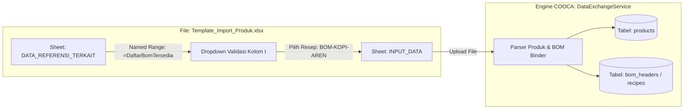
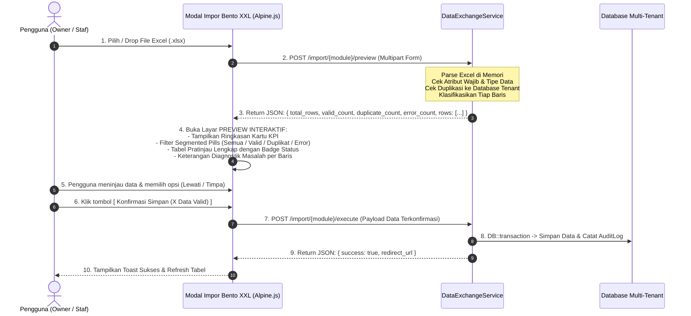

# IMPLEMENTATION PLAN: ARSITEKTUR PERTUKARAN DATA TERPADU (UNIFIED DATA EXCHANGE) & STYLING TEMPLATE EXCEL DENGAN DATA TERKAIT OTOMATIS (BOM / MASTER LOOKUP)

> **Dokumen Terkait:**  
> - Audit Sistem: [`docs/AUDIT_KOMPREHENSIF_IMPORT_EXPORT_SISTEM_COOCA.md`](file:///c:/laragon/www/cooca_core/docs/AUDIT_KOMPREHENSIF_IMPORT_EXPORT_SISTEM_COOCA.md)  
> - Rujukan Bisnis: [`docs/BRD_IMPORT_EXPORT_DAN_DATA_EXCHANGE_COOCA.md`](file:///c:/laragon/www/cooca_core/docs/BRD_IMPORT_EXPORT_DAN_DATA_EXCHANGE_COOCA.md)  
> - Rujukan Fungsional: [`docs/prd/PRD-35-DATA-EXCHANGE-ENGINE-IMPORT-EXPORT-AND-MIGRATION.md`](file:///c:/laragon/www/cooca_core/docs/prd/PRD-35-DATA-EXCHANGE-ENGINE-IMPORT-EXPORT-AND-MIGRATION.md)  
> - Target Codebase: `c:\laragon\www\cooca_core`  
> - Status: `READY FOR SPRINT EXECUTION`

---

## 1. Ringkasan Eksekutif & Sasaran Desain

Rencana implementasi ini mentransformasikan sistem impor-ekspor COOCA dari sekadar form upload biasa menjadi **mesin pertukaran data cerdas berstandar Apple HIG**. 

### Nilai Tambah Utama (Key Highlights):
1. **Template Excel "Hidup" dengan Data Terkait (Living Excel Templates with Dynamic Lookups):**
   - Saat pengguna mengunduh template Excel (misal: Template Produk), sistem secara otomatis menyuntikkan data bisnis tenant yang sedang aktif ke dalam **Sheet Referensi**.
   - **Fitur Spesial (Product-BOM Binding):** Pada kolom *"Pilihan Resep / Formula BOM"*, pengguna tidak perlu mengetik manual. Excel menyediakan **Data Validation Dropdown** yang langsung menampilkan daftar formula BOM / Resep yang sudah terdaftar di sistem.
2. **Styling Premium & Color-Coded Headers:**
   - Visual tabel Excel profesional menggunakan tipografi bersih, pembagian warna kolom yang intuitif (Wajib, Relasi, Opsional, Kalkulasi), zebra striping, dan proteksi formula.
3. **Penyelesaian Blocker Kritis Saldo Stok:**
   - Merombak logika parser agar mengenali SKU milik **Barang Jadi (`Product`)** maupun **Bahan Baku (`Material`)**.
4. **Onboarding Tanpa Hambatan (Zero Friction Onboarding):**
   - Penambahan import-export resmi untuk Pelanggan (CRM), Pemasok (Vendor), Stock Opname 2-arah, dan Bagan Akun (COA).

---

## 2. Standar Styling & Arsitektur Visual Template Excel

Setiap template Excel yang diunduh dari COOCA wajib memiliki struktur 3 Sheet terpadu:

```
┌────────────────────────────────────────────────────────────────────────┐
│ STRUKTUR WORKBOOK EXCEL RESMI COOCA (.XLSX)                            │
├────────────────────────────────────────────────────────────────────────┤
│ Sheet 1: [ INPUT_DATA ]            -> Lembar pengisian data utama      │
│ Sheet 2: [ DATA_REFERENSI_TERKAIT] -> Master tenant untuk dropdown     │
│ Sheet 3: [ PANDUAN_PENGISIAN ]     -> Panduan warna, aturan, & contoh  │
└────────────────────────────────────────────────────────────────────────┘
```

### A. Palet Token Warna Header Kolom (Color-Coded Semantic)

Pengguna langsung memahami status tiap kolom hanya dari warna headernya:

| Tipe Kolom | Warna Latar (HEX) | Warna Teks | Keterangan & Contoh |
| :--- | :--- | :--- | :--- |
| **🟢 WAJIB (Required)** | `#0F766E` *(Teal 700)* | Putih Tebal | Wajib diisi. Jika kosong, baris ditolak. (*Nama Produk, SKU, Harga Jual*). |
| **🔵 DATA TERKAIT (Lookup)**| `#1D4ED8` *(Blue 700)* | Putih Tebal | Terhubung ke dropdown sheet referensi. (*Kategori, Satuan, Resep BOM*). |
| **⚪ OPSIONAL (Optional)** | `#475569` *(Slate 600)* | Putih Tebal | Boleh dikosongkan. (*Deskripsi, Barcode, Catatan Khusus*). |
| **🟡 REKOMENDASI / FORMULA**| `#B45309` *(Amber 700)* | Putih Tebal | Nilai panduan atau formula otomatis. (*Estimasi Margin %, Minimum Stok*). |

### B. Spesifikasi Styling Tipografi & Baris Excel
- **Font Utama:** `Segoe UI` atau `Calibri`, ukuran `10pt` untuk data, `11pt Bold` untuk Header.
- **Tinggi Baris (Row Height):**
  - Baris Header (Baris 1): `32pt` (lapang dengan padding vertikal seimbang).
  - Baris Contoh Panduan (Baris 2): `24pt` (berlatar abu-abu tipis `#F1F5F9`, teks miring/italic `#64748B`).
  - Baris Data Input (Baris 3 ke bawah): `22pt`.
- **Zebra Striping:** Baris genap menggunakan warna lembut `#F8FAFC`, baris ganjil putih `#FFFFFF`.
- **Border:** Garis tipis halus (*Thin Border*) warna `#CBD5E1`.
- **Lebar Kolom (Column Width):** Auto-fit berdasarkan panjang header + padding minimal `4 karakter` agar teks tidak terpotong.

---

## 3. Fitur Khusus: "Membuat Produk dengan Pilihan BOM / Resep Langsung dari Excel"

### A. Masalah di Sistem Lama
Bisnis F&B (Restoran, Cafe, Bakery), Manufaktur, dan Percetakan memiliki produk jadi yang dibuat dari resep / formula BOM (Bahan Baku). Pada sistem lama, pengguna harus:
1. Input produk dulu di Excel.
2. Buka web COOCA, cari produk tersebut.
3. Masuk ke tab resep, lalu tambahkan bahan satu per satu.
*Proses ini memakan waktu berhari-hari untuk 200 menu resto!*

### B. Solusi Baru: Smart BOM Selector di Template Excel Produk



### C. Desain Kolom Template Produk ([`INPUT_DATA`])

| Kolom | Nama Header | Tipe Kolom | Contoh Nilai | Validasi / Sumber Data |
| :---: | :--- | :---: | :--- | :--- |
| **A** | `Nama Produk *` | 🟢 Wajib | Kopi Susu Gula Aren | Teks bebas max 255 |
| **B** | `Kode SKU *` | 🟢 Wajib | KOP-AREN-01 | Teks unik (Huruf/Angka/-) |
| **C** | `Barcode / EAN` | ⚪ Opsional | 8991234567890 | Angka / Teks |
| **D** | `Kategori Produk *` | 🔵 Lookup | Minuman Kopi | **Dropdown Sheet 2** (`=DaftarKategori`) |
| **E** | `Satuan Dasar *` | 🔵 Lookup | cup | **Dropdown Sheet 2** (`=DaftarSatuan`) |
| **F** | `Harga Jual (Rp) *` | 🟢 Wajib | 18000 | Angka (Rupiah) |
| **G** | `Harga Beli / HPP (Rp)`| 🟡 Estimasi | 7500 | Angka (Dapat auto-update dari BOM) |
| **H** | `Stok Minimum Alert` | ⚪ Opsional | 10 | Angka |
| **I** | `Pilihan Resep / BOM Terkait` | 🔵 **Lookup Spesial** | `[BOM-001] Resep Kopi Susu Aren` | **Dropdown Sheet 2** (`=DaftarBomTersedia`) |
| **J** | `Mode Resep Otomatis` | 🔵 Lookup | Terapkan Resep Terpilih | Opsi: `Terapkan Resep Terpilih` / `Kosongkan Resep` |
| **K** | `Gudang Penjualan Utama` | 🔵 Lookup | Gudang Bar Depan | **Dropdown Sheet 2** (`=DaftarGudang`) |
| **L** | `Deskripsi Singkat` | ⚪ Opsional | Espresso + fresh milk + aren | Teks |

### D. Tampilan Sheet Referensi ([`DATA_REFERENSI_TERKAIT`])
Sheet ini dibuat otomatis oleh controller berdasarkan data aktif tenant saat tombol download ditekan:

```
┌────────────────────────────────────────────────────────────────────────────────────────┐
│ SHEET 2: DATA_REFERENSI_TERKAIT (Otomatis Dikunci / Read-Only)                         │
├────────────────────────┬───────────────────┬──────────────────────┬────────────────────┤
│ TABEL 1: DAFTAR BOM    │ TABEL 2: KATEGORI │ TABEL 3: SATUAN(UOM) │ TABEL 4: GUDANG    │
│ (Named: DaftarBom)     │ (Named: Kategori) │ (Named: Satuan)      │ (Named: Gudang)    │
├────────────────────────┼───────────────────┼──────────────────────┼────────────────────┤
│ [BOM-001] Kopi Aren    │ Minuman Kopi      │ cup                  │ Gudang Utama       │
│ [BOM-002] Croissant    │ Bakery & Pastry   │ pcs                  │ Gudang Bar Depan   │
│ [BOM-003] Matcha Ice   │ Minuman Non-Kopi  │ botol                │ Dapur Pastry       │
│ [BOM-004] Kaos Sablon  │ Makanan Berat     │ porsi                │ Gudang Pusat (HQ)  │
│ [TIDAK_PAKAI_RESEP]    │ Merchandise       │ box                  │                    │
└────────────────────────┴───────────────────┴──────────────────────┴────────────────────┘
```

> **Keunggulan UX:** Saat pengguna mengisi Excel di laptopnya, pada kolom I tinggal klik tanda panah ke bawah (*dropdown*), lalu memilih formula resep yang diinginkan! Tidak ada risiko salah ketik kode BOM.

---

## 4. Matriks Spesifikasi Lengkap 8 Template Excel COOCA

Berikut adalah spesifikasi detail untuk 8 template Excel yang akan dibangun pada mesin pertukaran data:

| No | Modul Target | Nama File Template | Sheet 1: Input Data | Sheet 2: Data Terkait (Dropdown) |
| :-: | :--- | :--- | :--- | :--- |
| **1** | **Katalog Produk Jadi** | `Template_Import_Produk_COOCA.xlsx` | Nama Produk, SKU, Barcode, Kategori, Satuan, Harga Jual, HPP, Stok Min, **Pilihan Resep BOM**, Gudang Utama. | Daftar Kategori, Daftar Satuan, **Daftar Resep BOM Aktif**, Daftar Gudang. |
| **2** | **Katalog Bahan Baku** | `Template_Import_Bahan_Baku_COOCA.xlsx` | Nama Bahan, Kode Bahan, Kategori, Satuan Dasar, Harga Beli Terakhir, Stok Minimum, Default Supplier. | Daftar Kategori Bahan, Daftar Satuan, Daftar Supplier Aktif. |
| **3** | **Formula Resep (BOM)** | `Template_Import_Resep_BOM_COOCA.xlsx` | Produk Target (SKU/Nama), Bahan Baku (SKU/Nama), Qty Pakai, Satuan Bahan, % Susut/Waste, Catatan. | **Daftar Produk Jadi Aktif**, **Daftar Bahan Baku Aktif**, Daftar Satuan. |
| **4** | **Saldo Stok Awal** | `Template_Saldo_Stok_Awal_COOCA.xlsx` | SKU Barang (Bahan/Produk), Gudang Target, Jumlah Stok, Satuan, Harga Beli/HPP Satuan, Catatan. | **Daftar Seluruh SKU (Produk + Bahan)**, Daftar Gudang Aktif. |
| **5** | **Stock Opname Fisik** | `Lembar_Stock_Opname_[NamaGudang].xlsx` | Kode SKU, Barcode, Nama Barang, Lokasi Rak, Satuan, Stok Sistem, **Jumlah Hitung Fisik (Diisi Tim)**, Catatan. | Data Terkunci per Gudang & Tanggal Cut-Off Opname. |
| **6** | **Pelanggan (CRM)** | `Template_Import_Pelanggan_COOCA.xlsx` | Nama Pelanggan, No Telepon/WA, Email, Tier Diskon, Alamat, Kota, Limit Piutang, NPWP. | Daftar Tier Pelanggan (Reguler, VIP, Grosir, Reseller). |
| **7** | **Pemasok (Vendor)** | `Template_Import_Supplier_COOCA.xlsx` | Nama Supplier, Kode Supplier, PIC, No Telepon, Email, Termin Bayar (TOP Hari), Bank, No Rekening, Alamat. | Termin Standar (COD, 7 Hari, 14 Hari, 30 Hari, 60 Hari). |
| **8** | **Bagan Akun (COA)** | `Template_Import_COA_Akuntansi_COOCA.xlsx`| Kode Akun, Nama Akun, Kategori Utama, Kode Akun Induk, Posisi Normal (Debit/Kredit). | Daftar 9 Kategori Standar SAK EMKM Indonesia. |

---

## 5. Implementasi Teknis Backend (Code Blueprint)

### A. Arsitektur Service Terpadu: `app/Domain/Import/DataExchangeService.php`

Kita akan membuat layanan khusus yang menangani generasi template ber-styling dan injeksi dropdown referensi.

```php
<?php

declare(strict_types=1);

namespace App\Domain\Import;

use App\Models\Business;
use App\Models\BomHeader;
use App\Models\Product;
use App\Models\Material;
use App\Models\Unit;
use App\Models\Category;
use App\Models\Warehouse;
use PhpOffice\PhpSpreadsheet\Spreadsheet;
use PhpOffice\PhpSpreadsheet\Style\Alignment;
use PhpOffice\PhpSpreadsheet\Style\Border;
use PhpOffice\PhpSpreadsheet\Style\Fill;
use PhpOffice\PhpSpreadsheet\Cell\DataValidation;
use PhpOffice\PhpSpreadsheet\Cell\Coordinate;
use PhpOffice\PhpSpreadsheet\NamedRange;
use Symfony\Component\HttpFoundation\StreamedResponse;
use PhpOffice\PhpSpreadsheet\Writer\Xlsx;

final class DataExchangeService
{
    /**
     * Palet Token Warna Standar Apple HIG
     */
    private const COLOR_PRIMARY = '0F766E';    // Teal 700 (Wajib)
    private const COLOR_LOOKUP  = '1D4ED8';    // Blue 700 (Data Terkait / Dropdown)
    private const COLOR_MUTED   = '475569';    // Slate 600 (Opsional)
    private const COLOR_WARNING = 'B45309';    // Amber 700 (Kalkulasi / HPP)
    private const BORDER_COLOR  = 'CBD5E1';    // Slate 300
    private const ZEBRA_COLOR   = 'F8FAFC';    // Slate 50

    /**
     * Generate Template Produk Cerdas dengan Dropdown BOM & Master Data.
     */
    public function generateProductTemplateWithBom(Business $business): StreamedResponse
    {
        $spreadsheet = new Spreadsheet();
        
        // -------------------------------------------------------------
        // SHEET 1: INPUT DATA
        // -------------------------------------------------------------
        $sheetInput = $spreadsheet->getActiveSheet();
        $sheetInput->setTitle('INPUT_PRODUK');

        // Header Kolom
        $headers = [
            'A1' => ['text' => 'Nama Produk *', 'color' => self::COLOR_PRIMARY, 'width' => 30],
            'B1' => ['text' => 'Kode SKU *', 'color' => self::COLOR_PRIMARY, 'width' => 18],
            'C1' => ['text' => 'Barcode / EAN', 'color' => self::COLOR_MUTED, 'width' => 20],
            'D1' => ['text' => 'Kategori *', 'color' => self::COLOR_LOOKUP, 'width' => 22],
            'E1' => ['text' => 'Satuan Dasar *', 'color' => self::COLOR_LOOKUP, 'width' => 16],
            'F1' => ['text' => 'Harga Jual (Rp) *', 'color' => self::COLOR_PRIMARY, 'width' => 20],
            'G1' => ['text' => 'Harga Beli/HPP (Rp)', 'color' => self::COLOR_WARNING, 'width' => 20],
            'H1' => ['text' => 'Stok Minimum Alert', 'color' => self::COLOR_MUTED, 'width' => 18],
            'I1' => ['text' => 'Pilihan Resep BOM', 'color' => self::COLOR_LOOKUP, 'width' => 35],
            'J1' => ['text' => 'Gudang Utama *', 'color' => self::COLOR_LOOKUP, 'width' => 22],
            'K1' => ['text' => 'Deskripsi Singkat', 'color' => self::COLOR_MUTED, 'width' => 35],
        ];

        foreach ($headers as $cell => $meta) {
            $sheetInput->setCellValue($cell, $meta['text']);
            $colLetter = preg_replace('/[0-9]/', '', $cell);
            $sheetInput->getColumnDimension($colLetter)->setWidth($meta['width']);
            
            // Apply Header Styling
            $sheetInput->getStyle($cell)->applyFromArray([
                'font' => ['bold' => true, 'color' => ['rgb' => 'FFFFFF'], 'size' => 11, 'name' => 'Segoe UI'],
                'fill' => ['fillType' => Fill::FILL_SOLID, 'startColor' => ['rgb' => $meta['color']]],
                'alignment' => ['horizontal' => Alignment::HORIZONTAL_CENTER, 'vertical' => Alignment::VERTICAL_CENTER],
                'borders' => ['allBorders' => ['borderStyle' => Border::BORDER_THIN, 'color' => ['rgb' => self::BORDER_COLOR]]],
            ]);
        }
        $sheetInput->getRowDimension(1)->setRowHeight(32);

        // Baris Contoh (Row 2)
        $sampleRow = [
            'A2' => 'Kopi Susu Gula Aren',
            'B2' => 'KOP-AREN-01',
            'C2' => '899123450001',
            'D2' => 'Minuman Kopi',
            'E2' => 'cup',
            'F2' => 18000,
            'G2' => 7500,
            'H2' => 10,
            'I2' => '[BOM-001] Resep Kopi Susu Aren',
            'J2' => 'Gudang Utama',
            'K2' => 'Espresso double shot + susu fresh + gula aren organik',
        ];
        foreach ($sampleRow as $cell => $val) {
            $sheetInput->setCellValue($cell, $val);
            $sheetInput->getStyle($cell)->applyFromArray([
                'font' => ['italic' => true, 'color' => ['rgb' => '64748B'], 'size' => 10, 'name' => 'Segoe UI'],
                'fill' => ['fillType' => Fill::FILL_SOLID, 'startColor' => ['rgb' => 'F1F5F9']],
                'borders' => ['allBorders' => ['borderStyle' => Border::BORDER_THIN, 'color' => ['rgb' => self::BORDER_COLOR]]],
            ]);
        }
        $sheetInput->getRowDimension(2)->setRowHeight(24);

        // -------------------------------------------------------------
        // SHEET 2: DATA REFERENSI TERKAIT (LOOKUP MASTER)
        // -------------------------------------------------------------
        $sheetRef = $spreadsheet->createSheet();
        $sheetRef->setTitle('DATA_REFERENSI');

        // Tarik data aktif milik tenant
        $categories = Category::where('business_id', $business->id)->pluck('name')->toArray();
        if (empty($categories)) $categories = ['Makanan', 'Minuman', 'Produk Retail', 'Jasa'];

        $units = Unit::pluck('name')->toArray();
        if (empty($units)) $units = ['pcs', 'cup', 'porsi', 'botol', 'box', 'gram', 'kg', 'ml', 'liter'];

        $boms = BomHeader::whereHas('costModel', fn($q) => $q->where('business_id', $business->id))
            ->with('product')
            ->get()
            ->map(fn($b) => "[{$b->code}] " . ($b->product ? $b->product->name : $b->name))
            ->toArray();
        array_unshift($boms, '[TANPA_RESEP] Produk Non-Resep');

        $warehouses = Warehouse::where('business_id', $business->id)->pluck('name')->toArray();
        if (empty($warehouses)) $warehouses = ['Gudang Utama', 'Gudang Display Toko'];

        // Tulis Tabel Referensi di Sheet 2
        $refCols = [
            'A' => ['title' => 'Daftar Kategori', 'data' => $categories, 'named' => 'RefKategori'],
            'B' => ['title' => 'Daftar Satuan', 'data' => $units, 'named' => 'RefSatuan'],
            'C' => ['title' => 'Daftar Resep BOM Tersedia', 'data' => $boms, 'named' => 'RefBomTersedia'],
            'D' => ['title' => 'Daftar Gudang', 'data' => $warehouses, 'named' => 'RefGudang'],
        ];

        foreach ($refCols as $col => $info) {
            $sheetRef->setCellValue("{$col}1", $info['title']);
            $sheetRef->getStyle("{$col}1")->applyFromArray([
                'font' => ['bold' => true, 'color' => ['rgb' => 'FFFFFF']],
                'fill' => ['fillType' => Fill::FILL_SOLID, 'startColor' => ['rgb' => self::COLOR_PRIMARY]],
            ]);
            $sheetRef->getColumnDimension($col)->setWidth(32);

            $r = 2;
            foreach ($info['data'] as $item) {
                $sheetRef->setCellValue("{$col}{$r}", $item);
                $r++;
            }
            $endRow = max(2, $r - 1);
            
            // Daftarkan Named Range Excel
            $spreadsheet->addNamedRange(new NamedRange($info['named'], $sheetRef, "\${$col}\$2:\${$col}\${$endRow}"));
        }

        // -------------------------------------------------------------
        // TERAPKAN DATA VALIDATION DROPDOWN DI SHEET INPUT (BARIS 3 - 500)
        // -------------------------------------------------------------
        $this->applyDropdownValidation($sheetInput, 'D3:D500', '=RefKategori', 'Pilih Kategori');
        $this->applyDropdownValidation($sheetInput, 'E3:E500', '=RefSatuan', 'Pilih Satuan');
        $this->applyDropdownValidation($sheetInput, 'I3:I500', '=RefBomTersedia', 'Pilih Formula Resep');
        $this->applyDropdownValidation($sheetInput, 'J3:J500', '=RefGudang', 'Pilih Gudang Utama');

        // Set Sheet Input sebagai sheet aktif saat dibuka
        $spreadsheet->setActiveSheetIndex(0);

        // Stream ke browser
        return response()->streamDownload(function () use ($spreadsheet): void {
            $writer = new Xlsx($spreadsheet);
            $writer->save('php://output');
        }, "Template_Import_Produk_COOCA_{$business->id}.xlsx", [
            'Content-Type' => 'application/vnd.openxmlformats-officedocument.spreadsheetml.sheet',
            'Cache-Control' => 'max-age=0',
        ]);
    }

    /**
     * Helper untuk memasang Dropdown List Excel
     */
    private function applyDropdownValidation($sheet, string $cellRange, string $formula, string $promptTitle): void
    {
        $validation = $sheet->getDataValidation($cellRange);
        $validation->setType(DataValidation::TYPE_LIST);
        $validation->setErrorStyle(DataValidation::STYLE_INFORMATION);
        $validation->setAllowBlank(true);
        $validation->setShowInputMessage(true);
        $validation->setShowErrorMessage(true);
        $validation->setShowDropDown(true);
        $validation->setPromptTitle($promptTitle);
        $validation->setPrompt('Silakan pilih dari daftar yang tersedia.');
        $validation->setFormula1($formula);
    }
}
```

### B. Perbaikan Logika Saldo Stok Awal (Dual Resolution)

Pada parser saldo stok awal di [`DataImportService.php`](file:///c:/laragon/www/cooca_core/app/Domain/Import/DataImportService.php), ganti logika pengecekan tunggal menjadi resolusi ganda:

```php
// SEBELUMNYA (BUG): Hanya mengecek Material
// $material = Material::where('business_id', $bId)->where('code', $sku)->first();

// PERBAIKAN: Resolusi Cerdas (Cek Product DULU, jika tidak ada cek Material)
$product = Product::where('business_id', $bId)
    ->where(function ($q) use ($sku): void {
        $q->where('sku', $sku)->orWhere('barcode', $sku);
    })->first();

$material = null;
if (!$product) {
    $material = Material::where('business_id', $bId)
        ->where(function ($q) use ($sku): void {
            $q->where('code', $sku)->orWhere('sku', $sku);
        })->first();
}

if (!$product && !$material) {
    $errors[] = "Baris {$rowIdx}: SKU/Kode '{$sku}' tidak ditemukan pada katalog Produk maupun Bahan Baku.";
    continue;
}

// Catat stok awal ke InventoryStock
if ($product) {
    $this->recordInitialProductStock($product, $warehouseId, $qty, $costPrice);
} else {
    $this->recordInitialMaterialStock($material, $warehouseId, $qty, $costPrice);
}
```

---

## 6. Implementasi Antarmuka Pengguna (UI/UX) Bento Apple HIG v2.0

### A. Komponen Tombol Header Tabel ([`Direct Table Action`])
Setiap tampilan tabel modul (misal: [`customers/index.blade.php`](file:///c:/laragon/www/cooca_core/resources/views/app/customers/index.blade.php)) ditambahkan tombol aksi terpadu di samping tombol pencarian:

```blade
<!-- Tombol Aksi Impor / Ekspor di Header Halaman -->
<div class="flex items-center gap-2">
    <!-- Tombol Export Excel -->
    <a href="{{ route('app.customers.export', request()->query()) }}" 
       class="inline-flex items-center gap-2 px-3.5 py-2 text-xs font-semibold text-slate-700 bg-white border border-slate-200/80 rounded-xl hover:bg-slate-50 hover:border-slate-300 transition-all shadow-sm active:scale-95">
        <svg class="w-4 h-4 text-slate-500" fill="none" stroke="currentColor" viewBox="0 0 24 24">
            <path stroke-linecap="round" stroke-linejoin="round" stroke-width="2" d="M4 16v1a3 3 0 003 3h10a3 3 0 003-3v-1m-4-4l-4 4m0 0l-4-4m4 4V4"/>
        </svg>
        <span>Export Excel</span>
    </a>

    <!-- Tombol Import Excel -->
    <button type="button" @click="showImportModal = true"
       class="inline-flex items-center gap-2 px-3.5 py-2 text-xs font-semibold text-slate-700 bg-white border border-slate-200/80 rounded-xl hover:bg-slate-50 hover:border-slate-300 transition-all shadow-sm active:scale-95">
        <svg class="w-4 h-4 text-emerald-600" fill="none" stroke="currentColor" viewBox="0 0 24 24">
            <path stroke-linecap="round" stroke-linejoin="round" stroke-width="2" d="M4 16v1a3 3 0 003 3h10a3 3 0 003-3v-1m-4-8l-4-4m0 0L8 8m4-4v12"/>
        </svg>
        <span>Import Excel</span>
    </button>
</div>
```

### B. Arsitektur Mutlak: Preview Interaktif Pra-Simpan (Interactive Pre-Commit Preview Engine)

> ⚠️ **MANDAT ARSITEKTUR MUTLAK: "NO PREVIEW, NO COMMIT"**  
> Dilarang keras membuat fitur impor data yang langsung mengunggah dan menyimpan file ke database tanpa fase pratinjau (*blind import*). Seluruh proses impor di COOCA (baik di Pusat Impor `/import` maupun modal impor di tabel Pelanggan, Supplier, Stok Opname, COA, Karyawan) **WAJIB** melalui 2 fase:
> 1. **Fase 1 (Analisis & Validasi di Memori):** File diurai dan divalidasi tanpa menyentuh database operasional, menghasilkan laporan status per baris.
> 2. **Fase 2 (Pratinjau Interaktif & Konfirmasi):** Pengguna memeriksa data di layar, memfilter status, memilih strategi penanganan, dan mengonfirmasi sebelum data disimpan (*commit*).



---

### C. 4 Pilar Spesifikasi Antarmuka Preview Modal Bento XXL

#### 1. Kartu Ringkasan KPI & Segmented Filter Pills
Pada bagian atas tabel pratinjau, sistem menyajikan 4 kartu metrik interaktif yang sekaligus berfungsi sebagai tombol filter cepat:

```blade
<!-- Segmented Filter Pills di Header Preview -->
<div class="flex items-center flex-wrap gap-2">
    <!-- Filter Semua -->
    <button type="button" @click="previewFilter = 'all'"
        class="h-9 px-3.5 rounded-xl text-xs font-semibold border transition-all flex items-center gap-2"
        :class="previewFilter === 'all' ? 'bg-slate-900 text-white border-transparent shadow-sm' : 'bg-white text-slate-600 border-slate-200 hover:bg-slate-50'">
        <span>Semua Baris</span>
        <span class="px-1.5 py-0.5 rounded-md text-[11px] font-mono tabular-nums font-bold"
              :class="previewFilter === 'all' ? 'bg-white/20 text-white' : 'bg-slate-100 text-slate-700'"
              x-text="previewData ? previewData.total_rows : 0"></span>
    </button>

    <!-- Filter Siap Impor (Hijau) -->
    <button type="button" @click="previewFilter = 'valid'"
        class="h-9 px-3.5 rounded-xl text-xs font-semibold border transition-all flex items-center gap-2"
        :class="previewFilter === 'valid' ? 'bg-emerald-600 text-white border-transparent shadow-sm' : 'bg-emerald-50/60 text-emerald-700 border-emerald-200 hover:bg-emerald-100/60'">
        <span class="w-2 h-2 rounded-full bg-emerald-500" :class="previewFilter === 'valid' ? 'bg-white' : ''"></span>
        <span>Siap Impor</span>
        <span class="px-1.5 py-0.5 rounded-md text-[11px] font-mono tabular-nums font-bold"
              :class="previewFilter === 'valid' ? 'bg-white/20 text-white' : 'bg-emerald-100 text-emerald-800'"
              x-text="previewData ? previewData.valid_count : 0"></span>
    </button>

    <!-- Filter Duplikat (Kuning/Amber) -->
    <button type="button" @click="previewFilter = 'duplicate'"
        class="h-9 px-3.5 rounded-xl text-xs font-semibold border transition-all flex items-center gap-2"
        :class="previewFilter === 'duplicate' ? 'bg-amber-600 text-white border-transparent shadow-sm' : 'bg-amber-50/60 text-amber-700 border-amber-200 hover:bg-amber-100/60'">
        <span class="w-2 h-2 rounded-full bg-amber-500" :class="previewFilter === 'duplicate' ? 'bg-white' : ''"></span>
        <span>Duplikat</span>
        <span class="px-1.5 py-0.5 rounded-md text-[11px] font-mono tabular-nums font-bold"
              :class="previewFilter === 'duplicate' ? 'bg-white/20 text-white' : 'bg-amber-100 text-amber-800'"
              x-text="previewData ? previewData.duplicate_count : 0"></span>
    </button>

    <!-- Filter Error (Merah) -->
    <button type="button" @click="previewFilter = 'error'"
        class="h-9 px-3.5 rounded-xl text-xs font-semibold border transition-all flex items-center gap-2"
        :class="previewFilter === 'error' ? 'bg-rose-600 text-white border-transparent shadow-sm' : 'bg-rose-50/60 text-rose-700 border-rose-200 hover:bg-rose-100/60'">
        <span class="w-2 h-2 rounded-full bg-rose-500" :class="previewFilter === 'error' ? 'bg-white' : ''"></span>
        <span>Format Salah</span>
        <span class="px-1.5 py-0.5 rounded-md text-[11px] font-mono tabular-nums font-bold"
              :class="previewFilter === 'error' ? 'bg-white/20 text-white' : 'bg-rose-100 text-rose-800'"
              x-text="previewData ? previewData.error_count : 0"></span>
    </button>
</div>
```

#### 2. Penjelasan Diagnostik Masalah yang Bersahaja & Manusiawi (Human-Readable Errors)
Sistem tidak boleh menampilkan pesan teknis seperti *"SQLSTATE[23000]: Integrity constraint violation"* atau *"Undefined index: col_2"*. Setiap baris bermasalah wajib memiliki kolom **Keterangan & Solusi** yang jelas:

| Kategori Masalah | Contoh Pesan Diagnostik di Kolom Preview | Solusi Otomatis / Manual |
| :--- | :--- | :--- |
| **Duplikasi Kontak** | `"No. Telepon '08129876543' sudah terdaftar atas nama pelanggan 'Toko Barokah Jaya'."` | Pengguna dapat memilih opsi *"Perbarui Data"* atau biarkan *"Lewati"*. |
| **Kolom Wajib Kosong** | `"Nama Produk pada baris ini kosong. Kolom Nama Produk wajib diisi."` | Baris ditandai merah dan dilewati dari proses simpan. |
| **Nilai Negatif / Tidak Logis** | `"Harga Jual (Rp -15.000) tidak boleh bernilai negatif atau nol."` | Ditandai merah dengan saran koreksi nilai positif. |
| **Resep BOM Tidak Ditemukan** | `"Formula Resep '[BOM-KOP-999]' tidak ada di database resep Anda."` | Produk tetap dapat diimpor sebagai produk mandiri non-resep. |
| **Kategori Baru Terdeteksi** | `"Kategori 'Frozen Food' belum ada. Sistem akan otomatis mendaftarkannya sebagai kategori baru."` | Ditandai hijau/info dengan auto-create saat disimpan. |

#### 3. Kontrol Strategi Duplikat Sebelum Eksekusi
Tepat di atas tombol konfirmasi simpan, pengguna disajikan pilihan radio button yang jelas:
```html
<div class="p-3.5 rounded-xl bg-slate-50 border border-slate-200 flex flex-col sm:flex-row sm:items-center justify-between gap-3 text-xs">
    <div class="flex items-center gap-2 font-medium text-slate-700">
        <svg class="w-4 h-4 text-emerald-600" ...></svg>
        <span>Jika ditemukan data duplikat di sistem:</span>
    </div>
    <div class="flex items-center gap-4">
        <label class="flex items-center gap-1.5 cursor-pointer font-medium text-slate-700">
            <input type="radio" value="skip" x-model="duplicateStrategy" class="text-emerald-600 focus:ring-emerald-500">
            <span>Lewati Duplikat (Pertahankan Data Lama)</span>
        </label>
        <label class="flex items-center gap-1.5 cursor-pointer font-medium text-slate-700">
            <input type="radio" value="update" x-model="duplicateStrategy" class="text-emerald-600 focus:ring-emerald-500">
            <span>Perbarui Data Lama dengan Data Baru</span>
        </label>
    </div>
</div>
```

#### 4. Tabel Pratinjau Interaktif dengan Sticky Header & Checkbox Selektif
Tabel preview memiliki tinggi maksimal `max-h-96` dengan scroll vertikal dan horizontal yang halus, sticky thead, dan nomor baris Excel asli (`Row #`):

```html
<div class="overflow-x-auto max-h-96 rounded-xl border border-slate-200 shadow-inner">
    <table class="w-full text-left text-xs">
        <thead class="sticky top-0 bg-slate-100/95 backdrop-blur text-slate-600 font-semibold border-b border-slate-200 z-10">
            <tr>
                <th class="py-2.5 px-3 w-10">Baris</th>
                <th class="py-2.5 px-3 w-28">Status</th>
                <th class="py-2.5 px-3">Nama Entitas</th>
                <th class="py-2.5 px-3">Kode / Kunci Unik</th>
                <th class="py-2.5 px-3">Kategori / Relasi</th>
                <th class="py-2.5 px-3 text-right">Nilai Finansial</th>
                <th class="py-2.5 px-3 min-w-[200px]">Diagnostik & Keterangan</th>
            </tr>
        </thead>
        <tbody class="divide-y divide-slate-100 bg-white">
            <template x-for="row in filteredPreviewRows" :key="row.row_number">
                <tr class="hover:bg-slate-50/80 transition-colors"
                    :class="row.status === 'error' ? 'bg-rose-50/30' : (row.status === 'duplicate' ? 'bg-amber-50/30' : '')">
                    <td class="py-2 px-3 font-mono text-slate-400" x-text="row.row_number"></td>
                    <td class="py-2 px-3 whitespace-nowrap">
                        <span class="inline-flex items-center gap-1 px-2 py-0.5 rounded-full text-[11px] font-semibold"
                              :class="{
                                  'bg-emerald-50 text-emerald-700 border border-emerald-200': row.status === 'valid',
                                  'bg-amber-50 text-amber-700 border border-amber-200': row.status === 'duplicate',
                                  'bg-rose-50 text-rose-700 border border-rose-200': row.status === 'error'
                              }">
                            <span class="w-1.5 h-1.5 rounded-full"
                                  :class="{
                                      'bg-emerald-500': row.status === 'valid',
                                      'bg-amber-500': row.status === 'duplicate',
                                      'bg-rose-500': row.status === 'error'
                                  }"></span>
                            <span x-text="row.status_label"></span>
                        </span>
                    </td>
                    <td class="py-2 px-3 font-medium text-slate-900" x-text="row.name"></td>
                    <td class="py-2 px-3 font-mono text-slate-600" x-text="row.code"></td>
                    <td class="py-2 px-3 text-slate-600" x-text="row.category"></td>
                    <td class="py-2 px-3 text-right font-mono text-slate-900" x-text="row.formatted_price"></td>
                    <td class="py-2 px-3 text-slate-500" x-text="row.reason || '-'"></td>
                </tr>
            </template>
        </tbody>
    </table>
</div>
```

---

### D. Struktur Standar JSON Response Backend untuk Preview Engine

Setiap endpoint preview (`/import/{module}/preview`) wajib mengembalikan struktur JSON konsisten berikut:

```json
{
  "success": true,
  "total_rows": 120,
  "valid_count": 112,
  "duplicate_count": 6,
  "error_count": 2,
  "can_proceed": true,
  "rows": [
    {
      "row_number": 3,
      "status": "valid",
      "status_label": "Siap Impor",
      "name": "Kopi Susu Gula Aren",
      "code": "KOP-AREN-01",
      "category": "Minuman Kopi",
      "uom": "cup",
      "price": 18000,
      "cost_price": 7500,
      "formatted_price": "Rp 18.000",
      "bom_code": "BOM-001",
      "bom_name": "Resep Kopi Susu Aren",
      "reason": "Data lengkap & valid. Terhubung ke resep BOM-001."
    },
    {
      "row_number": 4,
      "status": "duplicate",
      "status_label": "Duplikat",
      "name": "Croissant Butter Spesial",
      "code": "ROT-001",
      "category": "Bakery",
      "uom": "pcs",
      "price": 22000,
      "cost_price": 9000,
      "formatted_price": "Rp 22.000",
      "bom_code": null,
      "reason": "SKU 'ROT-001' sudah terdaftar di sistem. Pilih 'Perbarui Data' jika ingin memperbarui harga."
    },
    {
      "row_number": 5,
      "status": "error",
      "status_label": "Format Salah",
      "name": "",
      "code": "MIN-999",
      "category": "Minuman",
      "uom": "cup",
      "price": 0,
      "cost_price": 0,
      "formatted_price": "Rp 0",
      "bom_code": null,
      "reason": "Nama Produk wajib diisi dan Harga Jual harus lebih besar dari 0."
    }
  ]
}
```

---

---

## 7. Panduan Pengoperasian Pengguna (User-Friendly SOP)

```
SOP PENGISIAN & IMPOR DATA DI COOCA
──────────────────────────────────────────────────────────────────────────
Langkah 1: Klik tombol [ Import Excel ] di modul yang Anda tuju (misal: Produk).
Langkah 2: Klik [ Unduh Template Resmi (.xlsx) ].
           -> Template otomatis menyertakan kategori, satuan, dan resep aktif Anda!
Langkah 3: Buka file di Microsoft Excel / Google Sheets / WPS Office.
           -> Kolom Hijau   : WAJIB diisi.
           -> Kolom Biru    : Klik panah ke bawah (Dropdown) untuk memilih data.
           -> Kolom Abu-Abu : Opsional / boleh dikosongkan.
Langkah 4: Simpan file, lalu tarik (drag-and-drop) file ke kotak upload di COOCA.
Langkah 5: Periksa tabel pratinjau (Preview). Jika semua berstatus HIJAU, klik [ Simpan Data ].
Langkah 6: Selesai! Seluruh data langsung aktif di kasir POS dan laporan keuangan.
```

---

## 8. Rencana Eksekusi Bertahap (Sprint Breakdown)

### Sprint 1: Blocker Fix & Master Data Onboarding (Target: Pekan 1)
- [ ] **Task 1.1:** Buat `DataExchangeService.php` dengan engine styling PhpSpreadsheet dan dynamic named range validation.
- [ ] **Task 1.2:** Perbaiki `DataImportService.php` agar saldo stok awal mengenali `Product` dan `Material`.
- [ ] **Task 1.3:** Implementasikan Template Produk dengan Dropdown Pilihan Resep BOM (`=RefBomTersedia`).
- [ ] **Task 1.4:** Tambahkan Import & Export Pelanggan ([`customers/index.blade.php`](file:///c:/laragon/www/cooca_core/resources/views/app/customers/index.blade.php)) + Route & Controller.
- [ ] **Task 1.5:** Tambahkan Import & Export Pemasok ([`suppliers/index.blade.php`](file:///c:/laragon/www/cooca_core/resources/views/app/suppliers/index.blade.php)) + Route & Controller.
- [ ] **Task 1.6:** Pasang tombol `Export Excel` langsung di header tabel Produk dan Bahan Baku.

### Sprint 2: Gudang & Migrasi Akuntansi (Target: Pekan 2)
- [ ] **Task 2.1:** Bangun siklus Stock Opname Excel dua arah di [`inventory/opname.blade.php`](file:///c:/laragon/www/cooca_core/resources/views/app/inventory/opname.blade.php) (Export Blank Sheet & Import Hitungan Fisik).
- [ ] **Task 2.2:** Bangun Impor Bagan Akun (COA) dengan validasi akun induk di [`finance/accounting/coa.blade.php`](file:///c:/laragon/www/cooca_core/resources/views/app/finance/accounting/coa.blade.php).
- [ ] **Task 2.3:** Bangun Impor Saldo Awal Neraca dengan validasi balancing Debit = Kredit.
- [ ] **Task 2.4:** Bangun Impor Saldo Awal Piutang (AR) dan Hutang (AP) Cut-Off.

### Sprint 3: HRM, Presensi Biometrik & Dispatch (Target: Pekan 3)
- [ ] **Task 3.1:** Bangun Impor Master Karyawan massal di [`hrm/index.blade.php`](file:///c:/laragon/www/cooca_core/resources/views/app/hrm/index.blade.php).
- [ ] **Task 3.2:** Bangun Impor Log Presensi Mesin Fingerprint (Format Solution/ZKTeco/Fingerspot).
- [ ] **Task 3.3:** Bangun Batch Export Pengiriman Toko Online di [`storefront/orders/index.blade.php`](file:///c:/laragon/www/cooca_core/resources/views/app/storefront/orders/index.blade.php).

---

## 9. Definition of Done (DoD)

1. **Uji Validasi Template:** Seluruh template Excel yang diunduh terbuka sempurna di Microsoft Excel (Desktop & Web), Google Sheets, dan LibreOffice tanpa error formula atau korupsi XML.
2. **Uji Dropdown BOM:** Pengguna dapat memilih resep yang sudah ada dari dropdown kolom I di Excel, dan saat diimpor, sistem mengaitkan produk dengan BOM tersebut secara otomatis.
3. **Uji Dual Resolution Stok:** Impor saldo persediaan untuk 50 SKU Produk dan 50 SKU Material berhasil terisi 100% tanpa error *"SKU tidak ditemukan"*.
4. **Uji Isolasi Multi-Tenant:** Data yang diekspor maupun dropdown referensi hanya memuat data milik `business_id` yang sedang login.
5. **Testing Suite:** Seluruh automated test di `tests/Feature/DataExchangeTest.php` lulus 100%.

---

*Disahkan oleh: Tim Rekayasa Perangkat Lunak & Desain Produk COOCA*
