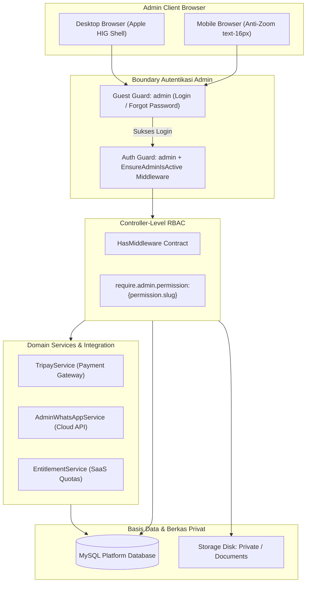
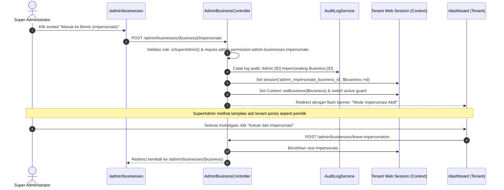

# Architecture & Workflow - Modul Platform Backoffice & Superadmin (`admin`)

> Modul: `admin` | Commit: `a17c5ae` | Standar Arsitektur: Laravel 11/12 HasMiddleware & Domain-Driven Services

---

## 1. Arsitektur Modul

Modul Admin diisolasi dari ranah aplikasi tenant dan publik dengan prinsip pemisahan tanggung jawab (*Separation of Concerns*):

### Karakteristik Arsitektur Utama:
1. **Controller-Level RBAC Enforcement:**
   Mengacu pada spesifikasi terbaru Laravel, seluruh kontroler admin menerapkan kontrak `Illuminate\Routing\Controllers\HasMiddleware` dan mendeklarasikan proteksi hak akses secara lokal dalam metode `public static function middleware(): array`. Ini mencegah kebocoran otorisasi jika ada route baru yang didaftarkan tanpa membungkus middleware di berkas route.
2. **Defensive Model Instantiation:**
   Model `Admin` dilengkapi `$attributes` bawaan (`'role' => 'super_admin'`, `'is_active' => true`), memastikan instansiasi baru tidak pernah berada dalam kondisi *indeterminate* yang menyebabkan pemutusan sesi tidak sengaja.

---

## 2. Alur Kerja Kunci 1: Impersonasi Tenant & Gerbang Debugging (`admin.businesses.impersonate`)

Fitur impersonasi dirancang agar Administrator platform dapat melakukan investigasi mendalam terhadap laporan galat atau kendala konfigurasi yang dialami pemilik bisnis tenant secara langsung tanpa meminta kredensial kata sandi pengguna.

### Diagram Alur Impersonasi:

### Mekanisme Keamanan Impersonasi:
- **Proteksi Akses:** Hanya admin dengan izin `admin.businesses.impersonate` yang berhak memicu endpoint.
- **Audit Logging Otomatis:** Setiap tindakan pergantian identitas tercatat dengan stempel waktu, IP address admin, dan ID tenant target.
- **Pita Navigasi Persisten:** Di seluruh view tenant saat impersonasi aktif, layout menampilkan pita peringatan merah mencolok dengan tombol langsung `Tinggalkan Impersonasi`.

---

## 3. Alur Kerja Kunci 2: Pusat Verifikasi Pemulihan Akun (`admin.account-recoveries`)

Digunakan untuk memulihkan akses pengguna pemilik bisnis yang kehilangan nomor ponsel, alamat email, atau autentikator 2FA.

### Tahapan Alur Kerja:
1. **Pengajuan Publik:** Pengguna mengisi formulir pemulihan publik dengan mengunggah 3 berkas otentik: Foto KTP asli, Dokumen Legal Usaha (NIB/SIUP), dan Foto Selfie memegang KTP.
2. **Antrean Masuk:** Tiket masuk dengan status `pending` ke antrean `/admin/account-recoveries`.
3. **Meja Uji Bukti Otentik (Show Desk):**
   - Admin memeriksa data pendaftaran lama (Old Email, Old Phone) dibandingkan dengan data permohonan baru.
   - Admin membuka berkas dokumen via endpoint privat bersandi token `admin.account-recoveries.document`.
4. **Keputusan Administrator:**
   - **Setujui (`approve`):** Alamat email dan nomor ponsel user di basis data diperbarui secara atomik dalam transaksi basis data (`DB::transaction`). Notifikasi WhatsApp otomatis terkirim via `AdminWhatsAppService` ke nomor baru pemohon.
   - **Tolak (`reject`):** Tiket ditandai `rejected` dengan alasan penolakan wajib diisi. Alasan dikirimkan ke email/WA pemohon untuk perbaikan berkas.

---

## 4. Alur Kerja Kunci 3: Pengaturan Platform & Penagihan Hibrida

Modul `/admin/settings` menyediakan kontrol pusat sistem:
- **Tab Sistem:** Konfigurasi nama aplikasi, logo platform, pemeliharaan (*maintenance mode*), dan kuota AI token default.
- **Tab Pembayaran:** Integrasi TriPay (API Key, Private Key, Merchant Code, Mode Sandbox/Production) dipadukan dengan konfigurasi rekening transfer manual (`/admin/payment-accounts`).
- **Tab WhatsApp:** Integrasi Meta WhatsApp Cloud API (Token Permanen, WABA ID, Phone Number ID) dan pengujian pesan (*Live Test Send*).
- **Tab SMTP:** Konfigurasi server pengiriman email sistem dengan diagnostik instan kirim email uji.

---

## 5. Matriks Role & Permissions RBAC (92 Permissions)

Platform admin memiliki pembagian 19 domain perizinan:
1. `admin.dashboard.*` (Lihat KPI platform)
2. `admin.businesses.*` (Lihat, ubah status, impersonasi, hapus)
3. `admin.users.*` (Lihat, ekspor CSV, reset sandi, hapus)
4. `admin.account_recoveries.*` (Lihat, periksa dokumen, approve, reject)
5. `admin.subscriptions.*` (Lihat transaksi, filter paket)
6. `admin.billing_packages.*` (Kelola paket langganan)
7. `admin.payment_accounts.*` (Kelola rekening manual)
8. `admin.finance.*` (Lihat ringkasan keuangan, laporan mutasi)
9. `admin.settlements.*` (Proses rekonsiliasi & penyelesaian)
10. `admin.ai_tokens.*` (Monitoring token & penambahan saldo)
11. `admin.settings.*` (Konfigurasi umum, TriPay, WhatsApp, SMTP)
12. `admin.whatsapp.*` (Template WA & broadcast sistem)
13. `admin.roles.*` (Kelola role & permissions admin)
14. `admin.leads.*` (Kelola pendaftaran prospek & status sales)
15. `admin.inbox.*` (Tiket bantuan & balasan)
16. `admin.feedback.*` (Ulasan pengguna)
17. `admin.b2b.*` (Invoices, Quotations, Orders, Returns B2B)
18. `admin.error_logs.*` (Inspeksi log & hapus jejak error)
19. `admin.templates.*` (Unggah master template impor Excel)
