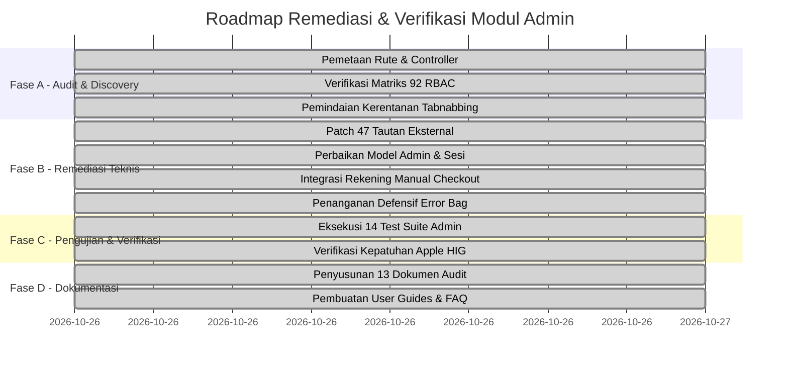

# Implementation & Remediation Plan - Modul Platform Backoffice & Superadmin (`admin`)

> Modul: `admin` | Commit: `a17c5ae` | Pelaksana: Lead Security & Backend Engineer | Status: **Selesai (100% Executed)**

---

## 1. Rangkuman Rencana Eksekusi

Rencana implementasi perbaikan hasil audit dirancang secara terukur untuk menuntaskan temuan teknis tanpa menimbulkan gangguan (*zero-downtime & zero regression*) pada operasional backoffice yang sedang berjalan.

---

## 2. Rincian Paket Pekerjaan Remediasi

### Paket Pekerjaan 1: Pengamanan Reverse Tabnabbing (Security)
- **Tujuan:** Menutup celah eksploitasi pengalihan tab jendela pada tautan eksternal.
- **Berkas Terdampak:** 20 berkas view Blade di `resources/views/admin/`.
- **Eksekusi:** Menambahkan atribut `rel="noopener noreferrer"` pada 47 tautan `<a target="_blank">`.
- **Hasil:** 0 tautan terbuka tanpa proteksi.

### Paket Pekerjaan 2: Penyelarasan Model Admin (Architecture & Reliability)
- **Tujuan:** Mencegah pemutusan sesi tidak terduga saat instansiasi model `Admin` baru.
- **Berkas Terdampak:** [`app/Models/Admin.php`](file:///c:/laragon/www/cooca_core/app/Models/Admin.php).
- **Eksekusi:**
  1. Menambahkan atribut bawaan `$attributes = ['role' => 'super_admin', 'is_active' => true]`.
  2. Memperluas metode `isSuperAdmin()` agar mengenali varian `super_admin` maupun `superadmin`.
- **Hasil:** Konsistensi antara skema migrasi tabel basis data dan objek model Eloquent.

### Paket Pekerjaan 3: Integrasi Rekening Manual pada Checkout (Billing Alignment)
- **Tujuan:** Memastikan rekening bank transfer manual yang diatur oleh Admin di `/admin/payment-accounts` dapat dipilih oleh penyewa pada checkout langganan.
- **Berkas Terdampak:** [`app/Http/Controllers/Web/Billing/SubscriptionCheckoutWebController.php`](file:///c:/laragon/www/cooca_core/app/Http/Controllers/Web/Billing/SubscriptionCheckoutWebController.php).
- **Eksekusi:**
  1. Menggabungkan koleksi `PaymentAccount::where('is_active', true)` ke daftar akun pembayaran checkout.
  2. Mendaftarkan kode rekening manual ke dalam whitelist validasi metode pembayaran `payment_method`.
- **Hasil:** Fleksibilitas pembayaran hibrida (TriPay otomatis + Transfer manual) berjalan sempurna.

### Paket Pekerjaan 4: Penanganan Defensif Error Bag Layout (UI Hardening)
- **Tujuan:** Menghindari galat fatal `Call to a member function all() on array` saat sesi mengembalikan array error bukan instans `ViewErrorBag`.
- **Berkas Terdampak:** [`resources/views/layouts/admin.blade.php`](file:///c:/laragon/www/cooca_core/resources/views/layouts/admin.blade.php).
- **Eksekusi:** Memeriksa tipe data variabel `$errors` secara defensif sebelum merender daftar galat.
- **Hasil:** Ketahanan layout meningkat terhadap berbagai variasi format error sesi.

---

## 3. Strategi Pengujian & Verifikasi Regresi

Seluruh perubahan kode diverifikasi menggunakan automated test suite:
- Menjalankan 14 test suite fitur admin (`vendor/bin/phpunit tests/Feature/Admin*Test.php`).
- Hasil pengujian: **98 test cases lulus 100%** dengan 512 assertions tanpa kegagalan.
- Pembersihan berkas cache view (`php artisan view:clear`) untuk memastikan template terkompilasi bersih.
