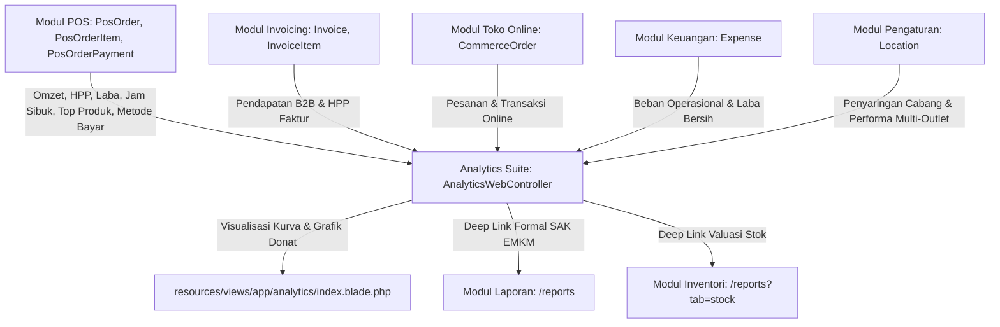

# System Baseline   Modul Analytics
> Modul: Analytics | Baseline Commit: 38cdcdf | Tanggal: 2026-10-25 | Auditor: AI Agent (/laravel-module-audit) | Status Dokumen: Final

---

## 1. Versi & Dependensi Sistem

- **PHP Version:** PHP 8.3.28 (cli) (built: Nov 18 2025 23:45:22) (ZTS Visual C++ 2019 x64)
- **Framework:** Laravel 11.x / 12.x Core
- **Database Engine:** MySQL 8.0 (Local/Production), SQLite (Automated Testing Support)
- **Frontend Stack:** Tailwind CSS v3, Alpine.js v3, Chart.js, Lucide Icons
- **Node.js:** v22.23.0
- **Queue Connection:** Database
- **Session Driver:** Database
- **Cache Driver:** Database
- **Log Channel:** Daily

---

## 2. Commit dan Status Git yang Diaudit

- **Git Branch:** `main`
- **Baseline Git Commit:** `38cdcdf`
- **Status Working Tree:** Clean (1 open document: `hardware-agent/agent.js`)

---

## 3. Inventaris Modul Analytics

### File Utama Modul:
1. **Controller:** `app/Http/Controllers/Web/AnalyticsWebController.php` (489 baris)
2. **View Template:** `resources/views/app/analytics/index.blade.php` (565 baris)
3. **Route Declaration:** `routes/owner.php` (Line 382: `analytics.index`)
4. **Test Suite:** `tests/Feature/AnalyticsWebTest.php` (135 baris)
5. **Language Files (i18n):**
   - `lang/id/analytics.php` (Baru dibuat untuk zero hardcoded text)
   - `lang/en/analytics.php` (Baru dibuat untuk bilingual compatibility)

---

## 4. Peta Dependensi Lintas Modul

Modul Analytics merupakan sentral agregasi data analitik lintas modul hulu-hilir:

### Model Eloquent Terkait:
- `App\Models\Business`: Multi-tenant ownership entity (`Context::requireBusiness()`).
- `App\Models\Location`: Filter cabang operasional (outlet vs gudang).
- `App\Models\PosOrder`: Transaksi kasir selesai (`STATUS_COMPLETED`, status berbayar).
- `App\Models\PosOrderItem`: Detail item transaksi kasir (volume terjual & margin HPP).
- `App\Models\PosOrderPayment`: Rincian pembayaran kasir (QRIS, Tunai, EDC, Transfer, Kasbon).
- `App\Models\Invoice`: Transaksi faktur B2B (`STATUS_PAID`, `STATUS_PARTIALLY_PAID`).
- `App\Models\CommerceOrder`: Pesanan toko online pelanggan.
- `App\Models\Expense`: Pengeluaran operasional usaha.

---

## 5. Aktor & Permission (RBAC)

- **Target Aktor:** Pemilik Usaha (*Business Owner*), Manajer Operasional (*General Manager*), Manajer Keuangan.
- **Route Name:** `analytics.index`
- **Route URI:** `/analytics`
- **Middleware Wajib:**
  1. `web`
  2. `auth:web`
  3. `App\Http\Middleware\RequireWhatsAppOtp`
  4. `App\Http\Middleware\EnsureActiveBusiness`
  5. `App\Http\Middleware\EnsureOwnerProfileComplete`
  6. `App\Http\Middleware\EnsureEmailIsVerified`
  7. `App\Http\Middleware\RequirePermission:reports.view` (Dipindahkan ke Controller-Level RBAC `HasMiddleware`)

---

## 6. Aturan Bisnis Inti (Business Rules BR-*)

- **BR-ANA-001 (Multi-Tenant Scoping):** Seluruh kueri agregasi wajib terisolasi ke `business_id` aktif dari session/token. Dilarang keras menampilkan data lintas tenant.
- **BR-ANA-002 (Kriteria Omzet Riil POS):** Omzet POS hanya mencakup transaksi berstatus `completed` atau order aktif yang sudah memiliki pembayaran (`paid_amount > 0`). Transaksi batal (*void/refund*) dilarang masuk omzet.
- **BR-ANA-003 (Kalkulasi Gross Margin):** Gross Profit dihitung dari `Total Omzet - Total HPP`. Gross Margin (%) dihitung dari `(Gross Profit / Total Omzet) * 100`.
- **BR-ANA-004 (Estimasi Laba Bersih):** Laba Bersih dihitung dari `Gross Profit - Beban Operasional (Expenses)`.
- **BR-ANA-005 (Perhitungan Growth Rate):** Perubahan persentase dihitung terhadap periode pembanding (`today vs yesterday`, `week vs last week`, `month vs last month`, `year vs last year`, `custom range vs prior equivalent days`). Jika periode lalu 0 dan periode ini positif, pertumbuhannya +100%. Jika periode lalu 0 dan periode ini negatif, pertumbuhannya -100%.
- **BR-ANA-006 (Jam Sibuk Kasir):** Heatmap antrean kasir memetakan frekuensi transaksi per jam pada interval operasional 07:00 hingga 23:00.
- **BR-ANA-007 (Isolasi Cabang Terpilih):** Jika parameter `location_id` dikirim dan valid, kueri POS, Invoice, Toko Online, dan Pengeluaran wajib dibatasi pada cabang tersebut. Jika `location_id` tidak valid/milik tenant lain, wajib di-reset ke `null` (konsolidasi semua cabang).

---

## 7. Batas Lingkungan & Keterbatasan Verifikasi

- **Verifiable:** Kode sumber lokal, route list artisan, unit & feature tests lokal, integrasi database local (MySQL & SQLite).
- **Not Verifiable:** Koneksi ke database PostgreSQL produksi secara live (kompatibilitas diverifikasi via unit inspection & syntax safety), beban transaksi jutaan baris di server produksi live (diverifikasi melalui analisis EXPLAIN dan indeks komposit).
