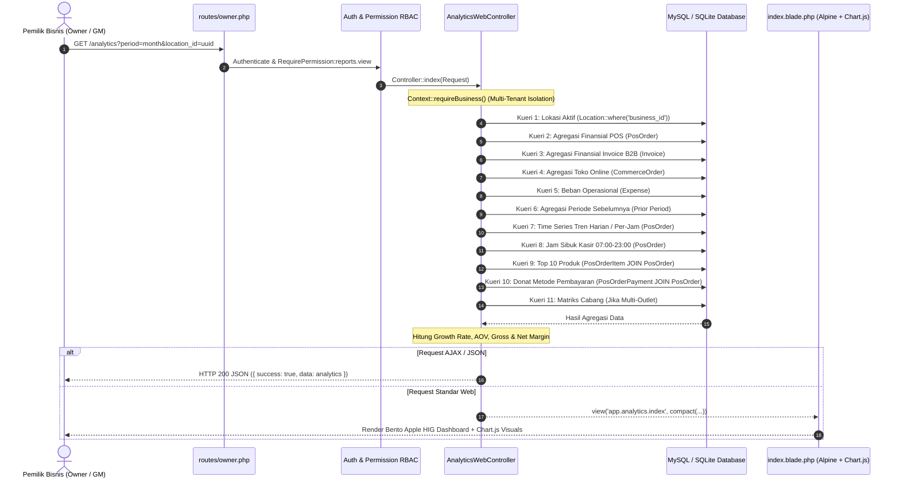
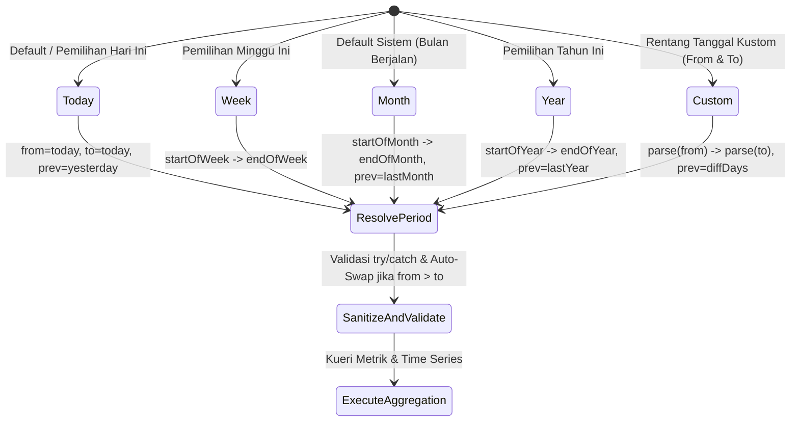

# Architecture & Workflow — Modul Analytics
> Modul: Analytics | Baseline Commit: 38cdcdf | Tanggal: 2026-10-25 | Auditor: AI Agent (/laravel-module-audit) | Status Dokumen: Final

---

## 1. Diagram Arsitektur & Data Flow



---

## 2. Peta Dependensi Lintas Modul

1. **Hulu Transaksi POS (`App\Models\PosOrder`):**
   - Menyediakan data omzet kasir riil, HPP produk terjual (`total_hpp_cost`), dan laba kotor riil (`total_gross_profit`).
   - Menyediakan cap waktu `order_date` dan `created_at` untuk pemetaan grafik time-series dan jam sibuk.
2. **Hulu B2B Invoicing (`App\Models\Invoice`):**
   - Menyediakan data omzet piutang/faktur yang telah berbayar (`paid_amount`) dan HPP faktur.
3. **Hulu Toko Online (`App\Models\CommerceOrder`):**
   - Menyediakan omzet pesanan online dari web storefront (`total_amount`).
4. **Hulu Beban Operasional (`App\Models\Expense`):**
   - Menyediakan beban pengeluaran riil untuk kalkulasi estimasi Laba Bersih (*Net Profit*).
5. **Hilir Pelaporan Formal SAK EMKM (`/reports`):**
   - Tautan terintegrasi langsung ke Laporan Laba Rugi resmi dan Valuasi Stok FIFO/Average.

---

## 3. Alur Bisnis & State Filter Rentang Waktu



---

## 4. Temuan Arsitektur & Workflow

### F-ANA-001 — Deklarasi Middleware Permission Masih di Route Level
- **Severity:** Medium | **Bukti:** `[VERIFIED]` | **Aspek:** Architecture & Security
- **Lokasi:** `app/Http/Controllers/Web/AnalyticsWebController.php:24`, `routes/owner.php:382`
- **Bukti:**
  ```php
  // routes/owner.php:382
  Route::get('/analytics', [AnalyticsWebController::class, 'index'])
      ->middleware('require.permission:reports.view')
      ->name('analytics.index');
  ```
  `AnalyticsWebController` tidak mengimplementasikan `HasMiddleware`, sehingga jika route dipanggil dari testing tanpa middleware route atau diduplikasi, permission guard tidak melekat langsung pada controller.
- **Root Cause:** Controller belum dimigrasikan ke konvensi Controller-Level RBAC Laravel 11/12 (`HasMiddleware`).
- **Rekomendasi:** Implementasikan `HasMiddleware` dengan `static::middleware()`, daftarkan `require.permission:reports.view` langsung pada controller.

---

### F-ANA-003 — Kerusakan Grafik Laba & Inkonsistensi Jam Sibuk pada Periode Hari Ini
- **Severity:** High | **Bukti:** `[VERIFIED]` | **Aspek:** Workflow & Calculation
- **Lokasi:** `app/Http/Controllers/Web/AnalyticsWebController.php:294-311`
- **Bukti:**
  ```php
  // AnalyticsWebController.php:291-311
  $profitData = [];
  if ($period === 'today') {
      ...
      $posTrend = PosOrder::where('business_id', $business->id)
          ...
          ->selectRaw("{$hourBucketExpr} as bucket, SUM(total_amount) as revenue, SUM(total_gross_profit) as profit")
          ->groupBy('bucket')
          ->pluck('revenue', 'bucket') // Menghapus field profit!
          ->toArray();

      for ($h = 8; $h <= 22; $h++) { // Dimulai jam 08, padahal heatmap jam 07
          $bucket = sprintf('%02d:00', $h);
          $labels[] = $bucket;
          $revenueData[] = (float) ($posTrend[$bucket] ?? 0);
          // $profitData tidak pernah diisi di sini!
      }
  }
  ```
- **Dampak:** Grafik tren laba kotor pada filter "Hari Ini" menghasilkan array kosong `[]`, menyebabkan Chart.js merender garis laba kotor yang hilang atau error dataset length mismatch.
- **Root Cause:** Kelalaian pengisian array `$profitData` di dalam blok loop jam per jam dan penggunaan `pluck('revenue', 'bucket')` yang membuang data `profit`.
- **Rekomendasi:** Ambil data sebagai collection Eloquent ber-key `bucket`, lakukan iterasi serempak 07:00–23:00, dan isi baik `revenueData` maupun `profitData`.
