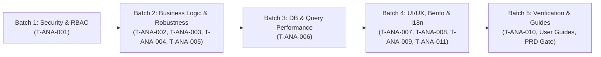

# Implementation Plan   Modul Analytics
> Modul: Analytics | Baseline Commit: 38cdcdf | Tanggal: 2026-10-25 | Auditor: AI Agent (/laravel-module-audit) | Status Dokumen: Final

---

## 1. Strategi & Urutan Eksekusi

Perbaikan diimplementasikan secara **surgical, bertahap, dan berurutan** dengan prinsip: *Security & Data Integrity First → Functional & Calculations → Performance → UI/UX & i18n → Test Suite & Verification*.

---

## 2. Dependensi Antartask & Kategori Perubahan

| Task ID | Nama Task | Prioritas | Temuan Dasar | Kategori Perubahan | Persetujuan Diperlukan? |
|---|---|---|---|---|:---:|
| `T-ANA-001` | Pindahkan Middleware RBAC ke Controller (`HasMiddleware`) | High | `F-ANA-001` | Safe Structural | Tidak |
| `T-ANA-002` | Pengamanan Parser Tanggal Kustom (Try/Catch & Auto-Swap) | High | `F-ANA-002` | Business Logic | Tidak |
| `T-ANA-003` | Perbaikan Kurva Laba Kotor & Sinkronisasi Jam 07:00–23:00 | High | `F-ANA-003` | Business Logic | Tidak |
| `T-ANA-004` | Dukungan Multi-Driver SQL (PostgreSQL, MySQL, SQLite) | Medium | `F-ANA-004` | Safe Database | Tidak |
| `T-ANA-005` | Filter `location_id` pada Pesanan Toko Online (`CommerceOrder`) | Medium | `F-ANA-005` | Business Logic | Tidak |
| `T-ANA-006` | Optimasi Kueri Agregasi via Direct `JOIN` | Medium | `F-ANA-006` | Performance | Tidak |
| `T-ANA-007` | Pembersihan Badge Pill pada Angka Persentase Margin | Low | `F-ANA-007` | UI/UX (Safe) | Tidak |
| `T-ANA-008` | Perbaikan Ergonomi Sentuh & Scroll Horizontal Mobile 360px | Low | `F-ANA-008` | UI/UX (Safe) | Tidak |
| `T-ANA-009` | Pembuatan File Translasi i18n (`lang/id` & `lang/en`) | Medium | `F-ANA-009` | i18n | Tidak |
| `T-ANA-010` | Pengembangan Automated Test Suite Komprehensif | High | `F-ANA-010` | Testing | Tidak |
| `T-ANA-011` | Penambahan Aksi Cetak Laporan Eksekutif (Print) | Low | `F-ANA-011` | Functional / UI | Tidak |

---

## 3. Rencana Rollback Tingkat Rilis

- Seluruh perubahan berada pada layer kode PHP/Blade tanpa alterasi skema database (zero migration), sehingga jika terjadi regresi tak terduga, rollback dapat dilakukan secara instan via `git checkout` atau revert commit tanpa menimbulkan *downtime* atau korupsi data.
- Kriteria Go/No-Go:
  - 100% test pada `AnalyticsWebTest` wajib `PASS`.
  - Halaman `/analytics` dapat diakses dengan respon `200 OK` pada mode desktop dan mobile.
  - Endpoint JSON `/analytics?format=json` mengembalikan data metrik yang terstruktur utuh.
