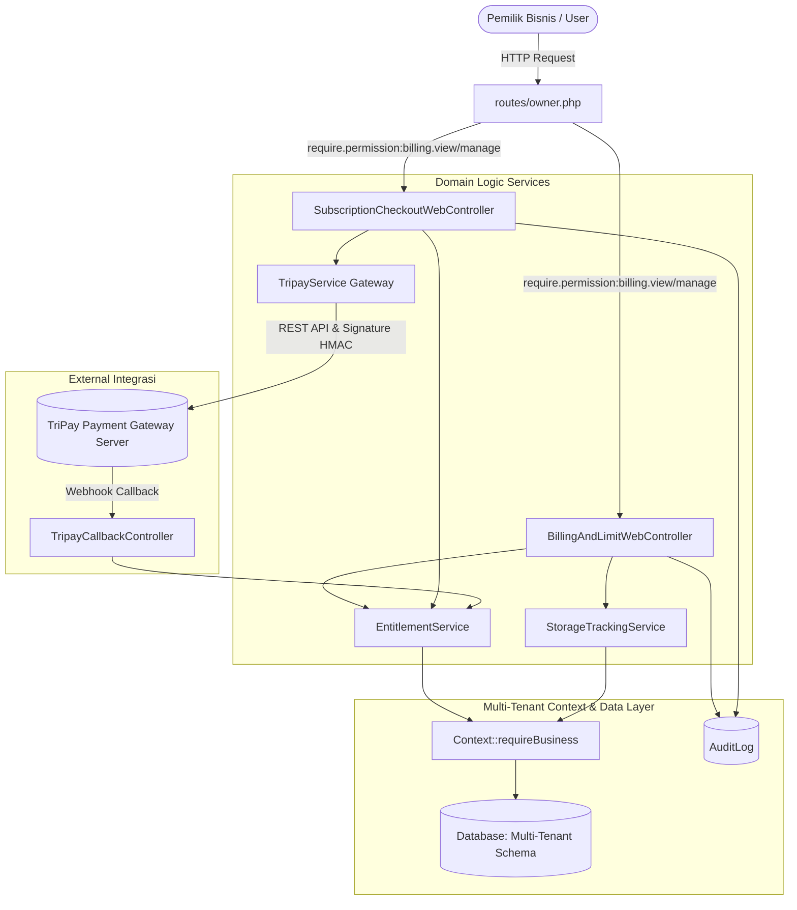

# Architecture & Workflow — Modul Billing & Subscription
> Modul: Billing & Subscription | Baseline Commit: 38cdcdf | Tanggal: 2026-10-25 | Status: Final

---

## 1. Arsitektur Komponen Modul

Modul Billing beroperasi pada lapisan Web Controller yang berinteraksi erat dengan dua Domain Service utama:

---

## 2. Alur Transaksi Langganan (Subscription Order Flow)

1. **Pemilihan Paket & Siklus**:
   - Pengguna membuka `/billing/checkout`.
   - Memilih paket (Standard / Premium / Prestige) dan siklus (Bulanan / Tahunan).
   - Opsional: Memasukkan kode promo voucher. Validasi AJAX memverifikasi kuota, batas pemakaian per tenant, dan batas tanggal voucher.
2. **Pembuatan Tagihan (Order Store)**:
   - Pengguna memilih kanal bayar (QRIS Dinamis atau Bank Virtual Account).
   - Controller memanggil `EntitlementService::createPaymentOrder`.
   - Transaksi dicatat pada `SubscriptionPayment` berstatus `pending`.
   - Peristiwa dicatat pada `AuditLog` dengan action `billing.order.created`.
   - Sistem memanggil API TriPay untuk membuat transaksi gateway dan memperoleh QR code / nomor Virtual Account.
   - Pengguna diarahkan ke `/billing/payments/{payment}`.
3. **Proses Pembayaran & Countdown 15 Menit**:
   - Halaman menampilkan QRIS atau Nomor VA dan timer kedaluwarsa 15 menit.
   - Frontend melakukan polling realtime setiap beberapa detik ke endpoint `/billing/payments/{payment}/status`.
   - Jika pembayaran berhasil diselesaikan, TriPay mengirim webhook callback atau polling mendeteksi status `paid/approved`.
   - Sistem otomatis meng-upgrade tier tenant pada `BusinessSubscription` dan membersihkan cache `clearUsageCache`.
   - Pengguna diarahkan ke halaman invoice `/billing/payments/{payment}/invoice`.

---

## 3. Alur Manajemen Kapasitas Cloud Storage (Storage & Quota Flow)

1. **Pemantauan Kapasitas Disk**:
   - Dasbor `/billing/limits` menampilkan rincian pemakaian storage per modul (katalog produk, bukti transaksi, dokumen faktur, avatar).
2. **Kalkulasi Ulang (Storage Recalculate)**:
   - Tombol "Hitung Ulang Penyimpanan" memicu `recalculateStorage`.
   - Service memindai seluruh file fisik di disk yang terikat dengan tenant aktif, mendeteksi file yatim (*orphaned files*), dan menyelaraskan total MB di database.
   - Jejak dicatat di `AuditLog` (`billing.storage.recalculated`).
3. **Pembersihan Berkas & Reclaim Kuota**:
   - Melalui modal "Storage File Manager", pengguna dapat melihat daftar berkas miliknya dan menghapus berkas yang tidak terpakai.
   - Guard multi-tenant memverifikasi `$storageFile->business_id === $business->id`.
   - Berkas fisik dihapus dan dicatat di `AuditLog` (`billing.storage.file_deleted`).
