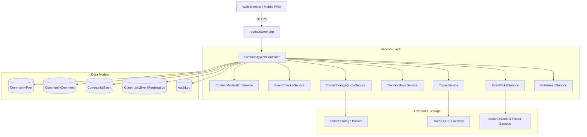
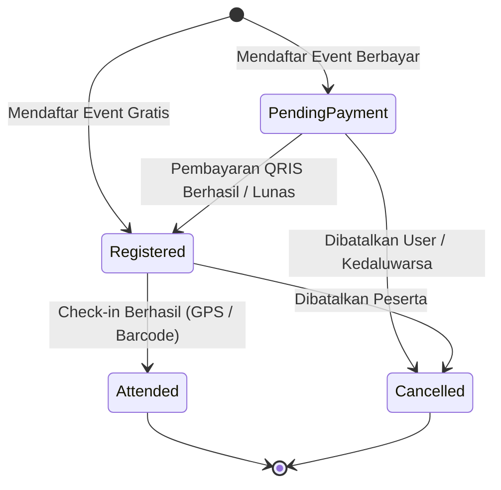

# Architecture & Workflow - community

> Modul: Community & Networking UMKM | Commit diaudit: 38cdcdf | Tanggal: 2026-10-25 | Status dokumen: Final

## Diagram Arsitektur

## Dependency Map
1. **Entitlement & Tiering:** `EntitlementService::canParticipateInCommunity` mengevaluasi langganan `BusinessSubscription` aktif sebelum mengizinkan `store`, `comment`, atau `toggleRepost`.
2. **Storage Quota:** `StorageTrackingService::assertCanUpload` memvalidasi kuota penyimpanan gambar postingan dan mencatat metadata file ke tabel `storage_files`.
3. **Tripay Payment:** `TripayService::createEventRegistrationTransaction` menginisialisasi invoice QRIS dinamis untuk event berbayar dan mengembalikan URL/string QRIS.
4. **Audit Log:** `AuditLog::create` merekam jejak transaksi registrasi, pembatalan pendaftaran, pelunasan simulasi, dan penghapusan postingan.

## Alur Bisnis & State Machine

### 1. State Machine Tiket Event Komunitas (`CommunityEventRegistration`)

### 2. Alur Posting Feed Komunitas
1. User mengirim form postingan dengan teks dan lampiran gambar opsional.
2. `EntitlementService` memverifikasi status paket langganan bisnis.
3. `ContentModerationService` memfilter konten terhadap tabel `community_word_filters`.
4. Jika ada gambar, `OwnerStorageQuotaService` memverifikasi sisa kuota storage tenant dan menyimpannya di folder `businesses/{id}/community/`.
5. Postingan tersimpan di database dan langsung tampil di timeline komunitas.

### 3. Alur Presensi Check-in Kehadiran Event
1. **Metode GPS Geofence:**
   - Browser meminta izin lokasi GPS peserta via Geolocation API (`navigator.geolocation.getCurrentPosition`).
   - Frontend mengirimkan koordinat latitude & longitude ke route `community.events.checkin-location`.
   - `EventCheckinService::calculateDistanceMeters` menghitung jarak ke titik koordinat venue event menggunakan Haversine Formula.
   - Jika jarak <= radius yang diizinkan (default 200m), status registrasi diubah menjadi `attended` dan waktu presensi dicatat.
2. **Metode Barcode Scan:**
   - Peserta membuka tiket digital berisikan SVG Barcode Code128.
   - Panitia acara memindai barcode menggunakan scanner portabel atau kamera hp ke route `community.events.checkin-barcode`.
   - Sistem memvalidasi kode tiket dan mencatat status `attended`.

## Temuan Arsitektur
- **Positif:** Pemisahan domain service sangat modular (`EventCheckinService`, `EventTicketService`, `TrendingTopicService`, `ContentModerationService`).
- **Penyelarasan:** Penambahan kontrak antarmuka `implements HasMiddleware` pada `CommunityWebController` guna mematuhi standar Controller-Level RBAC Laravel 11.

## Temuan Workflow
- **Financial Safety:** Simulasi pelunasan instan (`simulateEventPayment`) sebelumnya tidak memiliki pembatas environment. Telah diperbaiki dengan `abort_unless(app()->environment('local', 'testing'), 403)`.
- **UX Pembatalan:** Ditambahkan peringatan non-refundable pada konfirmasi pembatalan tiket berbayar.

## Root Cause
- Ketiadaan guard environment pada simulasi awal disebabkan kebutuhan pengujian prototipe cepat yang belum dipagari untuk fase rilis production.
