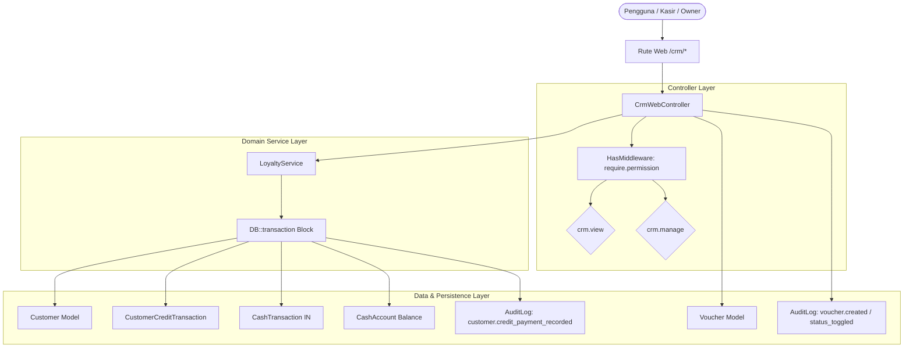

# Architecture and Workflow - crm

> Modul: CRM & Loyalty | Tanggal: 2026-10-25

## 1. Arsitektur Komponen

## 2. Alur Kerja Utama

### A. Alur Pencatatan Pelunasan Kasbon (Anti-Lapping Shield)
1. Permintaan masuk melalui `POST /crm/customers/{customer}/credit-payment`.
2. Controller memvalidasi kepemilikan bisnis pelanggan (`abort_unless($customer->business_id === Context::business()?->id, 403)`).
3. Controller memvalidasi input:
   - `amount`: Wajib numerik, minimal 1, dan maksimal tidak melebihi sisa kasbon (`$customer->current_credit_balance`).
   - `cash_account_id`: Wajib ada dan milik tenant aktif.
4. `LoyaltyService::recordCustomerCreditPayment` dipanggil dalam balutan `DB::transaction`:
   - Mengurangi kolom `current_credit_balance` pada tabel `customers`.
   - Membuat rekaman baru di `customer_credit_transactions` tipe `payment`.
   - Membuat rekaman kas masuk di `cash_transactions` tipe `in` yang terhubung dengan `CashAccount` terkait.
   - Menambahkan saldo pada `CashAccount`.
   - Menerbitkan `AuditLog` dengan tingkat keparahan risiko operasional.

### B. Alur Penerbitan & Siklus Hidup Voucher
1. Permintaan masuk melalui `POST /crm/vouchers`.
2. Validasi memastikan keunikan kode voucher per bisnis (`Rule::unique('vouchers', 'code')->where('business_id', Context::business()?->id)`).
3. Kode voucher diformat otomatis menjadi huruf kapital (`strtoupper`).
4. Voucher disimpan dengan status awal aktif (`is_active = true`) dan `used_count = 0`.
5. Perekaman `AuditLog` dengan aksi `voucher.created`.
6. Pengalihan kembali ke halaman katalog dengan notifikasi sukses.
7. Saat status voucher diubah via `POST /crm/vouchers/{voucher}/toggle`, status `is_active` dibalik dan direkam ke `AuditLog` dengan aksi `voucher.status_toggled`.
