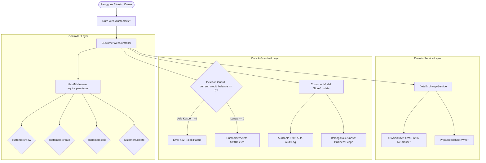

# Architecture and Workflow - customers

> Modul: Pelanggan (Customers Master Directory) | Tanggal: 2026-10-25

## 1. Arsitektur Komponen

## 2. Alur Kerja Utama

### A. Alur Pencarian & Direktori Pelanggan
1. Permintaan masuk melalui `GET /customers`.
2. Controller memvalidasi keberadaan tenant aktif via `Context::requireBusiness()`.
3. Jika terdapat parameter `tab=members` atau `tab=vouchers`, controller secara cerdas mengalihkan (*deep-linking*) ke modul CRM terkait (`crm.members.index` atau `crm.vouchers.index`).
4. Query pelanggan disaring berdasarkan `business_id` aktif dengan pencarian multifaktor:
   - Nama pelanggan (`name`)
   - Nama perusahaan (`company_name`)
   - Kode pelanggan (`code`)
   - Nomor telepon (`phone`)
   - Email (`email`)
   - Plat nomor kendaraan (`vehicle_license_plate`)
   - Model kendaraan (`vehicle_model`)
5. Data dikembalikan ke antarmuka Blade bersama 5 metrik hero bento (Total Pelanggan, Klien Korporat, Rata-rata Tempo, Saldo Piutang Berjalan, Total Poin Terbit).

### B. Alur Ekspor & Sanitasi Formula
1. Permintaan masuk melalui `GET /customers/export`.
2. Controller menyiapkan query pelanggan tenant aktif sesuai filter pencarian yang diterapkan.
3. `DataExchangeService::exportCustomers` dipanggil untuk menghasilkan berkas `.xlsx`.
4. Seluruh atribut teks disanitasi menggunakan `CsvSanitizer::sanitize` sebelum dimasukkan ke dalam sel PhpSpreadsheet.
5. Berkas di-stream ke browser pengguna dengan nama terformat waktu unik.

### C. Alur Penghapusan & Deletion Guard
1. Permintaan masuk melalui `DELETE /customers/{customer}`.
2. Controller memeriksa isolasi tenant (`abort_unless($customer->business_id === $business->id, 403)`).
3. Controller memeriksa saldo piutang berjalan (`current_credit_balance > 0`):
   - Jika masih memiliki kasbon aktif, request ditolak dengan kode status HTTP 422.
   - Jika kasbon telah lunas (0), model dihapus secara aman melalui `SoftDeletes` dan rekam jejak `deleted` dicatat otomatis oleh `Auditable` trait.
