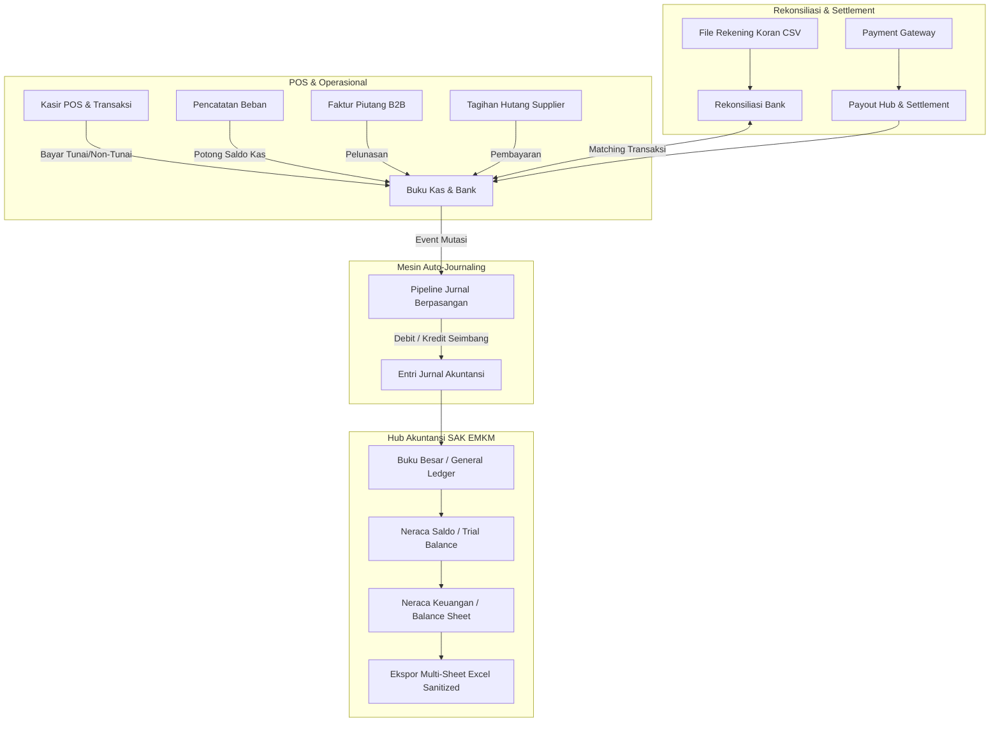

# Architecture & Workflow - finance

> Modul: Keuangan & Akuntansi Korporasi | Commit diaudit: 38cdcdf | Tanggal: 2026-10-25 | Status dokumen: Final

## 1. Arsitektur Domain Keuangan COOCA

Modul Keuangan memisahkan tanggung jawab antara pengelolaan likuiditas kas operasional (*Cash Management*) dengan pembukuan formal standar akuntansi (*Corporate Accounting*):

---

## 2. Alur Kerja Utama (Core Workflows)

### Alur 1: Siklus Otomasi Penjualan POS ke Jurnal Akuntansi
1. Kasir menyelesaikan transaksi di kasir POS (misal Rp 150.000 via QRIS).
2. Sistem menerbitkan record transaksi kas pada akun bank kliring terkait.
3. Event listener akuntansi menangkap transaksi dan mengeksekusi metode penjurnalan otomatis:
   - **Debit**: Rekening Bank Penampung QRIS Rp 150.000.
   - **Kredit**: Akun Pendapatan Penjualan Barang Rp 150.000 (atau dipisah jika ada PPN Keluaran).
4. Jurnal berstatus *Balanced* dan langsung tercermin pada Buku Besar dan Neraca Saldo tanpa delay (*real-time synchronous event*).

### Alur 2: Rekonsiliasi Bank Otomatis
1. Pemilik usaha mengunduh rekening koran dari internet banking (format CSV standar BCA, Mandiri, atau BRI).
2. Pengguna mengunggah CSV melalui menu [Rekonsiliasi Bank](/finance/reconciliations).
3. Parser memvalidasi baris mutasi bank dan membandingkannya dengan mutasi pada `CashAccountTransaction`:
   - **Pencocokan Otomatis**: Jika tanggal, nominal, dan arah mutasi (debit/kredit) cocok persis, status otomatis *Reconciled*.
   - **Transaksi Belum Terikat**: Jika terdapat bunga bank atau biaya administrasi bulanan, pengguna dapat mengeklik tombol aksi cepat untuk membuat transaksi buku kas instan yang langsung menyeimbangkan rekonsiliasi.

### Alur 3: Penyusunan Laporan Keuangan SAK EMKM
1. Akuntan atau pemilik usaha membuka menu [Neraca Saldo](/finance/trial-balance).
2. Sistem menghitung total mutasi debit dan kredit seluruh akun COA pada periode berjalan:
   - Jika `Total Debit == Total Kredit`, status pembukuan dinyatakan *Balanced*.
3. Akses menu [Neraca Keuangan SAK](/finance/balance-sheet).
4. Sistem mengelompokkan saldo ke dalam hierarki standar SAK EMKM:
   - **Aset**: Aset Lancar (Kas & Bank, Piutang Usaha, Persediaan) + Aset Tetap.
   - **Kewajiban**: Kewajiban Jangka Pendek (Hutang Usaha, Beban Akrual, PPN).
   - **Ekuitas**: Modal Pemilik + Saldo Laba Periode Berjalan.
5. Pemilik usaha dapat mengekspor neraca lengkap ke Excel berformat formal dengan formula yang telah disanitasi.
