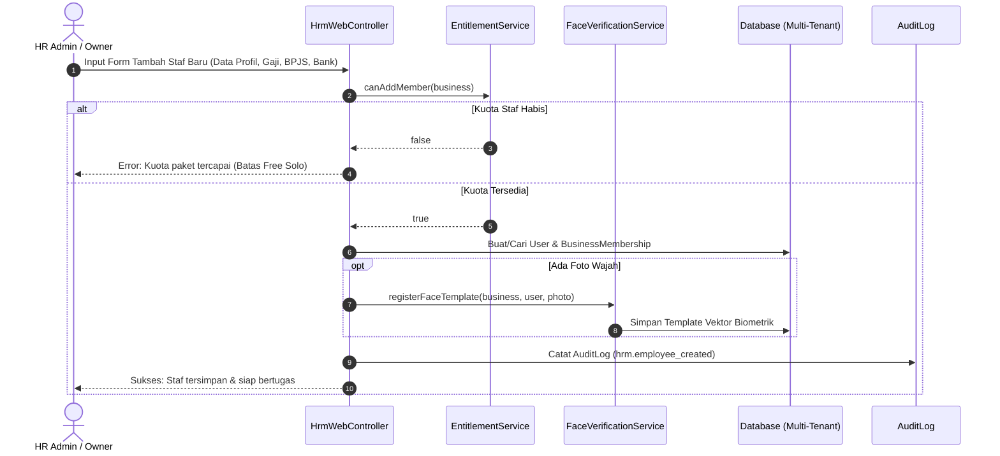
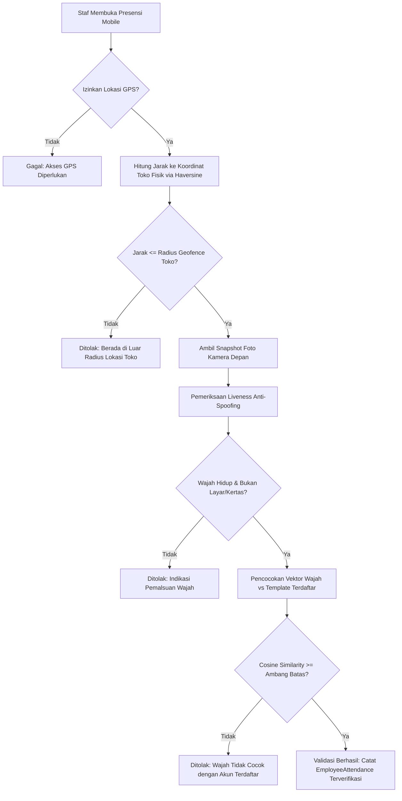
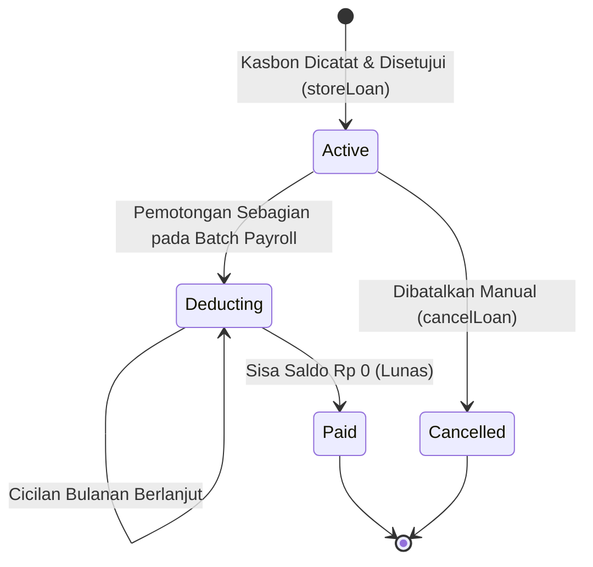
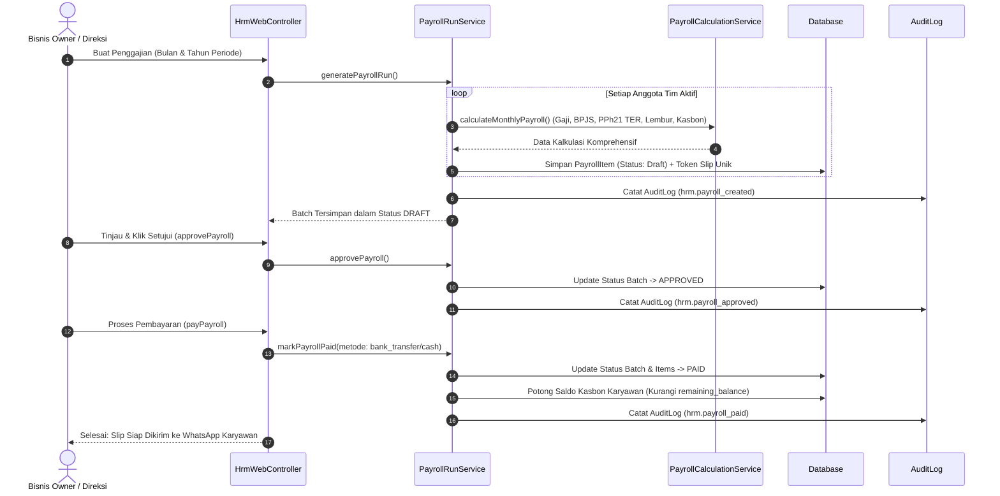

# Arsitektur & Alur Kerja Sistem - HRM & Penggajian

> Modul: Sumber Daya Manusia & Penggajian (HRM & Payroll) | Tanggal: 2026-10-25

## 1. Alur Kerja Siklus Hidup Karyawan (*Employee Lifecycle*)


## 2. Alur Presensi Geofence & Biometrik Wajah


## 3. Siklus Hidup Kasbon Karyawan (*Loan Lifecycle*)


## 4. Pipeline Pembuatan & Eksekusi Batch Penggajian (*Payroll Pipeline*)


## 5. Pola Isolasi Multi-Tenant (*Tenant Isolation*)
Seluruh model data HRM (`BusinessMembership`, `EmployeeAttendance`, `AttendanceCorrection`, `EmployeeLoan`, `Payroll`, `PayrollItem`, `WorkShift`, `EmployeeSchedule`, `Location`) menggunakan arsitektur multi-tenant berbasis `business_id`:
1. **Global Scope `BelongsToBusiness`:** Memastikan setiap query Eloquent secara implisit memfilter `where business_id = Context::getBusinessId()`.
2. **Controller Assertions:** Pada setiap akses detail ID spesifik, dilakukan verifikasi eksplisit:
   ```php
   if ($payroll->business_id !== $business->id) {
       abort(404);
   }
   ```
   Pengecekan ini mencegah serangan *Insecure Direct Object Reference* (IDOR) lintas tenant.
