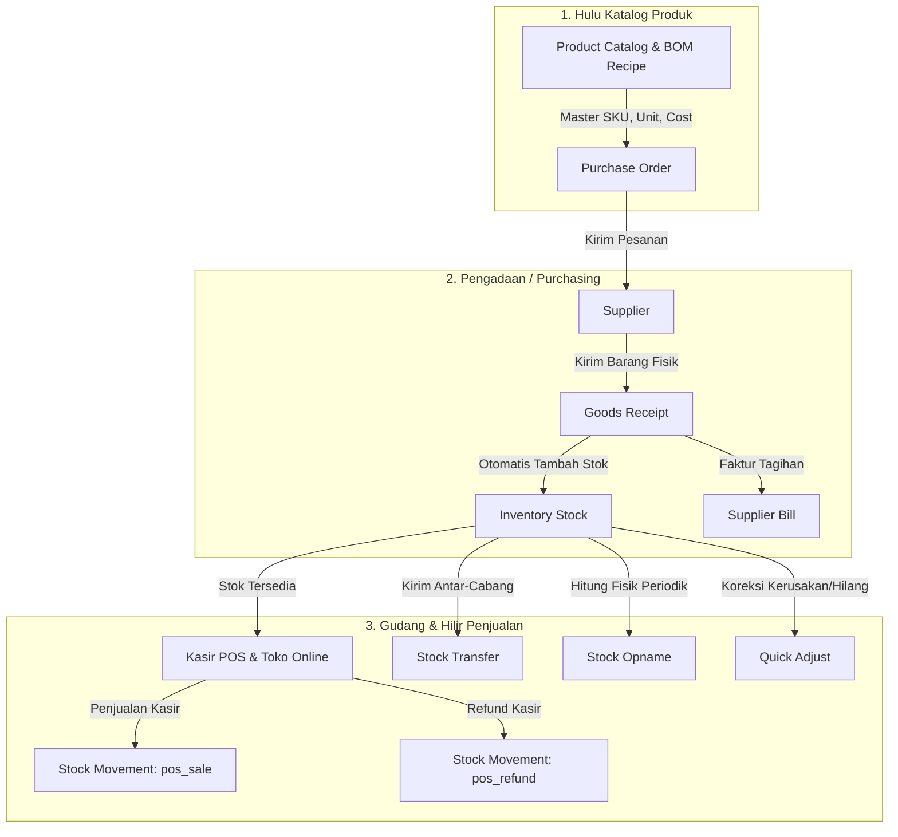

# Architecture & Workflow: Modul Inventory (Stok, Mutasi, Opname, & Transfer)

## 1. Arsitektur Triad Rantai Pasok COOCA

---

## 2. Alur Kerja Bisnis Mendalam (Deep Workflow Analysis)

### A. Alur Transfer Stok Antar-Gudang (Inter-Warehouse Stock Transfer)
1. **Pengajuan Pengiriman (*Send Transfer*):**
   - Staf gudang asal (`source_location_id`) menentukan gudang tujuan (`destination_location_id`), tanggal transfer, dan daftar item beserta kuantitas.
   - Sistem menerbitkan nomor dokumen unik `TRF-YYYYMMDD-XXX` dan mencatat status `pending` (barang *in-transit*).
   - Tercatat mutasi keluar (`StockMovement::TYPE_TRANSFER_OUT`) pada gudang asal.
   - Dicatat `AuditLog` dengan aksi `STOCK_TRANSFER_CREATED`.
2. **Penerimaan Fisik di Outlet/Gudang Tujuan (*Receive Transfer*):**
   - Staf di gudang penerima membuka menu Transfer Stok dan mengklik tombol **Konfirmasi Terima** (`w-9 h-9 min-h-[36px]`).
   - Sistem memvalidasi kepemilikan tenant via `abort_unless($transfer->business_id === $business->id, 404);`.
   - `StockService::completeStockTransfer()` dieksekusi dalam transaksi DB ber-kunci pesimis (`lockForUpdate`).
   - Stok gudang tujuan bertambah otomatis dan mutasi masuk (`StockMovement::TYPE_TRANSFER_IN`) dicatat.
   - Status transfer diperbarui menjadi `received` dan dicatat audit log `STOCK_TRANSFER_RECEIVED`.

---

### B. Alur Stock Opname & Rekonsiliasi Varians (Physical Counting & Variance Reconciliation)
1. **Pencetakan Lembar Hitung Kosong (*Blank Counting Sheet*):**
   - Staf gudang mengunduh lembar PDF/Excel kosong (`/inventory/opnames/export-blank`) untuk mencatat hitungan fisik tanpa melihat angka sistem (mencegah *bias* atau manipulasi).
2. **Pencatatan Hasil Hitung (*Input Opname*):**
   - Staf menginput hasil hitung fisik ke sistem melalui formulir web atau unggah Excel (`import-execute`).
   - Sistem menghitung selisih kuantitas:
     $$\Delta Q = Q_{\text{physical}} - Q_{\text{system}}$$
     dan total estimasi nilai selisih kerugian/kelebihan:
     $$\Delta \text{Cost} = \Delta Q \times \text{Unit Cost}$$
   - Dokumen tersimpan dengan status `counting` (draft).
3. **Rekonsiliasi Varians (*Reconcile Opname*):**
   - Owner/Manajer mereview selisih. Setelah diverifikasi, tombol **Rekonsiliasi** ditekan.
   - Sistem mengunci baris stok terkait (`lockForUpdate`), mengupdate `quantity` pada `inventory_stocks` agar identik dengan fisik lapangan.
   - Dicatat entri buku besar mutasi `StockMovement::TYPE_OPNAME`.
   - Jika terjadi selisih nilai, sistem secara otomatis mencatat jurnal akuntansi penyesuaian persediaan (`AutoJournalService`).
   - Status dokumen menjadi `reconciled` dan tercatat di `audit_logs`.

---

### C. Alur Koreksi Stok Cepat & Maker-Checker Approval (Quick Adjust)
1. **Penyesuaian Manual:**
   - Staf gudang memasukkan jumlah fisik baru dan alasan (misal: *Kemasan sobek, bocor, atau kadaluwarsa*).
2. **Evaluasi Aturan Persetujuan (`ApprovalRule`):**
   - Sistem menghitung total potensi kerugian:
     $$\text{Loss} = (Q_{\text{old}} - Q_{\text{new}}) \times \text{Cost}$$
   - **Kondisi 1: Tanpa Aturan Approval / Nilai di Bawah Ambang Batas:**
     - Penyesuaian langsung dieksekusi secara instan, stok terpotong, dan mutasi dicatat.
   - **Kondisi 2: Nilai Kerugian Melebihi Ambang Batas (`min_amount`):**
     - Sistem menahan eksekusi dan membuat dokumen `StockAdjustment` berstatus `pending_approval`.
     - Notifikasi muncul pada dashboard Owner / Supervisor.
     - Hanya pengguna berhak (`owner`, `supervisor`, atau pemegang izin `approvals.manage`) yang dapat menyetujui (`approveAdjustment`) atau menolak (`rejectAdjustment`).
     - Setiap keputusan dicatat lengkap di `audit_logs`.
