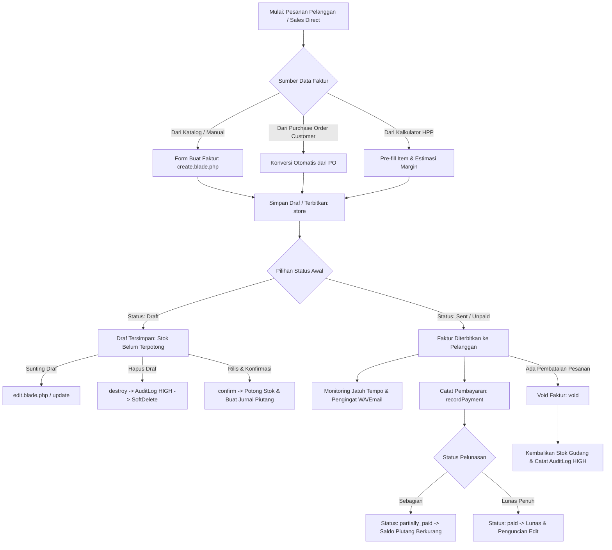

# Architecture and Workflow - Modul Faktur Penjualan & Piutang

> Modul: Invoices & Accounts Receivable | Tanggal Audit: 2026-10-26 | Target: `resources/views/app/invoices`

## 1. Arsitektur Domain & Diagram Alur Transaksi



## 2. Siklus Hidup Faktur (Invoice Lifecycle States)
1. **DRAFT (`draft`):** Faktur sedang disusun atau dinegosiasikan. Kuantitas barang belum memotong stok gudang. Dapat disunting atau dihapus oleh staf berizin `invoices.edit` / `invoices.delete`.
2. **SENT (`sent`):** Faktur telah diterbitkan dan dikirimkan kepada pelanggan B2B. Stok barang telah dikonfirmasi dan dipotong dari lokasi gudang yang dipilih.
3. **UNPAID (`unpaid`):** Faktur telah diterima pelanggan dan menunggu pembayaran sesuai termin (*Net 30, COD, dll.*).
4. **PARTIALLY PAID (`partially_paid`):** Pelanggan telah menyetor pembayaran sebagian (uang muka / termin 1). Sisa tagihan tertera pada `balance_due`.
5. **PAID (`paid`):** Seluruh tagihan telah lunas (`balance_due = 0`). Faktur terkunci permanen dari perubahan untuk integritas audit akuntansi.
6. **OVERDUE (`overdue`):** Tanggal hari ini telah melampaui `due_date` sementara saldo tagihan masih ada. Tombol pengingat termin diaktifkan.
7. **VOID (`void`):** Faktur dibatalkan resmi. Pengurangan stok dibatalkan (barang dikembalikan ke inventori) dan nilai piutang dinolkan.

## 3. Integrasi Akuntansi & Mutasi Stok (Inventory & Journal Integration)
- **Pengurangan Stok:** Dijalankan secara otomatis melalui `InvoiceService::confirmAndRelease` dengan memanggil `InventoryMovementService`. Jika stok gudang tidak mencukupi, sistem melempar `InsufficientStockException` dan membatalkan transaksi (*atomic rollback*).
- **Jurnal Otomatis Piutang:** Mencatat debit pada Akun Piutang Usaha (*Accounts Receivable*) dan kredit pada Akun Pendapatan Penjualan (*Sales Revenue*) beserta PPN Keluaran jika berlaku.
- **Pencatatan Pembayaran:** Setiap pembayaran melalui `recordPayment` mencatat debit pada Kas/Bank yang dipilih dan kredit pada Piutang Usaha, mengurangi `balance_due` faktur secara real-time.

## 4. Mekanisme Keamanan Controller-Level RBAC
`InvoiceWebController` mengimplementasikan `HasMiddleware` dengan pemetaan izin:
```php
public static function middleware(): array
{
    return [
        new Middleware('require.permission:invoices.view', only: ['index', 'show', 'print', 'pdf', 'sendTermReminder']),
        new Middleware('require.permission:invoices.create', only: ['create', 'store', 'confirm']),
        new Middleware('require.permission:invoices.edit', only: ['edit', 'update', 'void']),
        new Middleware('require.permission:invoices.record_payment', only: ['recordPayment']),
        new Middleware('require.permission:invoices.export', only: ['exportExcel']),
        new Middleware('require.permission:invoices.delete', only: ['destroy']),
    ];
}
```
Pemisahan hak akses ini menjamin prinsip *least privilege* terpenuhi: staf kasir atau staf gudang tidak dapat mengubah atau membatalkan faktur tanpa izin eksplisit.
