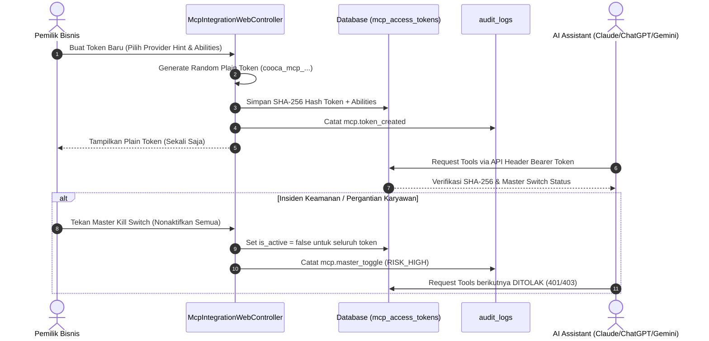

# Architecture & Workflow - Pengaturan Bisnis & MCP

> Modul: Pengaturan Bisnis & Ekosistem AI MCP | Tanggal: 2026-10-26

## 1. Arsitektur Modul Pengaturan
Modul Pengaturan Bisnis mengadopsi pola *Multi-Tenant Centralized Hub*. Seluruh konfigurasi melekat pada entitas `Business` yang aktif di dalam `Context::requireBusiness()`.

```mermaid
graph TD
    User([Pengguna / Owner]) --> WebRouter[Laravel Web Router]
    WebRouter --> AuthGuard[Auth & Tenant Context]
    AuthGuard --> ControllerRBAC{Controller HasMiddleware}
    
    ControllerRBAC -->|settings.view| ViewHandler[SettingWebController@index]
    ControllerRBAC -->|settings.edit| MutationHandler[SettingWebController@update / storeBranch]
    ControllerRBAC -->|require.role:owner| OwnerHandler[applyTemplate / updateModules]
    ControllerRBAC -->|mcp.view & edit| McpHandler[McpIntegrationWebController]
    
    MutationHandler --> AuditLogger[(Immutable audit_logs)]
    McpHandler --> AuditLogger
    McpHandler --> McpRegistry[McpToolRegistry]
    McpRegistry --> AIAssistants[Claude / ChatGPT / Gemini]
```

## 2. Alur Kerja Pembaruan Profil & Keuangan (Workflow 1)
1. **Otorisasi Akses:** Pengguna wajib memiliki permission `settings.edit` atau peran `owner`.
2. **Validasi Input:**
   - Validasi format email, nomor telepon E.164, dan NPWP.
   - Normalisasi zona waktu Indonesia (`WIB`, `WITA`, `WIT`).
   - Hash aman untuk `pos_supervisor_pin` menggunakan `Hash::make()` (tidak pernah disimpan dalam plain text).
3. **Perekaman Nilai Sensitif (*Differential Audit Trail*):**
   - Mendeteksi apakah ada perubahan pada field kritis (`bank_account_number`, `bank_name`, `pos_supervisor_pin`, `timezone`).
   - Melakukan *masking* data rahasia sebelum disimpan ke `audit_logs` (misal: PIN diubah menjadi `••••••`).
   - Mencatat nilai lama (*old_values*) dan nilai baru (*new_values*) dengan level risiko `RISK_HIGH`.

## 3. Alur Kerja Manajemen Cabang & Geofencing (Workflow 2)
1. **Pemeriksaan Kuota Entitlement:**
   - Sebelum cabang dibuat, `EntitlementService::canCreateLocation` memvalidasi kuota cabang sesuai paket langganan.
2. **Pembuatan & Geofencing:**
   - Koordinat latitude dan longitude divalidasi dalam rentang geografis valid (-90 s/d 90 dan -180 s/d 180).
   - Radius geofence presensi staf ditetapkan (10 s/d 10.000 meter).
   - Jika cabang ditandai sebagai *primary*, titik asal pengiriman logistik `CommerceStoreSetting` otomatis disinkronkan.
3. **Penghapusan Non-Destruktif (*Safe Deletion Pipeline*):**
   - Cabang utama (*primary*) dilarang dihapus.
   - Cabang yang membawahi gudang aktif (*child warehouses*) dilarang dihapus.
   - Cabang yang memiliki stok fisik barang dilarang dihapus.
   - Cabang yang memiliki riwayat historis (transaksi POS, mutasi stok, presensi staf) otomatis dialihkan ke status `is_active = false` (*soft deactivate*) dan mencatat log audit.
   - Hanya cabang tanpa riwayat dan tanpa stok yang dapat dihapus secara permanen.

## 4. Alur Kerja Integrasi AI MCP (Workflow 3)
Modul ini mengimplementasikan spesifikasi resmi **Model Context Protocol (MCP)** untuk integrasi asisten AI:



### Provider AI yang Didukung Eksklusif
1. **Claude (Anthropic):** Integrasi via Claude Desktop / Claude Code dengan konfigurasi JSON stdio.
2. **ChatGPT (OpenAI):** Integrasi via Custom GPT Actions / OAuth 2.0 Authorization Server.
3. **Gemini (Google):** Integrasi via Google Antigravity / Gemini Extensions API Endpoint.
