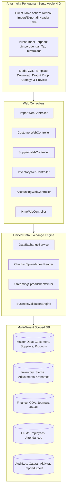

# PRD-35: Arsitektur Mesin Pertukaran Data Terpadu (Unified Data Exchange Engine), Impor/Ekspor Lintas Modul & Onboarding Klien Skala Enterprise

> **ID Dokumen:** `PRD-35-DATA-EXCHANGE-ENGINE-IMPORT-EXPORT-AND-MIGRATION`  
> **Status Dokumen:** RATIFIED & APPROVED (Siap Implementasi Bertahap)  
> **Rujukan Audit:** [`docs/AUDIT_KOMPREHENSIF_IMPORT_EXPORT_SISTEM_COOCA.md`](file:///c:/laragon/www/cooca_core/docs/AUDIT_KOMPREHENSIF_IMPORT_EXPORT_SISTEM_COOCA.md)  
> **Rujukan BRD:** [`docs/BRD_IMPORT_EXPORT_DAN_DATA_EXCHANGE_COOCA.md`](file:///c:/laragon/www/cooca_core/docs/BRD_IMPORT_EXPORT_DAN_DATA_EXCHANGE_COOCA.md)  
> **Domain Terkait:** `app/Services/DataImportService.php`, `app/Http/Controllers/Web/`, `resources/views/app/`  
> **Target Pengguna:** Business Owner, Tim Akuntan & Finance, Staf Gudang & Logistik, HRD & Payroll Officer, Support Onboarding  
> **Standar Arsitektur:** `docs/agent.md`, Bento Apple HIG v2.0, Zero-Data-Loss, Multi-Tenant Scoped, Chunked Streaming  

---

## 1. Latar Belakang & Pernyataan Masalah Teknis

Sistem ERP COOCA melayani beragam skenario bisnis UMKM hingga korporasi multi-cabang di Indonesia. Pada audit sistem menyeluruh terhadap folder [`resources/views/app`](file:///c:/laragon/www/cooca_core/resources/views/app), ditemukan kelemahan struktural pada subsistem pertukaran data (*Data Exchange*):

1. **Kegagalan Skema Persediaan Awal ([`DataImportService.php#L644-L670`](file:///c:/laragon/www/cooca_core/app/Services/DataImportService.php)):**
   - Importer saldo awal stok hanya melakukan pencarian pada model `Material`. Jika pengguna memasukkan SKU dari model `Product` (Barang Jadi), sistem melempar error *"SKU tidak ditemukan"*. Hal ini memblokir 100% klien ritel dan grosir.
2. **Ketiadaan Importer Master Data Kunci:**
   - Tidak ada antarmuka maupun service untuk mengimpor data **Pelanggan (`customers`)**, **Pemasok (`suppliers`)**, dan **Karyawan (`employees`)**, yang menjadi prasyarat mutlak onboarding klien baru.
3. **Ketiadaan Importer Migrasi Akuntansi:**
   - Modul Keuangan belum memiliki alat untuk mengimpor **Bagan Akun (Chart of Accounts / COA)**, **Saldo Awal Neraca Debet-Kredit**, dan **Faktur Piutang/Hutang Berjalan (Cut-Off AR/AP)**.
4. **Ketiadaan Workflow Stock Opname Fisik Dua Arah:**
   - Halaman [`inventory/opname.blade.php`](file:///c:/laragon/www/cooca_core/resources/views/app/inventory/opname.blade.php) tidak memiliki fitur unduh *Blank Stock Opname Sheet* (Excel) dan unggah kembali hasil hitungan fisik lapangan.
5. **Ketiadaan Integrasi Log Presensi Mesin Biometrik:**
   - Mesin fingerprint fisik (Solution/ZKTeco) menghasilkan file log absen (CSV/Excel) yang saat ini belum bisa dibaca oleh modul HRM COOCA untuk penggajian otomatis.
6. **Asimetri Ekspor di Tabel Harian:**
   - Halaman tabel operasional harian (Pelanggan, Supplier, Produk, Bahan Baku, Stok Gudang) tidak memiliki tombol ekspor langsung di header tabel.

---

## 2. Sasaran Produk & Metrik Keberhasilan (Product Goals & OKRs)

| Sasaran Produk | Metrik Keberhasilan | Target |
| :--- | :--- | :---: |
| **Penyelesaian Blocker Stok** | Importer saldo stok awal berhasil memproses SKU `Product` dan `Material` | 100% Lolos Uji |
| **Kemandirian Onboarding** | Klien mampu mengimpor Master Pelanggan, Supplier, & Karyawan secara mandiri | < 15 Menit |
| **Migrasi Finansial Presisi** | Jurnal saldo awal neraca yang diimpor seimbang (*balanced*) antara total debet dan kredit | 0 Toleransi Selisih |
| **Efisiensi Stock Opname** | Auto-kalkulasi selisih fisik vs sistem dari file Excel hasil hitungan tim gudang | < 10 Detik per 1.000 Baris |
| **Dukungan Fingerprint HR** | Parser mengenali format ekspor mesin absensi populer (Solution/ZKTeco/Fingerspot) | 100% Terpetakan ke Payroll |
| **Performa & Konsumsi Memori** | Pemrosesan file hingga 10.000 baris tidak melebihi batas memori PHP (128 MB) | Memory Capping Safe |

---

## 3. Arsitektur Teknis Sistem (System Architecture)



---

## 4. Spesifikasi Fungsional Rinci (Functional Requirements)

### FR-01: Perbaikan Mesin Impor Saldo Stok Awal (Dual Resolution Product & Material)
1. Sistem pada `DataImportService@processInventoryImport` wajib memvalidasi SKU terhadap **dua model**:
   - Pencarian pertama pada `Product::where('business_id', $bId)->where('sku', $sku)->first()`.
   - Pencarian kedua pada `Material::where('business_id', $bId)->where('code', $sku)->first()`.
2. Jika ditemukan, sistem mencatat saldo stok awal pada gudang target (`warehouse_id`) dengan tipe entitas polimorfik atau relasi yang sesuai.
3. Kolom `harga_beli_satuan` wajib digunakan untuk membentuk **Nilai Valuasi Persediaan Awal** pada akun Buku Besar (Aset Persediaan).

---

### FR-02: Mesin Impor & Ekspor Master Pelanggan (`customers`)
1. **Aksi Antarmuka:** Menambahkan tombol `📥 Import Excel` dan `📤 Export Excel` pada [`resources/views/app/customers/index.blade.php`](file:///c:/laragon/www/cooca_core/resources/views/app/customers/index.blade.php).
2. **Skema Kolom Template:**
   - `nama_pelanggan` *(Wajib)*
   - `nomor_telepon` *(Wajib, kunci unik anti-duplikat)*
   - `email` *(Opsional)*
   - `kategori_tier` *(Opsional: Reguler, VIP, Grosir, Reseller)*
   - `alamat_lengkap`, `kota`, `kode_pos` *(Opsional)*
   - `limit_piutang` *(Opsional, default 0)*
   - `npwp` *(Opsional)*
3. **Strategi Duplikat:**
   - *Skip:* Jika nomor telepon sudah ada di tenant yang sama, lewati.
   - *Update:* Perbarui data pelanggan yang ada dengan informasi terbaru dari file.
4. **Fitur Ekspor:** Menghasilkan file Excel seluruh pelanggan terfilter berdasarkan kata kunci pencarian atau kategori tier yang sedang aktif di antarmuka.

---

### FR-03: Mesin Impor & Ekspor Master Pemasok / Vendor (`suppliers`)
1. **Aksi Antarmuka:** Menambahkan tombol `📥 Import Excel` dan `📤 Export Excel` pada [`resources/views/app/suppliers/index.blade.php`](file:///c:/laragon/www/cooca_core/resources/views/app/suppliers/index.blade.php).
2. **Skema Kolom Template:**
   - `nama_supplier` *(Wajib)*
   - `kode_supplier` *(Opsional, jika kosong sistem generate otomatis `SUP-XXXX`)*
   - `nama_kontak_pic` *(Opsional)*
   - `nomor_telepon` *(Wajib)*
   - `email` *(Opsional)*
   - `termin_pembayaran_hari` *(Opsional, default 0 untuk COD/Cash)*
   - `nama_bank`, `nomor_rekening`, `atas_nama_rekening` *(Opsional)*
   - `alamat` *(Opsional)*
3. **Fitur Ekspor:** Menghasilkan rekap data vendor lengkap untuk kebutuhan audit purchasing.

---

### FR-04: Tombol Ekspor Langsung pada Halaman Produk & Bahan Baku
1. Pada [`resources/views/app/products/index.blade.php`](file:///c:/laragon/www/cooca_core/resources/views/app/products/index.blade.php), tambahkan tombol `📤 Export Excel` yang mengunduh daftar produk sesuai filter kategori/stok yang sedang aktif.
2. Kolom hasil ekspor mencakup: `Kode SKU`, `Barcode`, `Nama Produk`, `Kategori`, `Harga Beli (HPP)`, `Harga Jual`, `Satuan`, `Stok Saat Ini`, dan `Status Aktif`.
3. Format file hasil ekspor dapat langsung dipakai sebagai acuan untuk pembaruan data dan diimpor kembali (*round-trip compatibility*).
4. Terapkan fungsionalitas ekspor yang identik pada [`resources/views/app/materials/index.blade.php`](file:///c:/laragon/www/cooca_core/resources/views/app/materials/index.blade.php).

---

### FR-05: Workflow Dua Arah Stock Opname Fisik (`inventory/opname`)
1. Pada halaman [`resources/views/app/inventory/opname.blade.php`](file:///c:/laragon/www/cooca_core/resources/views/app/inventory/opname.blade.php):
   - **Tombol Aksi 1 - Export Lembar Opname:** Membuka modal pemilihan Gudang dan Kategori Barang. Sistem menghasilkan Excel berisi kolom:
     - `kode_sku`, `barcode`, `nama_barang`, `lokasi_rak`, `satuan`, `stok_tercatat_sistem`, dan kolom kosong `jumlah_hitung_fisik`, `catatan_kondisi`.
   - **Tombol Aksi 2 - Import Hasil Hitung Fisik:** Mengunggah file Excel yang telah diisi kuantitas fisiknya oleh tim gudang.
2. **Kalkulasi Selisih Otomatis:**
   - Sistem membandingkan `jumlah_hitung_fisik` terhadap `stok_tercatat_sistem`.
   - Menampilkan modal preview: Daftar barang dengan status **Cocok (Hijau)**, **Selisih Kurang (Merah)**, atau **Selisih Lebih (Biru)**.
3. **Penerapan Penyesuaian:** Tombol konfirmasi akan membuat dokumen `StockAdjustment` otomatis dan membukukan mutasi stok ke database.

---

### FR-06: Migrasi Finansial: Bagan Akun (COA) & Saldo Awal Neraca
1. **Impor Bagan Akun ([`finance/accounting/coa.blade.php`](file:///c:/laragon/www/cooca_core/resources/views/app/finance/accounting/coa.blade.php)):**
   - Mendukung format kolom: `kode_akun`, `nama_akun`, `kategori` *(Aset, Kewajiban, Ekuitas, Pendapatan, Beban)*, `kode_induk_parent`, `posisi_normal` *(Debit/Kredit)*.
   - Validasi struktur hierarkis agar parent akun tersimpan lebih dahulu sebelum sub-akun.
2. **Impor Saldo Awal Neraca ([`finance/accounting/balance-sheet.blade.php`](file:///c:/laragon/www/cooca_core/resources/views/app/finance/accounting/balance-sheet.blade.php)):**
   - Mendukung format kolom: `kode_akun`, `posisi` *(Debit/Kredit)*, `saldo_awal_rupiah`.
   - **Validasi Keras (Hard Guardrail):** Total Debit wajib sama persis dengan Total Kredit ($\Sigma Debit = \Sigma Kredit$). Jika ada selisih Rp 1 pun, tombol simpan dinonaktifkan dengan peringatan: *"Jurnal Saldo Awal Tidak Seimbang (Selisih: Rp XXX)"*.

---

### FR-07: Impor Saldo Awal Piutang (AR) & Hutang (AP) Berjalan (Cut-Off Migration)
1. **Impor Piutang Berjalan ([`finance/receivables.blade.php`](file:///c:/laragon/www/cooca_core/resources/views/app/finance/receivables.blade.php)):**
   - Kolom: `nomor_invoice_lama`, `nama_pelanggan` *(harus cocok atau dibuatkan otomatis)*, `tanggal_faktur`, `tanggal_jatuh_tempo`, `sisa_piutang_rupiah`, `keterangan`.
2. **Impor Hutang Berjalan ([`finance/payables.blade.php`](file:///c:/laragon/www/cooca_core/resources/views/app/finance/payables.blade.php)):**
   - Kolom: `nomor_tagihan_vendor`, `nama_supplier`, `tanggal_tagihan`, `tanggal_jatuh_tempo`, `sisa_hutang_rupiah`, `keterangan`.
3. Seluruh saldo ini otomatis membentuk laporan buku pembantu piutang/hutang dan jadwal umur penagihan (*aging schedule*).

---

### FR-08: Impor Massal Data Karyawan (HRM Onboarding)
1. Pada [`resources/views/app/hrm/index.blade.php`](file:///c:/laragon/www/cooca_core/resources/views/app/hrm/index.blade.php), sediakan modal impor data karyawan.
2. Format Kolom:
   - `nik_karyawan` *(Wajib, unik)*
   - `nama_lengkap` *(Wajib)*
   - `email`, `nomor_telepon` *(Wajib)*
   - `divisi_departemen`, `jabatan` *(Opsional)*
   - `gaji_pokok_bulanan` *(Wajib, numeric)*
   - `tunjangan_tetap` *(Opsional, default 0)*
   - `nama_bank`, `nomor_rekening`, `atas_nama_rekening` *(Wajib untuk payroll)*
   - `status_ptkp` *(Opsional: TK/0, K/0, K/1, K/2, K/3)*
   - `nomor_bpjs_kesehatan`, `nomor_bpjs_ketenagakerjaan` *(Opsional)*
3. Otomatis membuat profil karyawan dan menghubungkan komponen gaji awal untuk kalkulasi payroll bulanan.

---

### FR-09: Impor Log Presensi Mesin Biometrik Fisik (Fingerprint)
1. Pada modul HRM, sediakan fitur upload log mesin absensi harian/bulanan.
2. Parser otomatis membaca file ekspor standar mesin **Solution, Fingerspot, dan ZKTeco**:
   - Kolom: `nik_mesin`, `tanggal_absen`, `jam_scan`, `tipe_scan` *(Masuk / Pulang / Otomatis)*.
3. Sistem secara cerdas memetakan jam scan pertama sebagai **Jam Masuk** dan jam scan terakhir sebagai **Jam Pulang**, lalu menghitung menit keterlambatan terhadap jam kerja shift karyawan yang terdaftar.

---

### FR-10: Ekspor Batch Pengiriman Toko Online (Storefront Dispatch)
1. Pada [`resources/views/app/storefront/orders/index.blade.php`](file:///c:/laragon/www/cooca_core/resources/views/app/storefront/orders/index.blade.php), tambahkan tombol `📤 Export Batch Pengiriman`.
2. Format ekspor dirancang kompatibel untuk serah terima kurir (JNE, J&T, SiCepat, Paxel, Lalamove):
   - Kolom: `No Pesanan`, `Nama Penerima`, `No HP`, `Alamat Lengkap`, `Kecamatan`, `Kota`, `Kode Pos`, `Berat Total (gr)`, `Item Barang & Qty`, `Total Nilai COD (jika ada)`, `Catatan Pengiriman`.

---

## 5. Spesifikasi Antarmuka & UX (Bento Apple HIG v2.0)

### 5.1 Desain Tombol Aksi Langsung di Header Tabel
Tiap halaman modul wajib menggunakan layout tombol seragam pada komponen header:

```blade
<!-- Komponen Tombol Header Standar COOCA -->
<div class="flex items-center gap-2">
    <!-- Tombol Export Excel -->
    <a href="{{ $exportRoute }}" 
       class="inline-flex items-center gap-1.5 px-3 py-2 text-xs font-medium text-slate-700 bg-white border border-slate-200 rounded-xl hover:bg-slate-50 transition shadow-sm active:scale-95">
        <svg class="w-4 h-4 text-slate-500" fill="none" stroke="currentColor" viewBox="0 0 24 24">
            <path stroke-linecap="round" stroke-linejoin="round" stroke-width="2" d="M4 16v1a3 3 0 003 3h10a3 3 0 003-3v-1m-4-4l-4 4m0 0l-4-4m4 4V4"/>
        </svg>
        <span>Export Excel</span>
    </a>

    <!-- Tombol Import Excel -->
    <button type="button" @click="showImportModal = true"
       class="inline-flex items-center gap-1.5 px-3 py-2 text-xs font-medium text-slate-700 bg-white border border-slate-200 rounded-xl hover:bg-slate-50 transition shadow-sm active:scale-95">
        <svg class="w-4 h-4 text-emerald-600" fill="none" stroke="currentColor" viewBox="0 0 24 24">
            <path stroke-linecap="round" stroke-linejoin="round" stroke-width="2" d="M4 16v1a3 3 0 003 3h10a3 3 0 003-3v-1m-4-8l-4-4m0 0L8 8m4-4v12"/>
        </svg>
        <span>Import Excel</span>
    </button>
</div>
```

### 5.2 Arsitektur Modal Import XXL & Mandat Preview Pra-Simpan (Mandatory Pre-Commit Preview)

> ⚠️ **ATURAN MUTLAK:** Dilarang keras melakukan impor langsung (*blind import*). Seluruh proses impor wajib melalui 2 fase: **Upload & Parse di Memori** $\rightarrow$ **Pratinjau Interaktif & Diagnostik**.

Modal impor di seluruh modul dirancang dengan hierarki visual Apple HIG Bento XXL:
1. **Langkah 1 (Unduh Template):** Banner emerald dengan tombol *Download Template Resmi (.xlsx)* yang otomatis berisi data referensi aktif tenant.
2. **Langkah 2 (Unggah File):** Area dropzone dengan indikator nama file dan tombol hapus.
3. **Langkah 3 (Layar Pratinjau Interaktif / Preview Screen):**
   - **Kartu Ringkasan KPI:** Menampilkan jumlah total baris, baris siap impor (hijau), duplikat (kuning), dan error (merah).
   - **Segmented Filter Pills:** Tombol filter instan `[ Semua ]`, `[ Siap Impor ]`, `[ Duplikat ]`, `[ Format Salah ]`.
   - **Tabel Pratinjau Lengkap:** Menyajikan seluruh baris data hasil parse dengan sticky header, badge status, dan kolom **Keterangan & Solusi Diagnostik** yang jelas dalam Bahasa Indonesia.
   - **Kontrol Penanganan Duplikat:** Radio button `🔘 Lewati Duplikat (Aman)` vs `🔘 Perbarui Data Lama (Update)`.
4. **Langkah 4 (Konfirmasi & Eksekusi):** Tombol aksi simpan `[ Simpan Data Valid (X Baris) ]` yang memicu alert konfirmasi sebelum commit ke database.

---

## 6. Persyaratan Non-Fungsional, Keamanan & Integritas Data

1. **Multi-Tenant Strict Scoping:**
   - Seluruh query import/export wajib menyertakan filter `where('business_id', auth()->user()->business_id)`.
   - Dilarang keras melakukan import yang menerima `business_id` dari file Excel pengunggah.
2. **Efisiensi Memori (Streaming / Chunked Reading):**
   - File impor diurai menggunakan pembacaan bertahap (*chunk size* 500 baris per iterasi).
   - Memori PHP dibatasi agar tidak melampaui `memory_limit: 128MB`.
3. **Integritas Transaksi Finansial:**
   - Seluruh impor yang melibatkan pembukuan buku besar (Persediaan, COA, Saldo Awal, AR/AP) wajib dibungkus dalam blok `DB::beginTransaction()` dan `DB::commit()`. Jika ada kegagalan baris kritis, lakukan `DB::rollBack()` secara utuh.
4. **Pencegahan Berkas Berbahaya (File Upload Security):**
   - Validasi ketat ekstensi dan MIME type: hanya menerima `xlsx` (`application/vnd.openxmlformats-officedocument.spreadsheetml.sheet`), `xls`, dan `csv` (`text/csv`).
   - Tolak file berformat `.xlsm` (yang mengandung macro VBA berbahaya).
5. **Pencatatan Audit Trail:**
   - Setiap kali proses impor atau ekspor selesai, rekam entri ke tabel `audit_logs`:
     - `action`: `import_customers` / `export_inventory`
     - `details`: Jumlah baris, nama file, status keberhasilan, waktu pemrosesan.

---

## 7. Kriteria Penerimaan & Definition of Done (DoD)

- [ ] **DoD-01:** Saldo stok awal pada `/import` berhasil mengimpor SKU milik `Product` (Barang Jadi) dan `Material` (Bahan Baku) tanpa error.
- [ ] **DoD-02:** Modal Import dan tombol Export tersedia serta berfungsi normal di halaman Pelanggan ([`customers/index.blade.php`](file:///c:/laragon/www/cooca_core/resources/views/app/customers/index.blade.php)).
- [ ] **DoD-03:** Modal Import dan tombol Export tersedia serta berfungsi normal di halaman Pemasok ([`suppliers/index.blade.php`](file:///c:/laragon/www/cooca_core/resources/views/app/suppliers/index.blade.php)).
- [ ] **DoD-04:** Tombol Export Excel berfungsi normal di halaman Produk ([`products/index.blade.php`](file:///c:/laragon/www/cooca_core/resources/views/app/products/index.blade.php)) dan Bahan Baku ([`materials/index.blade.php`](file:///c:/laragon/www/cooca_core/resources/views/app/materials/index.blade.php)).
- [ ] **DoD-05:** Halaman Stock Opname ([`inventory/opname.blade.php`](file:///c:/laragon/www/cooca_core/resources/views/app/inventory/opname.blade.php)) memiliki fitur download lembar opname kosong dan upload hasil hitungan dengan auto-kalkulasi selisih.
- [ ] **DoD-06:** Modul Keuangan memiliki importer Bagan Akun (COA) dan Saldo Awal Neraca dengan validasi seimbang debet-kredit.
- [ ] **DoD-07:** Modul HRM memiliki importer data karyawan massal dan importer file log presensi fingerprint.
- [ ] **DoD-08:** Seluruh template Excel resmi dapat diunduh langsung dari antarmuka dengan format ber-header warna dan baris panduan yang jelas.
- [ ] **DoD-09:** Seluruh pengujian fitur (`tests/Feature/ImportExportTest.php`) lolos 100% tanpa regresi.

---

*Disahkan oleh: Tim Arsitektur Sistem & Engineering COOCA*
