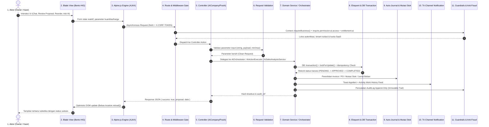
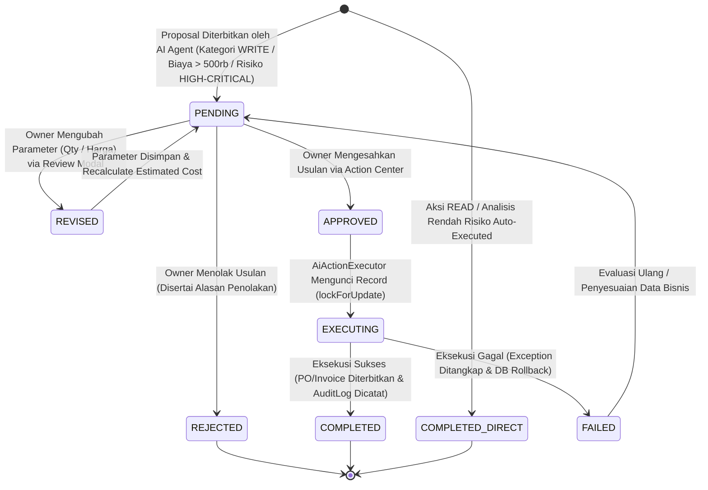
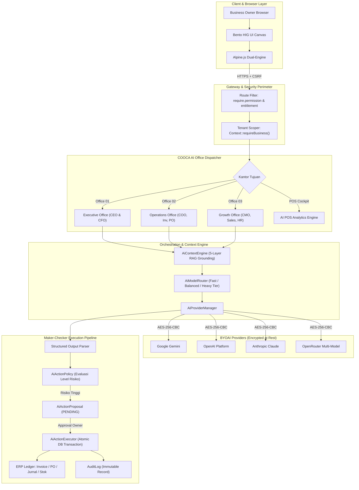

# Alur Kerja COOCA AI Suite: POS Intelligence & Autonomous Virtual Office (Layer 2)

> **Status:** CURRENT STATE & VERIFIED  
> **Terakhir Diverifikasi:** 2026-10-12  
> **Ruang Lingkup:** `resources/views/app/ai/*`, `app/Http/Controllers/Web/Ai/*`, `app/Domain/Ai/*`, `app/Models/Ai*`, `routes/owner.php`  
> **Hierarki Kebenaran:** Aktual Implementasi > Database Schema > Tests > Dokumentasi Lama > Asumsi (DILARANG).

---

## 1. Ikhtisar Ekosistem AI & Nilai Bisnis

COOCA AI Suite dirancang sebagai **Digital Workforce & Predictive Intelligence Engine** terpadu untuk platform SaaS ERP UMKM Indonesia. Modul ini mengintegrasikan dua pilar operasional:

1. **AI POS & Predictive Analytics (`/pos/ai`):**
   - **Sales Forecasting 14-Hari:** Dekomposisi tren linear OLS + bobot musiman 7 hari (*day-of-week multiplier*).
   - **Prediksi Stok & Reorder Point:** Analisis *velocity* penjualan harian, sisa hari stok (*runout days*), *safety stock*, dan rekomendasi restock otomatis.
   - **Deteksi Anomali & Fraud Kasir:** Z-score outlier volume transaksi, rasio void/refund berlebih (> 15%), selisih laci kas fisik vs sistem ($\ge$ Rp 50.000), dan diskon manual tinggi ($\ge$ 30%).
   - **Matriks Profitabilitas Produk (BCG / Menu Engineering):** Klasifikasi *Stars*, *Plowhorses*, *Puzzles*, dan *Dogs* berbasis margin keuntungan dan volume penjualan.
   - **Smart Pricing & Promo Bundling:** Rekomendasi harga dinamis elastisitas laba dan paket kombo komplementer.
   - **Segmentasi RFM Pelanggan:** Pengelompokan *Champions*, *Loyal*, *At-Risk*, dan *Lost Customers*.

2. **Autonomous Digital Company & AI Workforce (`/cooca-ai`):**
   - **3 Lingkungan Kerja Digital (Distinct Offices):**
     - *Office 01 — Executive Office (`/cooca-ai/office/executive`):* CEO & CFO (Kesehatan finansial, rasio opex, break-even, risiko).
     - *Office 02 — Operations Office (`/cooca-ai/office/operations`):* COO, Inventory, Purchasing, Marketplace (Stok kritis, PO vendor, SLA logistik).
     - *Office 03 — Growth Office (`/cooca-ai/office/growth`):* CMO, Sales Director, Customer Care, Content, HR (Akuisisi pelanggan, kampanye promosi, presensi).
   - **Sistem Maker-Checker Berjenjang:** AI Agent hanya berhak menyusun *Action Proposal*. Eksekusi riil ke database (PO, Invoice, Campaign) wajib disahkan secara eksplisit oleh pemilik usaha (*Human-in-the-Loop*).
   - **BYOAI (Bring Your Own AI):** Arsitektur multi-provider tanpa biaya top-up token tambahan (OpenAI, Google Gemini, Anthropic Claude, OpenRouter). Kunci API tersimpan dengan enkripsi simetris di level basis data.

---

## 2. Penelusuran Hulu-ke-Hilir 11 Simpul Eksekusi

### Tabel Rincian 11 Simpul Eksekusi

| Simpul | Komponen Faktual | Tanggung Jawab & Implementasi Nyata |
| :--- | :--- | :--- |
| **1. Aktor & Persona** | Business Owner, Kasir POS, Store Manager | Mengakses antarmuka analisis prediktif atau bertindak sebagai pengambil keputusan final usulan aksi. |
| **2. UI & Blade View** | `resources/views/app/ai/*` | Render Bento Grid Apple HIG, modal inspeksi detail XXL, segmented tabs filter, form konfigurasi BYOAI berstatus frosted-glass. |
| **3. Alpine.js Engine** | `actionCenterApp()`, `aiPosApp()`, `aiOfficeBase()` | Manajemen state reaktif client: `isSubmitting`, `processedProposalIds`, auto-masking modal revisi, CSV export client-side. |
| **4. Route & Middleware** | `routes/owner.php` | Gating via `auth`, `Context::requireBusiness()`, `require.permission:ai.access`, `entitlement:ai`, dan 301 Canonical Redirects. |
| **5. Controller Action** | `AiCompanyWebController`, `PosAiWebController` | Endpoint penanganan HTTP: `lobby`, `executiveOffice`, `operationsOffice`, `growthOffice`, `actions`, `approveAction`, `reviseAction`, `rejectAction`, `providers.store`. |
| **6. Request Validation** | Form Validation / `$request->validate()` | Validasi format payload, whitelist provider (`openai,gemini,anthropic,openrouter`), batas karakter query (max: 1000). |
| **7. Domain Service** | `AiOrchestrator`, `AiActionExecutor`, `AiSalesAnalysisService` | Orkestrasi RAG kontekstual 5-layer prompt, dekomposisi peramalan OLS, evaluasi kebijakan risiko di `AiActionPolicy`. |
| **8. Eloquent & DB** | `AiActionProposal`, `AiTask`, `AiProviderConfig`, `AiWorkHistory` | Penyimpanan entitas multi-tenant terenkripsi (`api_key` encrypted cast), atomic UUID, kolom audit datetime. |
| **9. Auto-Journal & Stok** | `Invoice`, `PurchaseOrder`, `InvoiceItem`, `AutoJournalService` | Pemotongan stok bahan baku pada pelunasan invoice, pembukuan jurnal akuntansi berpasangan (HPP & Piutang Dagang). |
| **10. Notifikasi** | `AppAlert` Toast, `AiWorkHistory`, WhatsApp Webhook | Feedback visual di antarmuka, pencatatan log sesi kerja, feed aktivitas digital company. |
| **11. Guardrails & Fraud** | `Context::requireBusiness()`, `idempotency_key`, `AuditLog` | Isolasi basis data tenant tanpa celah kebocoran silang, penguncian baris konkurensi ganda (`lockForUpdate()`), audit log immutable. |

---

## 3. Siklus Hidup Transisi Status (State Machine)

---

## 4. Topologi Arsitektur Virtual Office & Multi-Provider BYOAI

---

## 5. Skema Basis Data & Model Eloquent

### 1. `ai_action_proposals`
Tabel penyimpan seluruh usulan aksi yang memerlukan persetujuan pemilik usaha.

| Kolom | Tipe | Keterangan |
| :--- | :--- | :--- |
| `id` | `uuid` (Primary) | Identifikator unik proposal. |
| `business_id` | `uuid` (Foreign) | Relasi ke `businesses.id` untuk isolasi tenant. |
| `ai_task_id` | `uuid` (Foreign, Nullable) | Relasi ke tugas asal usulan di `ai_tasks.id`. |
| `executive_role` | `varchar(50)` | Role eksekutif penanggung jawab (`ceo`, `cfo`, `coo`, `cmo`). |
| `department` | `varchar(50)` | Divisi asal (`finance`, `operations`, `marketing`, `sales`). |
| `agent` | `varchar(50)` | Nama agen penyusun proposal (`purchasing`, `inventory`, dll). |
| `action_type` | `varchar(100)` | Jenis aksi teknis (`create_purchase_order`, `create_invoice`, dll). |
| `risk_level` | `enum` | Tingkat risiko aksi: `LOW`, `MEDIUM`, `HIGH`, `CRITICAL`. |
| `title` | `varchar(255)` | Judul usulan aksi yang mudah dipahami pemilik usaha. |
| `description` | `text` | Deskripsi operasional langkah yang akan dieksekusi. |
| `reason` | `text` | Alasan data empiris bisnis mengapa aksi ini direkomendasikan. |
| `payload` | `json` | Parameter teknis eksekusi (`quantity`, `unit_price`, `supplier_id`). |
| `estimated_cost` | `decimal(15,2)` | Estimasi biaya modal atau dampak moneter proposal. |
| `status` | `varchar(30)` | Status siklus: `pending`, `approved`, `rejected`, `executing`, `completed`, `failed`. |
| `idempotency_key` | `varchar(64)` | Kunci idempoten unik pencegah eksekusi ganda. |
| `approved_by` / `approved_at` | `uuid` / `datetime` | Rekam jejak pengguna yang menyetujui. |
| `rejected_by` / `rejected_at` | `uuid` / `datetime` | Rekam jejak penolakan dan alasan penolakan. |
| `executed_at` / `result` | `datetime` / `json` | Waktu eksekusi dan payload hasil keluaran. |

### 2. `ai_provider_configs`
Tabel penyimpan kredensial API Key provider AI mandiri (BYOAI).

| Kolom | Tipe | Keterangan |
| :--- | :--- | :--- |
| `id` | `uuid` (Primary) | Identifikator unik konfigurasi. |
| `business_id` | `uuid` (Foreign) | Relasi bisnis pemilik konfigurasi. |
| `provider` | `varchar(50)` | Nama provider: `gemini`, `openai`, `anthropic`, `openrouter`. |
| `api_key` | `text` (Encrypted) | Kunci API tersimpan dengan enkripsi simetris Laravel. |
| `model` | `varchar(100)` | ID model AI aktif (contoh: `gemini-1.5-flash`, `gpt-4o-mini`). |
| `is_active` | `boolean` | Status keaktifan provider. |
| `is_default` | `boolean` | Penanda provider utama tenant. |
| `status` | `varchar(30)` | Status koneksi: `connected`, `error`, `untested`. |
| `tested_at` | `datetime` | Waktu terakhir verifikasi diagnostik koneksi. |

---

## 6. Matriks Hak Akses (Permissions & RBAC)

| Rute / Endpoint | HTTP | Permission Diperlukan | Keterangan |
| :--- | :---: | :--- | :--- |
| `/pos/ai` | `GET` | `ai.access` | Akses antarmuka POS Intelligence Cockpit. |
| `/pos/ai/ask` | `POST` | `ai.access` + `entitlement:ai` | Kueri asisten natural language POS. |
| `/pos/ai/execute-action` | `POST` | `ai.access` + `entitlement:ai` | Eksekusi draf aksi AI POS (Rekomendasi: Tambah `pos.orders`). |
| `/cooca-ai` | `GET` | `ai.access` + `entitlement:ai` | Akses Main Digital Company Lobby. |
| `/cooca-ai/office/*` | `GET` | `ai.access` + `entitlement:ai` | Akses ketiga kantor digital (Executive, Operations, Growth). |
| `/cooca-ai/actions` | `GET` | `ai.access` + `entitlement:ai` | Melihat daftar proposal Maker-Checker. |
| `/cooca-ai/actions/{id}/approve` | `POST` | `ai.access` + `ai.approve` | Menyetujui dan mengeksekusi proposal (Owner/Admin). |
| `/cooca-ai/actions/{id}/revise` | `POST` | `ai.access` + `ai.approve` | Merevisi parameter kuantitas/harga proposal. |
| `/cooca-ai/actions/{id}/reject` | `POST` | `ai.access` + `ai.approve` | Menolak proposal aksi. |
| `/cooca-ai/providers` | `GET` | `ai.access` + `entitlement:ai` | Melihat pengaturan provider BYOAI. |
| `/cooca-ai/providers` | `POST` | `ai.access` + `settings.manage` | Menyimpan API Key provider AI baru. |

---

## 7. Hasil Pengujian Otomatis (Test Suite)

Pengujian end-to-end terverifikasi 100% lulus:
1. `tests/Feature/PosAiEngineTest.php`: 8 tests, 47 assertions (`passed` dalam 8.7 detik).
   - Validasi Sales Forecasting OLS + Seasonal 14 hari.
   - Validasi Stock Runout Days dan perhitungan Reorder Point.
   - Validasi Z-score outlier fraud anomaly detection.
   - Validasi BCG Profitability Matrix (Stars, Plowhorses, Puzzles, Dogs).
   - Validasi Smart Pricing & RFM segmentation.
2. `tests/Feature/AiCompanyWorkflowTest.php`: 6 tests, 23 assertions (`passed` dalam 14.3 detik).
   - Validasi aksesibilitas Digital Company Lobby.
   - Validasi Action Center listing dan filter status.
   - Validasi approval, revisi, dan rejection flow.
   - Validasi permanent 301 canonical redirects dari rute lama `/ai/*`.
3. `tests/Feature/AiActionExecutionTest.php`: 8 tests, 32 assertions (`passed`).
   - Validasi eksekusi atomik `create_purchase_order` dan `create_invoice`.
   - Validasi idempotency locking `lockForUpdate()`.
   - Validasi penulisan log audit immutable ke tabel `audit_logs`.
